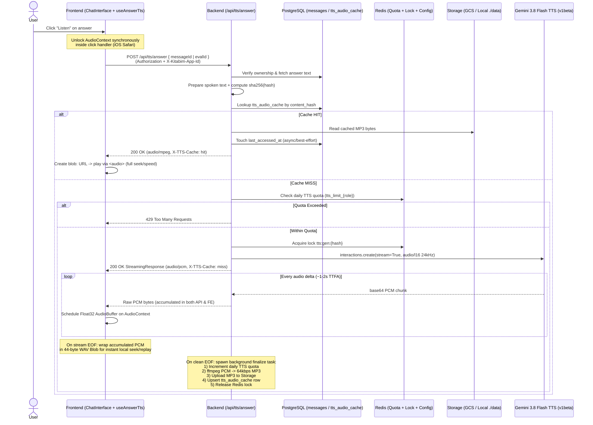

# Gemini-Based TTS for Question Answers — Design Specification

**Branch:** `feature/implement-tts`  
**Status:** Design Proposed (Aligned on Core Decisions)  
**Prerequisite PoC:** [hf-tts-poc.md](./hf-tts-poc.md)

---

## 1. Overview & Goals

Add a Gemini-powered **Text-to-Speech (TTS)** "Listen" feature scoped strictly to **Q&A answers** (Global Chat and Reader Book Chat).

### Goals
1. **Natural Uyghur Narration:** Synthesize Q&A answers using Google `gemini-3.8-flash-tts`, which natively supports Uyghur Arabic script, dates/numbers (`1876 — يىلى`), and literary punctuation without regex number expansion.
2. **Low Time-to-First-Audio (~1–2s):** Stream raw PCM (`audio/l16`) on cache miss so playback starts almost immediately while transcoding and caching 64 kbps MP3 in the background.
3. **Zero Duplicate Spend on Replays & Featured Answers:** Content-addressed caching ensures replaying history or listening to shared featured/sample answers costs \$0 after first generation.
4. **Strict Answer-Only Scope & Cost Control:** Signed-in users only, server-side answer text lookup by ID (never arbitrary client text), per-role daily synthesis quotas (cache hits are free), and a global admin kill switch.
5. **Extensible Foundation:** Keep storage paths, DB schema, and core services clean so future phases (book narration, dictionary audio, multi-voice selection) require no breaking migrations.

### Non-Goals & Strict Scope Boundary (v1)
- **ONLY Q&A answers inside Global Chat and Reader Chat** (`ChatInterface.tsx` with `type="global"` or `type="book"`).
- **Explicitly excluded from v1 (no Listen button, no TTS API support):**
  - Book pages / chapters in `ReaderView.tsx` / `PageItem.tsx` (future phase — Batch API).
  - Dictionary entries in `DictionaryView.tsx` (future phase).
  - Quran verses in `QuranView.tsx`.
  - Admin views (`AdminQuestions.tsx`, `QuestionDetailModal.tsx`) and Share modals (`ShareChatModal.tsx`).
  - Guest (unauthenticated) playback — signed-in users only (`require_reader`).
  - User-facing voice picker or per-character voice mapping (v1 uses one admin-configured default voice, `Sadaltager`, while storing `voice` in the cache key and schema for seamless future expansion).
  - Highlighting individual words synchronized to audio timestamps (word-level alignment).

---

## 2. Locked Design Decisions

| Decision | Choice | Rationale |
| :--- | :--- | :--- |
| **TTS Model** | `gemini-3.8-flash-tts` via Interactions API (`v1beta`, `store=False`) | **Uyghur is only supported on `gemini-3.8-flash-tts`** (`gemini-3.8-flash-lite-tts` does not support Uyghur). Reuses existing `GEMINI_API_KEY`. |
| **Uncached Playback** | **Streaming PCM (`stream=True`) + background MP3 cache** | Unary synthesis takes ~6–20s for typical Q&A answers. Streaming starts playback in ~1–2s via Web Audio API; subsequent replays serve cached MP3 with instant seeking. |
| **Cached Audio Format** | **64 kbps Mono MP3** (transcoded via `ffmpeg` in backend) | ~480 KB/min vs. ~2.8 MB/min WAV (**6× smaller**), fast mobile loading, universal browser/iOS Safari support. |
| **Access & Quotas** | **Signed-in users only** (`require_reader`), **separate daily TTS generation limit per role** | Cache hits are free and do not consume quota. Admin has no limit. Prevents TTS from eating into chat Q&A quota or being abused by bots. |
| **Voice Configuration** | **Single admin-configured default voice (`Sadaltager`)** | Best Uyghur fidelity in [hf-tts-poc.md](./hf-tts-poc.md). Voice is part of the content hash and `tts_audio_cache` table so adding a voice picker later needs zero schema changes. |

---

## 3. Gemini 3.8 Flash TTS API Contract & Cost Model

### API Call Shape (`google-genai` SDK / Interactions `v1beta`)

```python
from google import genai

client = genai.Client(
    api_key=settings.gemini_api_key,
    http_options={"api_version": "v1beta", "timeout": int(timeout * 1000)},
)

stream = await client.aio.interactions.create(
    model=model_name,  # from system_configs: "tts_gemini_model" -> "gemini-3.8-flash-tts"
    store=False,       # do not retain interaction state server-side
    input=[{
        "type": "user_input",
        "content": [{
            "type": "text",
            "text": spoken_text,
            "annotations": [{
                "type": "speech_metadata",
                "style": style_prompt,  # English only per AGENTS.md
            }],
        }],
    }],
    response_format={
        "type": "audio",
        "mime_type": "audio/l16",
        "sample_rate": 24000,
    },
    generation_config={
        "speech_config": [{"voice": voice_name}],
    },
    stream=True,
)
```

> **Note on SDK vs. REST fallback:** Verify `client.aio.interactions.create` exists in the pinned `google-genai` version installed in `Dockerfile.backend` (requires `google-genai >= 3.5.0`; otherwise upgrade `google-genai>=3.5.0` in `services/backend/requirements.txt` or stream SSE directly over `httpx` against `POST https://generativelanguage.googleapis.com/v1beta/interactions`). Prefer upgrading `google-genai>=3.5.0` so we stay on the official SDK.

### Stream Events & Output Format
- `stream=True` returns headerless **24 kHz, mono, 16-bit signed little-endian PCM** (`audio/l16`) inside `step.delta` events where `event.delta.type == "audio"` (base64-encoded `event.delta.data`).
- Final token usage arrives on `event.event_type == "interaction.completed"` (`event.interaction.usage`).
- **Limits:** `8,192` input tokens / `16,384` output audio tokens (~10.9 minutes max audio per call at 25 tokens/sec).

### Pricing (`gemini-3.8-flash-tts`, Standard Paid Tier)
- **Through Dec 31, 2026 (Introductory):** \$0.50 / 1M input text tokens, **\$9.00 / 1M output audio tokens** (\$0.00225 per 10s ≈ **\$0.0135 / minute**).
- **Starting Jan 1, 2027 (Standard):** \$1.00 / 1M input text tokens, **\$18.00 / 1M output audio tokens** (\$0.0045 per 10s ≈ **\$0.027 / minute**).
- **Typical Q&A Answer (~600 Uyghur chars ≈ 50s audio):** ~\$0.011 on first synthesis (~\$0.023 in 2027), **\$0** on every cached replay.

---

## 4. Architecture & End-to-End Flow



### Concurrent Cache-Miss Coalescing
If User B requests the exact same `content_hash` (e.g., a featured homepage question) while User A's stream is still generating:
1. User B fails to acquire `tts:gen:{hash}` immediately.
2. Backend waits up to `25s` (polling `tts_audio_cache` / lock status every `500ms`).
3. Once User A's background task finishes writing the MP3, User B gets an instant `audio/mpeg` cache hit without consuming User B's quota or paying Gemini twice.
4. If the lock times out or User A aborted mid-stream, User B falls through and synthesizes normally.

### Client Disconnect / Mid-Stream Cancel
- If the user clicks Stop or closes the tab mid-stream, FastAPI cancels the async generator → the Gemini stream closes early → **no partial/corrupted MP3 is cached**, the Redis lock is released in `finally`, and **no daily quota is charged** if zero audio or an incomplete stream was aborted before completion (note: if we want to prevent quota bypass by aborting at 95%, we can increment quota once >10s of audio—~480 KB PCM—has been streamed).

---

## 5. Security & Answer-Only Enforcement

1. **No arbitrary text endpoint:** `POST /api/tts/answer` accepts **only** `{ "messageId": str | null, "evalId": int | null }` (exactly one required). Client-supplied text is never accepted.
2. **Authentication:** Every endpoint under `/api/tts` uses `Depends(require_reader)`. Unauthenticated requests return `401`.
3. **Authorization / Ownership Check:**
   - If `messageId` is provided:
     - Fetch `ConversationMessage` joined with `Conversation`.
     - Verify `message.role == "model"` and `conversation.user_id == current_user.id` and `conversation.deleted_at is None`.
     - Otherwise return `404` (never leak existence of other users' messages).
   - If `evalId` is provided:
     - Fetch `RAGEvaluation`.
     - Verify `eval.answer` is non-empty AND (`eval.user_id == current_user.id` OR `eval.show_on_homepage is True`).
     - Otherwise return `404`.
4. **App ID Middleware:** `POST /api/tts/answer` is automatically protected by `enforce_app_id` (`X-Kitabim-App-Id`), already sent by frontend `authFetch`.
5. **Global On/Off Switch (`tts_enabled`):**
   - Stored in `system_configs` (`tts_enabled`, `"true"` / `"false"`), editable in Admin → System Configs under the `TTS` tab, with immediate Redis cache invalidation on update (`SystemConfigsRepository.set_value`).
   - Exposed publicly via `GET /api/config` as `ttsEnabled: boolean` (same pattern as `rag_chat_cost_enabled` → `showChatCost`).
   - **Frontend enforcement:** When `ttsEnabled === false`, the Listen button and inline player are completely hidden in both Global Chat and Reader Chat.
   - **Backend enforcement:** Checked on **every** `POST /api/tts/answer` request (even for cached audio). When disabled, returns `503 Service Unavailable` with localized message (`errors.tts.disabled`).
6. **Admin-Configurable TTS Model (`tts_gemini_model`):**
   - Follows the exact same convention as `ocr_gemini_model`, `rag_gemini_chat_model`, `embed_gemini_model`, `kg_gemini_extraction_model`, `rag_gemini_judge_model`, and `rag_gemini_reranker_model` (see [config.py](file:///Users/Omarjan/Projects/kitabim-ai/packages/backend-core/app/core/config.py)):
     - Stored in `system_configs` (seeded default `"gemini-3.8-flash-tts"`).
     - Editable live in Admin → System Configs (`TTS` tab) with immediate Redis invalidation.
     - **No env-var or hardcoded fallback:** If `tts_gemini_model` is missing or empty in `system_configs`, the backend raises an explicit error (HTTP `500`, `"system_config 'tts_gemini_model' is not set"`), matching [ai_router.py](file:///Users/Omarjan/Projects/kitabim-ai/services/backend/api/endpoints/ai_router.py).
     - Because `model` is included in `content_hash`, switching `tts_gemini_model` in Admin automatically synthesizes and caches under the new model without returning stale audio from a previous model.

### Small Prerequisite in Chat SSE & Types
Currently `ConversationRepository.save_turn` returns `(user_msg, model_msg)`, but [orchestrator.py](file:///Users/Omarjan/Projects/kitabim-ai/packages/backend-core/app/services/chat/orchestrator.py) discards `model_msg.id` and does not emit `messageId` in the SSE `done` event (and cached sample answers inside a conversation have `eval_id=None`).
- **Update [orchestrator.py](file:///Users/Omarjan/Projects/kitabim-ai/packages/backend-core/app/services/chat/orchestrator.py):** Capture `_, model_msg = await conv_repo.save_turn(...)` and include `"message_id": model_msg.id` in every `"type": "done"` yield (both normal turns, refusal turns, and cached sample turns).
- **Update [chat_router.py](file:///Users/Omarjan/Projects/kitabim-ai/services/backend/api/endpoints/chat_router.py):** Include `"messageId": event.get("message_id")` in `done_payload` (and in `POST /api/chat/` JSON response).
- **Update [types.ts](file:///Users/Omarjan/Projects/kitabim-ai/packages/shared/src/types.ts) & [useChat.ts](file:///Users/Omarjan/Projects/kitabim-ai/apps/frontend/src/hooks/useChat.ts):** Add `id?: string` to `Message`, populate from `m.id` when loading conversation history and from `onMessageId` callback on SSE `done`.

---

## 6. Text Preparation Pipeline (`packages/backend-core/app/utils/tts_text.py`)

Before hashing and calling Gemini, raw Markdown answers are normalized into clean spoken Uyghur text:

1. **Kitabim Citation Links:**
   - Replace `[«كىتاب نامى»، 42-بەت](ref:book-id:42)` → `«كىتاب نامى»، 42-بەت` (keeps natural attribution, removes internal `ref:` syntax).
   - Strip stray `(ref:...)` or `(BookID: ...)` artifacts (mirroring [share_router.py](file:///Users/Omarjan/Projects/kitabim-ai/services/backend/api/endpoints/share_router.py)).
2. **Markdown Stripping:**
   - Strip headings (`#`), bold/italic (`**`, `*`, `__`, `_`), inline code backticks, fenced code blocks (strip fence lines), blockquotes (`>`), list markers (`- `, `* `, `1. `), horizontal rules (`---`), and markdown images.
   - Convert markdown tables into plain comma/newline separated lines (strip `|` and alignment separator rows `|---|---|`).
   - Strip raw `http://` / `https://` URLs.
3. **Formatting & Pauses:**
   - Preserve paragraph breaks (`\n\n`) so Gemini inserts natural narration pauses.
   - Collapse excessive spaces and strip zero-width / control chars.
   - Strip emojis/pictographs that aren't meaningful in speech.
   - **Do NOT** run regex number expansion — `gemini-3.8-flash-tts` pronounces Uyghur numbers and years natively.
4. **Length Cap & Multi-Chunk Fallback:**
   - Read `tts_max_chars` from `system_configs` (default `5000` chars ≈ 7 minutes of audio, safely under the 16,384 output token limit).
   - If cleaned text is empty after stripping, return HTTP `422` (`errors.tts.empty_text`).
   - If cleaned text exceeds `tts_max_chars`, truncate cleanly at the last sentence boundary (`[.؟!؛]`) within the limit (and include header `X-TTS-Truncated: true`).
   - For multi-paragraph texts above `2500` chars (optional safety threshold), split on paragraph boundaries and stream each chunk sequentially into the same PCM stream (seamlessly concatenating PCM bytes with a 300ms silence pad between chunks) so long answers stay rock-solid without hitting output-token drift.

---

## 7. Database Schema, Cache Keys & System Configs

### Migration `105_add_tts_tables_and_configs.sql` (+ `105_rollback_...sql`)

#### Table 1: `tts_audio_cache`
```sql
CREATE TABLE IF NOT EXISTS tts_audio_cache (
    content_hash      VARCHAR(64) PRIMARY KEY,
    storage_path      TEXT NOT NULL,
    mime_type         VARCHAR(64) NOT NULL DEFAULT 'audio/mpeg',
    model             VARCHAR(100) NOT NULL,
    voice             VARCHAR(100) NOT NULL,
    style             TEXT NOT NULL DEFAULT '',
    text_chars        INTEGER NOT NULL DEFAULT 0,
    duration_sec      DOUBLE PRECISION NULL,
    size_bytes        INTEGER NOT NULL DEFAULT 0,
    input_tokens      INTEGER NOT NULL DEFAULT 0,
    output_tokens     INTEGER NOT NULL DEFAULT 0,
    cost_usd          NUMERIC(12, 6) NOT NULL DEFAULT 0,
    hit_count         INTEGER NOT NULL DEFAULT 0,
    created_at        TIMESTAMPTZ NOT NULL DEFAULT NOW(),
    last_accessed_at  TIMESTAMPTZ NOT NULL DEFAULT NOW()
);

CREATE INDEX IF NOT EXISTS idx_tts_audio_cache_last_accessed
    ON tts_audio_cache (last_accessed_at);
```
*Content hash formula:*  
`sha256(f"v1|{model}|{voice}|{style}|{format}|{spoken_text}".encode("utf-8")).hexdigest()`  
Changing `tts_default_voice`, `tts_default_style`, or `tts_gemini_model` in Admin automatically yields a new hash without stale collisions.

#### Table 2: `user_tts_usage`
Mirrors `user_chat_usage` in [models.py](file:///Users/Omarjan/Projects/kitabim-ai/packages/backend-core/app/db/models.py) for durable daily per-user quota tracking:
```sql
CREATE TABLE IF NOT EXISTS user_tts_usage (
    id          SERIAL PRIMARY KEY,
    user_id     VARCHAR(36) NOT NULL REFERENCES users(id) ON DELETE CASCADE,
    usage_date  DATE NOT NULL DEFAULT CURRENT_DATE,
    count       INTEGER NOT NULL DEFAULT 1,
    CONSTRAINT user_tts_usage_user_id_date_key UNIQUE (user_id, usage_date)
);

CREATE INDEX IF NOT EXISTS idx_user_tts_usage_user_id ON user_tts_usage (user_id);
CREATE INDEX IF NOT EXISTS idx_user_tts_usage_date ON user_tts_usage (usage_date);
```

### Redis Keys ([cache_config.py](file:///Users/Omarjan/Projects/kitabim-ai/packages/backend-core/app/core/cache_config.py))
- `KEY_TTS_USAGE = "tts:usage:{user_id}:{date}"` (same Lua `INCR` + expire-at-UTC-midnight pattern as [chat_limit_service.py](file:///Users/Omarjan/Projects/kitabim-ai/packages/backend-core/app/services/chat_limit_service.py))
- Lock key: `tts:gen:{content_hash}` (TTL `120s`, via `redis_lock`)

### Seeded `system_configs` ([seeds.py](file:///Users/Omarjan/Projects/kitabim-ai/packages/backend-core/app/db/seeds.py) + Migration `105`)

All keys use the `tts_` prefix so they group cleanly in the Admin System Config Panel:

| Key | Default Value | Description |
| :--- | :--- | :--- |
| `tts_enabled` | `"true"` | Global kill switch; exposed publicly via `GET /api/config` as `ttsEnabled`. |
| `tts_gemini_model` | `"gemini-3.8-flash-tts"` | Gemini TTS model (no hardcoded fallback per `config.py` convention). |
| `tts_default_voice` | `"Sadaltager"` | Default prebuilt voice name (or custom `voice_...` ID). |
| `tts_default_style` | `"calm, clear, articulate narrator"` | English `speech_metadata.style` instruction. |
| `tts_gemini_timeout` | `"90"` | Timeout in seconds for Gemini TTS streaming requests. |
| `tts_max_chars` | `"5000"` | Max normalized character count per answer synthesis. |
| `tts_limit_reader` | `"15"` | Daily new (uncached) TTS syntheses allowed for `reader` role. |
| `tts_limit_editor` | `"50"` | Daily new (uncached) TTS syntheses allowed for `editor` role. (`admin` = unlimited.) |

Also update `DEFAULT_MODEL_PRICING` in [pricing.py](file:///Users/Omarjan/Projects/kitabim-ai/packages/backend-core/app/llm/pricing.py) and `sys_llm_model_pricing` in [seeds.py](file:///Users/Omarjan/Projects/kitabim-ai/packages/backend-core/app/db/seeds.py) to include:
```json
"gemini-3.8-flash-tts": {"input": 0.50, "output": 9.00}
```
*(Update to `1.00 / 18.00` via Admin UI on Jan 1, 2027 without a redeploy.)*

---

## 8. Backend Component Design

### Shared Business Logic (`packages/backend-core/app/`)
1. **`app/utils/tts_text.py`** — Pure Markdown/citation cleaner & optional paragraph chunker (`prepare_answer_for_tts(raw_markdown: str, max_chars: int) -> tuple[str, bool]`).
2. **`app/llm/models.py`** — Add:
   - `_TTS_LIMITER = RedisRateLimiter("gemini_tts", limit=settings.gemini_tts_rpm, window=60)` (add `gemini_tts_rpm: int = int(os.getenv("GEMINI_TTS_RPM", "15"))` to [config.py](file:///Users/Omarjan/Projects/kitabim-ai/packages/backend-core/app/core/config.py)).
   - `_TTS_BREAKER = CircuitBreaker("llm_tts", ...)` included in `is_llm_available()`, `reset_circuit_breakers()`, `force_open_circuit_breakers()`, and `get_circuit_breaker_status()` (`"tts_breaker"`).
   - `stream_tts_pcm(text: str, *, model_name: str, voice: str, style: str, timeout: float | None, usage_out: dict | None) -> AsyncIterator[bytes]` protected by `_TTS_BREAKER` and `_TTS_LIMITER`.
3. **`app/db/repositories/tts_cache_repository.py`** — CRUD for `TtsAudioCache` (`get_by_hash`, `upsert`, `touch_hit`).
4. **`app/db/repositories/user_tts_usage_repository.py`** — Daily counter queries for `UserTtsUsage` (mirrors `UserChatUsageRepository`).
5. **`app/services/tts_limit_service.py`** — Per-role daily TTS limit service (mirrors [chat_limit_service.py](file:///Users/Omarjan/Projects/kitabim-ai/packages/backend-core/app/services/chat_limit_service.py): `get_user_usage_status`, `is_within_limit`, `increment_usage`).
6. **`app/services/tts_service.py`** — Orchestrates:
   - Reading `tts_*` configs from `SystemConfigsRepository`.
   - Resolving answer text from `ConversationMessage` or `RAGEvaluation` with ownership verification.
   - Hashing, cache lookup, Redis lock coalescing.
   - Streaming PCM while accumulating chunks in memory.
   - Background `transcode_pcm_to_mp3(pcm_bytes: bytes, sample_rate: int = 24000) -> bytes` via `asyncio.create_subprocess_exec("ffmpeg", "-hide_banner", "-loglevel", "error", "-f", "s16le", "-ar", str(sample_rate), "-ac", "1", "-i", "pipe:0", "-codec:a", "libmp3lame", "-b:a", "64k", "-f", "mp3", "pipe:1")`.
   - Uploading MP3 to `storage.upload_bytes(mp3_bytes, f"tts/answers/{h[:2]}/{h}.mp3")` (stored in private `GCS_DATA_BUCKET` in prod, `./data/tts/answers/...` locally).
   - Computing `duration_sec = len(pcm_bytes) / (24000 * 2)` and `cost_usd = estimate_cost_usd(model, input_tokens, output_tokens, ...)` and saving to `tts_audio_cache`.

### Backend API Router (`services/backend/api/endpoints/tts_router.py`, prefix `/api/tts`)

| Method & Path | Auth | Behavior |
| :--- | :--- | :--- |
| `POST /api/tts/answer` | `require_reader` | Body: `{ "messageId"?: string, "evalId"?: number }`. On cache hit: returns `200` `audio/mpeg` with `X-TTS-Cache: hit`, `X-TTS-Duration-Sec`, `X-TTS-Content-Hash`. On cache miss: streams `200` `audio/pcm; rate=24000; channels=1; encoding=s16le` with `X-TTS-Cache: miss`, `X-TTS-Sample-Rate: 24000`, `X-TTS-Truncated`, `X-Accel-Buffering: no`. Errors: `401`, `404`, `422` (empty text), `429` (daily TTS limit reached), `503` (disabled or circuit open). |
| `GET /api/tts/usage` | `require_reader` | Returns `{ "usage": int, "limit": int \| null, "hasReachedLimit": bool }`. |

### Updates to [services/backend/main.py](file:///Users/Omarjan/Projects/kitabim-ai/services/backend/main.py)
- Register `tts_router.router` at `/api/tts`.
- Add `"ttsEnabled": tts_enabled` to `GET /api/config`.
- Add `X-TTS-Cache`, `X-TTS-Sample-Rate`, `X-TTS-Duration-Sec`, `X-TTS-Truncated`, `X-TTS-Content-Hash` to `CORSMiddleware` `expose_headers`.
- Add `media-src 'self' blob:;` to the backend CSP header.

---

## 9. Frontend Design (`apps/frontend/src/`)

### Audio Engine & Hook (`apps/frontend/src/services/ttsService.ts` + `apps/frontend/src/hooks/useAnswerTts.ts`)

Design a clean dual-mode player encapsulated inside `useAnswerTts`:
1. **Single Active Answer Coordinator:** Tracks `activeKey` (`messageId || eval:${evalId}`), `status` (`idle | loading | streaming | playing | paused | error`), `currentTime`, `duration`, `playbackRate` (`1 | 1.25 | 1.5`), and `errorMessage`. Starting a different answer immediately aborts/stops the previous one.
2. **In-Session Client Cache (`Map<string, string>` of `answerKey -> blobUrl`):**
   - If the user pauses and replays (or re-clicks Listen on) an answer already played in this session, playback is instant from the local `blob:` URL with **zero network calls**.
   - Revoke all object URLs cleanly on unmount or conversation switch.
3. **Cache Hit Mode (`Content-Type: audio/mpeg`):**
   - Reads `response.blob()`, creates `URL.createObjectURL(blob)`, stores in session cache, and plays via a single managed `HTMLAudioElement` (`<audio>`), giving full seek/scrub bar, accurate duration, and `playbackRate`.
4. **Cache Miss Streaming Mode (`Content-Type: audio/pcm`):**
   - Synchronously creates/resumes `AudioContext` inside the button's `onClick` handler (critical for iOS Safari autoplay compliance).
   - Reads `response.body.getReader()` chunks:
     - Handles odd-byte boundary carry-over across TCP chunks (each PCM sample is 2 bytes).
     - Converts `Int16Array` → `Float32Array` (`/ 32768.0`), creates `AudioBuffer(1, samples, 24000)`, schedules back-to-back `AudioBufferSourceNode`s with a ~150ms initial jitter buffer to avoid stutter.
     - Appends raw PCM chunks to an array in parallel.
   - Supports **Pause/Resume** (`audioCtx.suspend()` / `audioCtx.resume()`), **Stop** (`AbortController.abort()` + `audioCtx.close()`), and **Speed** (`source.playbackRate.value`).
   - **Seamless transition on stream EOF:** Wraps the accumulated PCM chunks in a 44-byte RIFF/WAV header in-browser (`new Blob([wavHeader, ...pcmChunks], { type: 'audio/wav' })`), stores its `blob:` URL in the session cache, and enables full scrubbing/replaying immediately once streaming finishes.

### UI Integration ([ChatInterface.tsx](file:///Users/Omarjan/Projects/kitabim-ai/apps/frontend/src/components/chat/ChatInterface.tsx) + `AnswerAudioPlayer.tsx`)
- **Strict Placement (Global & Reader Chat Answers Only):**
  - Rendered **exclusively** inside [ChatInterface.tsx](file:///Users/Omarjan/Projects/kitabim-ai/apps/frontend/src/components/chat/ChatInterface.tsx) — covering both Global Chat (`type === 'global'`) and Reader Book Chat (`type === 'book'`) — and **only** on completed assistant (`msg.role === 'model'`) messages when `isAuthenticated && ttsEnabled && (msg.id || msg.evalId)`.
  - Not rendered on user prompt bubbles, streaming/in-progress answers, book pages, dictionary entries, Quran verses, share modals, or admin panels.
- **Trigger Button:** Add a `Volume2` / `Square` / `Loader2` icon button in the assistant message action row right next to `Share2`, `ThumbsUp`, `ThumbsDown`.
- **Inline Player Bar (`AnswerAudioPlayer.tsx`):**
  - Renders compactly below the active answer bubble (glass-panel style matching Kitabim's Tailwind tokens, light + dark mode).
  - Controls (`dir="ltr"` for timeline direction so progress moves left-to-right naturally while tooltips/labels remain RTL Uyghur):
    - Play / Pause toggle
    - Live streaming waveform/indicator while streaming, transitioning to an interactive `<input type="range">` seek bar once complete/cached
    - Elapsed / Total time (`0:12 / 0:54`)
    - Playback speed pill (`1×` → `1.25×` → `1.5×`)
    - Close / Stop (`X`) button
  - Clear localized error pill if `429` (daily TTS limit reached) or `503` (service disabled or temporarily busy).
- **Admin UI ([SystemConfigPanel.tsx](file:///Users/Omarjan/Projects/kitabim-ai/apps/frontend/src/components/admin/config/SystemConfigPanel.tsx)):**
  - Add `'tts'` (`prefix: 'tts_'`, label `'TTS'`) to `FEATURE_GROUPS` so admins can filter directly to `tts_enabled`, `tts_gemini_model`, `tts_default_voice`, `tts_default_style`, `tts_gemini_timeout`, `tts_max_chars`, `tts_limit_reader`, and `tts_limit_editor`.
  - Render `tts_breaker` alongside `text_breaker`, `embed_breaker`, and `ocr_breaker` in the Circuit Breaker panel (updating the grid to `md:grid-cols-2 xl:grid-cols-4`).
- **Public Config ([authService.ts](file:///Users/Omarjan/Projects/kitabim-ai/apps/frontend/src/services/authService.ts)):**
  - Read `ttsEnabled` from `/api/config` and export `getTtsEnabled()` (same pattern as `getShowChatCost()`).
- **i18n (`apps/frontend/src/locales/ug.json`, `en.json` & `services/backend/locales/ug.json`, `en.json`):**
  - Add localized labels for Listen, Loading, Playing, Pause, Stop, Speed, Daily TTS limit reached, TTS disabled, and playback errors.

---

## 10. Infrastructure & Deployment Changes

1. **`Dockerfile.backend`:** Add `ffmpeg` to the final stage `apt-get install -y curl ffmpeg` (used strictly for in-memory PCM → 64 kbps MP3 transcoding).
2. **`services/backend/requirements.txt`:** Ensure `google-genai>=3.5.0` (so `client.aio.interactions.create` is available).
3. **CSP Headers (`media-src 'self' blob:`):** Update all 3 CSP definitions:
   - [services/backend/main.py](file:///Users/Omarjan/Projects/kitabim-ai/services/backend/main.py)
   - [apps/frontend/nginx.conf](file:///Users/Omarjan/Projects/kitabim-ai/apps/frontend/nginx.conf)
   - `deploy/gcp/nginx/*.conf`
4. **Storage:** Zero bucket changes needed — `tts/answers/...` routes automatically to `GCS_DATA_BUCKET` in GCP (private) and `./data/tts/answers/...` locally via [storage_service.py](file:///Users/Omarjan/Projects/kitabim-ai/packages/backend-core/app/services/storage_service.py).
5. **Cleanup (Optional Maintenance Hook):** Because `tts_audio_cache` tracks `last_accessed_at`, the existing worker maintenance job can optionally prune cold audio files older than e.g. 90 days in a future pass if storage ever grows large.

---

## 11. Failure Modes & Edge Cases

| Edge Case | Handling |
| :--- | :--- |
| User clicks Listen while answer is still streaming text | Button is hidden until `!isChatting \|\| idx < chatMessages.length - 1` AND `msg.id` / `msg.evalId` exists. |
| Answer is an error/refusal or pure links/symbols | Empty cleaned text returns `422`; frontend shows friendly toast. |
| Gemini `429` / `503` / timeout | Treated as transient (does not trip `_TTS_BREAKER` prematurely); returns `503` or `429`; quota is **not** incremented; Redis lock released in `finally`. |
| `ffmpeg` transcode fails post-stream | Logged as error; user already heard the streamed PCM; lock released and cache row skipped so next request retries cleanly. |
| User switches conversation / navigates away mid-playback | `useAnswerTts` `useEffect` cleanup aborts in-flight fetch, stops `AudioContext` / `<audio>`, and revokes `blob:` URLs. |
| iOS Safari autoplay policy | `AudioContext` is instantiated and `.resume()`d synchronously inside the `onClick` gesture before `await authFetch(...)`. |
| Answer > `tts_max_chars` (5,000 chars) | Truncated cleanly at sentence boundary with `X-TTS-Truncated: true`; frontend can show a subtle note. |

---

## 12. Phased Implementation Plan

1. **Phase 1 — DB, Config & Chat ID Plumb-through:**
   - Migration `105_add_tts_tables_and_configs.sql` (+ rollback) + ORM models (`TtsAudioCache`, `UserTtsUsage`) + `seeds.py` + `pricing.py` + `cache_config.py` + `config.py`.
   - Emit `messageId` in Chat SSE `done` event ([orchestrator.py](file:///Users/Omarjan/Projects/kitabim-ai/packages/backend-core/app/services/chat/orchestrator.py), [chat_router.py](file:///Users/Omarjan/Projects/kitabim-ai/services/backend/api/endpoints/chat_router.py), [types.ts](file:///Users/Omarjan/Projects/kitabim-ai/packages/shared/src/types.ts), [useChat.ts](file:///Users/Omarjan/Projects/kitabim-ai/apps/frontend/src/hooks/useChat.ts)).
2. **Phase 2 — Backend Core & API:**
   - `tts_text.py`, `_TTS_BREAKER` / `_TTS_LIMITER` / `stream_tts_pcm()` in [models.py](file:///Users/Omarjan/Projects/kitabim-ai/packages/backend-core/app/llm/models.py).
   - `tts_cache_repository.py`, `user_tts_usage_repository.py`, `tts_limit_service.py`, `tts_service.py` (with `ffmpeg` MP3 transcoding and Redis lock coalescing).
   - `tts_router.py`, wire into [main.py](file:///Users/Omarjan/Projects/kitabim-ai/services/backend/main.py) (`/api/tts`, `/api/config`, CORS `expose_headers`, CSP), `Dockerfile.backend` (`ffmpeg`), Nginx CSP configs, backend locales.
   - Backend unit & endpoint tests (`pytest`).
3. **Phase 3 — Frontend Audio Engine & UI:**
   - `ttsService.ts`, `useAnswerTts.ts` (Web Audio PCM streaming + WAV local cache + `<audio>` MP3 playback), `AnswerAudioPlayer.tsx`.
   - Integrate into [ChatInterface.tsx](file:///Users/Omarjan/Projects/kitabim-ai/apps/frontend/src/components/chat/ChatInterface.tsx) (Global & Reader), `authService.ts` (`getTtsEnabled`), `SystemConfigPanel.tsx` (`tts_` group + `tts_breaker`), frontend locales.
   - Frontend unit tests (`vitest`).
4. **Phase 4 — Local Docker E2E Verification:**
   - Rebuild & restart via `./deploy/local/rebuild-and-restart.sh all`.
   - Verify cache-miss streaming (~1–2s TTFA), background MP3 persistence in `./data/tts/`, cache-hit `<audio>` playback with seeking, quota enforcement (`429`), kill switch (`tts_enabled=false`), and iOS/Safari CSP compliance.
