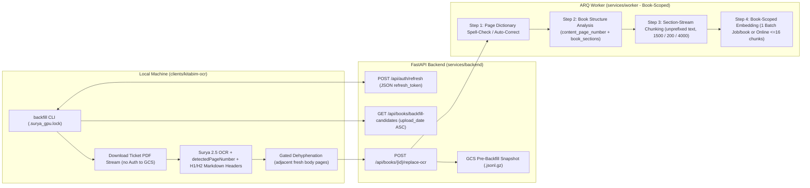
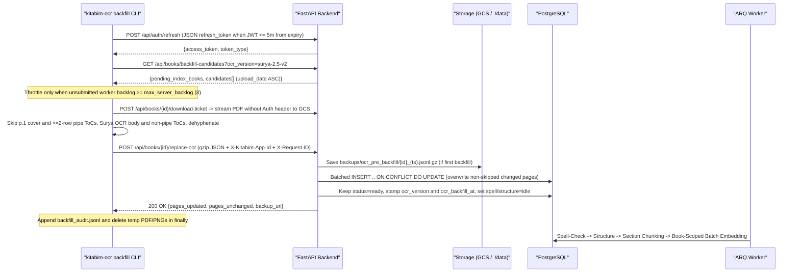

# Legacy Book Surya OCR Backfill, Printed-Page Alignment, and Section-Aware Indexing

*   **Author:** Omarjan
*   **Status:** Approved for Implementation
*   **Date:** 2026-11-09

--------------------------------------------------------------------------------

## Overview

As of `2026-11-08`, Kitabim.AI serves `967` Uyghur books in production (`946` legacy PDFs plus `21` Surya 2.5 PDFs and `.docx` books). The `946` legacy PDFs (`381` `gcs_sync`, `322` `upload`, `242` pre-`2026-11-08` `surya_local`, and `1` `NULL`-source PDF) had their page text extracted using earlier Gemini Vision OCR prompts or an earlier Surya v1 setup. Meanwhile, the standalone local desktop tool ([clients/kitabim-ocr/](../../../clients/kitabim-ocr)) runs a tuned Surya 2.5 (`surya-ocr==0.23.0`, `surya-2.5-uyghur-v2-gguf`) pipeline with reverse-side bleed-through suppression, faded-ink contrast recovery, Uyghur diacritic dot preservation, Table-of-Contents (ToC) pipe-table formatting, and hallucination filtering.

This design upgrades the `946` legacy PDFs using an unattended sequential CLI command on local Apple Silicon/GPU hardware paired with a single-book bulk OCR replacement endpoint on [services/backend/](../../../services/backend), avoiding running a GPU/high-RAM OCR container on GCP Compute Engine. Before running the corpus backfill, the backend pipeline retires unused LLM-based Spell-Check and LLM-based History Concept Extraction features and adds a deterministic, zero-LLM **Book Structure Analysis** stage (`Book.structure_milestone`) plus **Section-Stream Chunking** so printed page numbers match physical PDF pages, chapters and individual works (poems, stories, essays) are indexed as bounded units, and prose paragraphs spanning page turns are no longer split mid-sentence.

## The Problem

Users and operators currently hit five concrete failures across reading, search, and corpus maintenance:

1.  **Legacy OCR Errors Degrade Reading and Search**: `946` production PDFs lack Surya 2.5 v2 improvements, leaving bleed-through noise, dropped Uyghur diacritics, `455`+ unformatted non-pipe ToC pages, and hallucinated lines in live books. Running Surya 2.5 inside a production container on the CPU-only GCP Compute Engine VM would saturate CPU and RAM for weeks, while renting an always-on cloud GPU VM adds recurring infrastructure cost for hardware already available locally. However, the existing local client cannot run unattended across `946` books because its OAuth token expires every 60 minutes via an interactive browser prompt, its PDF downloader writes 0-byte files on HTTP `307` Google Cloud Storage redirects, and its per-page update API would issue ~450,000 sequential requests.
2.  **Physical PDF Page Numbers Do Not Match Printed Book Pages**: Reader ToC links and ToC-based RAG lookups rely on a single book-wide integer (`Book.content_page_offset`), auto-computed from `MAX(page_number) WHERE is_toc = TRUE`. That single offset breaks whenever a Uyghur book places its ToC at the back of the book (setting an offset around `300`), numbers front matter continuously with body pages, or has missing/inserted scan pages mid-book—while books without `content_page_offset > 0` render unclickable ToC tables in the Reader, and RAG chat citations display physical PDF scan indices instead of printed book page numbers.
3.  **Poems, Stories, and Chapters Lack Structural Boundaries**: Books without a printed ToC (or with a chapter-only ToC) have no structured index of individual chapters or short works, and Surya `"Title"` / `"SectionHeader"` blocks wrapped in `
` HTML lose their `#` / `##` Markdown prefixes during OCR conversion. On multi-poem anthology pages, adjacent short poems have no stored intra-page boundaries, allowing search chunks to bleed across separate works and preventing [`ChatOrchestrator`](../../../packages/backend-core/app/services/chat/orchestrator.py) and [`toc_lookup_service.py`](../../../packages/backend-core/app/services/rag/toc_lookup_service.py) from returning the exact text of a named poem or disambiguating common titles (`«ئانا»`, `«ۋەتەن»`, `«غەزەل»`).
4.  **Page-Isolated Chunking Splits Paragraphs and Fragments Context**: Chunking runs on isolated pages with `CHUNK_SIZE = 1000` (or `500` in production env defaults) treated as a pre-flush cap, while [`embedding_scanner.py`](../../../services/worker/scanners/embedding_scanner.py) claims arbitrary cross-book page slices. Across 20,000 sampled production chunks, the median chunk length is `438` characters (`546` mean, vs. `1,405` median characters per printed page), prose paragraphs crossing from page `N` to page `N + 1` are cut mid-sentence at every page turn, and 15–20 couplet ghazals are split across multiple chunks.
5.  **Live Re-Indexing Risks Catalog Unavailability, Duplicate Embedding Spend, and Retired Pipeline Overhead**: Public library, reader, and search queries hide books where `Book.status != 'ready'`, while transitioning a book back to `'ready'` triggers unintended Gemini `BookSummary` and Neo4j Knowledge Graph jobs. At the same time, the worker schedules unused **LLM Spell-Check** and **LLM History Concept Extraction** jobs/pollers, [`BOOK_SUMMARY_PROMPT`](../../../packages/backend-core/app/core/prompts.py) generates 20–30 unused hypothetical questions (`Section 6`) that RAG strips out while UI modals render them verbatim, and running the `946`-book OCR backfill *before* updating structure and chunking logic would pay `gemini-embedding-2` costs across ~200M–350M Uyghur tokens twice.

## Goals

*   **Align Printed and Physical Page Numbers End-to-End**: Capture raw printed page numbers discarded during local Surya OCR (`detectedPageNumber`), fit per-page `Page.content_page_number` strings deterministically, expose a book-wide `contentPageMap` for virtual-scroll Reader ToC navigation, display printed page numbers in Reader badges, `ReferenceModal`, and visible RAG citations (while keeping physical PDF pages in `ref:` links), and let editors override alignment in one click via Reader "Mark as Page 1".
*   **Extract Deterministic Book Structure Across All Catalog Books (Zero LLM Calls)**: Introduce a book-scoped `Book.structure_milestone` worker stage between dictionary spell-check and chunking (`Page OCR -> Dictionary Spell-Check -> Book Structure Analysis -> Section-Stream Chunking -> Embedding`) that populates a two-tier `book_sections` hierarchy (chapters and individual works with intra-page block bounds) across both ToC-backed and ToC-less books.
*   **Upgrade to Section-Stream Chunking and Book-Scoped Embedding**: Pack unprefixed Uyghur prose and poetry within leaf `book_sections` (`1500`-char target, cross-page prose stitching, page-local footnote binding, `text_hash` vector carry-over), attach section breadcrumbs in RAG context headers rather than chunk embeddings, and run `chunking` and `embedding` as book-scoped milestones using single-job Gemini Batch Embedding in production (`embed_batch_enabled = 'true'`) with fast online `:batchEmbedContents` fallback for small edits.
*   **Retire Unused LLM Pipeline Features and Summary Questions**: Remove all **LLM Spell-Check** and **LLM History Concept Extraction / Staging Queue** code, routes, worker tasks, DB schema, and UI controls (preserving the static `history_dictionary` table and `HistoryDictionaryPanel.tsx`), and remove `Section 6 (Hypothetical Queries)` from both [`BOOK_SUMMARY_PROMPT`](../../../packages/backend-core/app/core/prompts.py) and existing `book_summaries.summary` rows at zero LLM cost.
*   **Run Unattended Sequential OCR Backfill on Legacy PDFs Without Catalog Downtime**: Provide a headless `backfill` subcommand in [clients/kitabim-ocr/](../../../clients/kitabim-ocr) (with non-rotating OAuth `refresh_token` renewal, signed-ticket PDF streaming, oldest-first `upload_date` ordering, cover/pipe-ToC skipping, gated cross-page dehyphenation, GPU lockfile coordination, and unsubmitted-backlog throttling) paired with `POST /api/books/{book_id}/replace-ocr` that snapshots pre-backfill pages to GCS, keeps public books `'ready'`, and suppresses unintended `BookSummary` and Neo4j jobs.

## Non-Goals

*   Running or deploying a containerized `kitabim-ocr` service in local Docker Compose or GCP Compute Engine.
*   Re-OCRing `.docx` books or `surya_local` PDF books uploaded on or after `2026-11-08T00:00:00Z` during Phase 2 (these books execute Phase 1 structure analysis, section-stream chunking, and embedding directly).
*   Preserving or migrating Neo4j Knowledge Graph chunk-reference lookups (`get_graph_chunk_detail`) or regenerating Neo4j Knowledge Graphs and `BookSummary` records during backfill.
*   Zero-downtime shadow/staging chunk tables (`chunks_staging` / `Chunk.generation`) per individual book while that book awaits Gemini Batch or online embedding completion.
*   Replacing Gemini Vision OCR on the low-volume web-UI PDF upload route (`POST /api/books/upload`).
*   Calling any LLM for book structure, heading, or page-number detection.
*   Retaining downloaded PDFs or rendered page images on local disk after a book's bulk OCR push succeeds.

## Open Questions

None — all architectural and operational questions resolved.

## Critical User Journeys (CUJs)

### CUJ 1: Operator Runs Unattended Multi-Day Backfill Across `946` Legacy PDFs

*   **Given**: Phase 1 backend changes are deployed (`embed_batch_enabled = 'true'`), the operator has run `python main.py login` once after Phase 1 deployment so `token.json` stores `{access_token, refresh_token}`, and the catalog contains `946` legacy PDFs (`ocr_version IS NULL`) alongside `.docx` books and `surya-2.5-v2`-stamped PDFs.
*   **When**: The operator runs `python main.py backfill` (or `--limit 15` for canary validation) on local hardware over multiple days, including stopping and resuming with `Ctrl+C`.
*   **Then**: The CLI processes un-upgraded PDFs oldest-first (`Book.upload_date ASC, Book.id ASC`), renews expired access tokens via `POST /api/auth/refresh` without opening a browser, streams PDFs via download tickets without forwarding bearer headers to GCS, skips page 1 covers and `>= 2`-row pipe ToCs while re-OCRing non-pipe ToCs and body pages, and deletes local temp files after each book. Each `POST /api/books/{book_id}/replace-ocr` snapshots pre-backfill pages to GCS on first run, overwrites changed pages, keeps public books at `Book.status = 'ready'` without triggering `BookSummary` or Neo4j jobs, and throttles CLI progress only on unsubmitted server worker backlog rather than asynchronous Gemini Batch queues.

### CUJ 2: Reader Navigates Printed ToC Entries and Editor Fixes Missing Page Numbers

*   **Given**: A scanned Uyghur book uses virtualized scrolling ([`VirtualScrollReader.tsx`](../../../apps/frontend/src/components/reader/VirtualScrollReader.tsx)) where only ~10–15 pages around the viewport are loaded in browser memory, and the book has front-matter pages before Content Page 1, a ToC at the back of the book, or margin cropping that removed printed page numbers.
*   **When**: A reader on page 3 clicks a ToC row for printed page `215`—or, on a book with cropped margins, an authenticated editor (`editor` or `admin`) clicks "Mark as Page 1" on physical page `9` and confirms the modal.
*   **Then**: Reader ToC clicks resolve via the book-wide `contentPageMap` returned on `GET /api/books/{book_id}` and scroll `VirtualScrollReader` directly to physical page `223` even when unloaded or placed at the back of the book. Confirming "Mark as Page 1" calls `POST /api/books/{book_id}/pages/9/set-start-page` (`require_editor`), sets `content_page_number = NULL` before page `9` and `"1", "2", ...` on non-ToC pages from page `9` onward with `content_page_number_manual = TRUE`, updates visible Reader page badges and `contentPageMap` immediately, and re-runs `Book.structure_milestone` while preserving manual page anchors.

### CUJ 3: Reader Queries RAG for a Specific Poem, Ambiguous Poem Title, or Multi-Page Prose Scene

*   **Given**: Production books (with or without a ToC) have completed `Book.structure_milestone`, section-stream chunking of unprefixed `Chunk.text`, and `gemini-embedding-2` indexing.
*   **When**: A user asks chat/RAG for a named poem (unique or shared across books, such as `«ئانا»`), or asks about a prose scene on a heading-less mid-chapter page whose paragraph starts at the bottom of physical page `52` (printed page `46`) and finishes at the top of physical page `53` (printed page `47`).
*   **Then**: Single-match short-work queries return only that poem's sliced block span without adjacent poems on the same page; multi-match short-work queries (filtered by any book or author named in the question) return the top match's full text plus a capped disambiguation list of other matching books/pages. Mid-chapter prose chunks inherit `section_id` from their enclosing `book_section`, expose `Section: <Chapter › Work>` in the RAG context header across both reranked and graded chat paths, and render printed page numbers in visible Uyghur citations (`[ئانا يۇرت، 46–47-بەت](ref:abc123:52,53)`) while `ReferenceModal` displays printed page `46` and navigates physical pages `52,53`.

## Technical Plan (Architecture)

### 1. System Overview, Local Workdir Continuity & Two-Phase Single-Embedding Rollout

To avoid running a GPU/high-RAM OCR container on GCP Compute Engine and ensure every catalog book is embedded with `gemini-embedding-2` once, deployment separates backend pipeline/indexing upgrades (Phase 1) from sequential legacy PDF re-OCR (Phase 2):

*   **Local `KITABIM_WORK_DIR` Continuity (`main.py app`)**:
    *   Active local `main.py app` OCR queues continue running uninterrupted while Phase 1 is implemented. `PageState` in [`workdir.py`](../../../clients/kitabim-ocr/engine/workdir.py) defaults `detected_page_number` to `None` when loading pre-update `pages.json` sessions, and existing `on_startup` / `resume_session` handlers in [`app_server.py`](../../../clients/kitabim-ocr/preview/app_server.py) resume interrupted sessions after restart without adding bespoke queue endpoints.
    *   Pre-update sessions lacking `detected_page_number` keep their Surya 2.5 text and still receive `content_page_number` and `book_sections` via ToC-to-heading alignment on `upload-ocrd`. After Phase 1 deploys, the operator runs `python main.py login` once to persist `{access_token, refresh_token}` in `token.json` before starting headless `backfill`.
*   **Phase 1 (Deploy Pipeline, Structure Stage, Chunking, Removals, and UI First)**:
    *   Applies schema migrations, removes retired LLM Spell-Check and LLM History Concept Extraction/Staging code, strips Section 6 (`Hypothetical Queries`) from `book_summaries`, and deploys book-scoped `structure_milestone -> chunking_milestone -> embedding_milestone` workers, RAG printed-page/section citations, and Reader `contentPageMap` + "Mark as Page 1" updates (syncing `CHUNK_SIZE=1500`, `CHUNK_OVERLAP=200`, `CHUNK_MIN_SIZE=350` in `.env`).
    *   Migration `101` stamps `ocr_version = 'surya-2.5-v2'` directly on `surya_local` PDFs uploaded on or after `2026-11-08T00:00:00Z`, sets `structure_milestone = 'idle'` on those PDFs plus non-PDF books (`file_type != 'pdf'`), and initializes legacy PDFs (`ocr_version IS NULL`) to `structure_milestone = 'complete'` so Phase 1 embeds only the non-legacy books (`21` books as of `2026-11-08`).
*   **Phase 2 (Sequential Headless Backfill Across Legacy PDFs + Final Sweep)**:
    *   `python main.py backfill` processes un-upgraded PDFs (`ocr_version IS DISTINCT FROM 'surya-2.5-v2'`) in `Book.upload_date ASC, Book.id ASC` order under `$KITABIM_WORK_DIR/.surya_gpu.lock`. Each `POST /api/books/{book_id}/replace-ocr` updates that book's pages and triggers `spell_check -> structure -> chunking -> embedding` once.
    *   After Phase 2 finishes, `scripts/trigger_remaining_structure_backfill.py` resets `Book.structure_milestone = 'idle'` in controlled batches on any remaining `ocr_version IS NULL` PDFs skipped during backfill so 100% of the catalog uses section-stream indexing.

### 2. Data Model & Milestone State Machine Architecture

All book-level milestones (`ocr_milestone`, `spell_check_milestone`, `structure_milestone`, `chunking_milestone`, `embedding_milestone`, `graph_milestone`) standardize on [`BOOK_MILESTONE_COMPLETE = "complete"`](../../../packages/backend-core/app/core/pipeline.py) (`'idle' | 'in_progress' | 'complete' | 'partial_failure' | 'failed'`), reserving `'succeeded'` (`PAGE_MILESTONE_SUCCEEDED`) strictly for `Page.*_milestone` columns.

1.  **Decoupled Page-Scoped vs. Book-Scoped Milestones**:
    *   **Page-scoped stages (`ocr`, `spell_check`)** continue tracking per-page state on `pages` and rolling up to `Book.ocr_milestone` and `Book.spell_check_milestone` via [`BookMilestoneService.update_book_milestones`](../../../packages/backend-core/app/services/book_milestone_service.py).
    *   **Book-scoped stages (`structure`, `chunking`, `embedding`)** claim, retry, and recover directly on `books` (`structure_milestone`, `chunking_milestone`, `embedding_milestone` with per-step `*_retry_count` and `*_claimed_at` columns), decoupled from per-page rollup overwrites. When a book's embedding completes (via `BatchEmbeddingJob` poller or online `embedding_job`), all OCR'd pages of the book are bulk-marked `Page.is_indexed = True` and `Page.embedding_milestone = 'succeeded'` in one statement.
2.  **Core Entity Extensions ([`models.py`](../../../packages/backend-core/app/db/models.py))**:
    *   `Book`: Adds `structure_milestone` (`DEFAULT 'idle'`, `CHECK` matching book milestone states), claim/retry timestamps and counters for `structure`, `chunking`, and `embedding`, plus backfill provenance fields (`ocr_version`, `ocr_backfill_at`, and `gcs_ocr_backup_uri` storing the relative storage key returned by [`StorageProvider.upload_bytes`](../../../packages/backend-core/app/services/storage_service.py)).
    *   `Page`: Retains `content_page_number` (`VARCHAR(20) NULL` for solver-fitted ASCII numeral strings) and adds `detected_page_number` (`INTEGER NULL` for raw Surya sidecar integers, never overwritten by the solver) plus `content_page_number_manual` (`BOOLEAN NOT NULL DEFAULT FALSE` for editor overrides), indexed by `(book_id, content_page_number)`. Drops retired `llm_spell_check_status` and `llm_spell_check_at`.
    *   `BookSection` (`book_sections`): Stores a 2-level per-book tree (`chapter` -> child `work`, plus `front_matter`, `back_matter`, `synthetic_body`) with `section_index`, `level`, `title`, `normalized_title`, optional `toc_printed_page`, physical page span `(start_page, end_page)`, intra-page block bounds `(start_block_index, end_block_index)`, and `source` (`toc_matched`, `toc_interpolated`, `header_detected`, `synthetic_body`).
    *   `Chunk`: Keeps `page_number` (`NOT NULL`) as the chunk's starting physical page (`UniqueConstraint(book_id, page_number, chunk_index)`) and adds `end_page_number` (`INTEGER NULL`, inclusive ending physical page), `section_id` (`REFERENCES book_sections(id) ON DELETE SET NULL`), and `text_hash` (`sha256` of whitespace-normalized unprefixed `Chunk.text` for vector reuse across re-chunking).
3.  **Retired Tables, `system_configs` & `book_summaries` Cleanup**:
    *   Drops `batch_llm_spell_check_jobs`, `history_dictionary_staging`, and `batch_history_extraction_jobs` (retaining `history_dictionary`), deletes all 10 current and legacy `llm_spell_check_*` / `history_*` config keys, updates `embed_gemini_timeout = '45'` and `embed_batch_max_chunks_per_job = '5000'` (so even 1,000-page anthologies submit as **1** `BatchEmbeddingJob`), and strips Section 6 (`6. تىپىك سوئاللار`) while renumbering Section `7.` to `6.` across `book_summaries.summary`.

### 3. Local OCR Engine Enhancements ([clients/kitabim-ocr/engine/](../../../clients/kitabim-ocr/engine))

*   **Markdown Heading Preservation**: Update HTML-to-Markdown block conversion in [`recognize.py`](../../../clients/kitabim-ocr/engine/recognize.py) so Surya `"Title"` and `"SectionHeader"` layout blocks emit `# ` and `## ` prefixes even when Surya wraps them in `
` or plain text (excluding standalone page numbers), matching `.docx` heading output in [`docx_service.py`](../../../packages/backend-core/app/services/docx_service.py).
*   **Bleed-Through-Safe Sidecar `detectedPageNumber` Capture**:
    *   Evaluate phantom bleed-through filtering ahead of `PageHeader`/`PageFooter` discard while keeping `ink_contrast_reference` computed strictly over body blocks (never diluted by headers/footers).
    *   Extract pure-digit printed page candidates (`1 <= n <= 5000`, normalizing ASCII `0-9`, Arabic-Indic `٠-٩`, and Persian `۰-۹` digits without applying Latin letter-to-digit substitution to multi-word running headers) from discarded `PageFooter` blocks, stripped top/bottom standalone number lines, and discarded `PageHeader` blocks (preferring footer/bottom-edge over header).
    *   Expose `ocr_page_with_meta(...) -> PageOcrResult(text, detected_page_number, ended_with_hyphen)` while keeping `ocr_page(...) -> str` backward-compatible, and send `detectedPageNumber` per page in `upload-ocrd` and `replace-ocr` payloads while keeping `Page.text` free of margin numbers.
*   **Gated Cross-Page Dehyphenation**: Add a cross-page word-joining helper in [`line_ends.py`](../../../clients/kitabim-ocr/engine/line_ends.py) (cropping only the bottom body line of page `p` when needed to verify a trailing hyphen and joining page `p`'s hyphenated stem with page `p + 1`'s leading fragment) gated to contiguous page pairs `(p, p + 1)` freshly OCR'd in the current run where neither page is `is_toc` or skipped and `ended_with_hyphen` is `True` on page `p`.
*   **Shared Uyghur Numeral & ToC Parsing**: Reuse existing `_DIGIT_TRANSLATION` and [`extract_standalone_page_number`](../../../packages/backend-core/app/utils/text.py) across [`text.py`](../../../packages/backend-core/app/utils/text.py) and vendored [`text_cleanup.py`](../../../clients/kitabim-ocr/engine/text_cleanup.py), extend `parse_toc_entries` to parse both pipe-table (`| Title | 45 |`) and dot-leader ToC rows, and preserve `\n\n` paragraph breaks and `#`/`##`/`###` headings in `clean_uyghur_text`.

### 4. Deterministic Book Structure Analysis (`Book.structure_milestone`)

Implemented in `packages/backend-core/app/services/book_structure_service.py` and run by `structure_scanner.py`, reactive [`event_dispatcher.py`](../../../services/worker/scanners/event_dispatcher.py), and `structure_job.py` under [`RedisLock`](../../../packages/backend-core/app/utils/redis_lock.py):

*   **Readiness Gate**: Claims books (`FOR UPDATE SKIP LOCKED`) where `Book.structure_milestone == 'idle'`, `Book.status != 'error'`, `Book.total_pages > 0`, at least one `Page` row has `ocr_milestone == 'succeeded'`, no non-skipped page has incomplete OCR, and (when `spell_check_enabled == 'true'`) all OCR'd pages have `spell_check_milestone IN ('succeeded', 'failed')`. Running after dictionary auto-correct fixes OCR typos in ToC entries and headings before matching.
*   **Stage 1 — Piecewise-Monotonic + ToC-Anchored `Page.content_page_number` Solver**:
    1.  *Manual Overrides*: Preserves `Page.content_page_number` on any page where `content_page_number_manual == TRUE`.
    2.  *Piecewise Offset Fitting*: Fits a piecewise-constant offset `c_p = page_number - printed_page` across `detected_page_number` observations via dynamic programming with a step-change penalty requiring `>= 3` corroborating detections to shift offsets—handling mid-book scan gaps/plates while rejecting single-page outliers (such as years `1985`). Sets `NULL` on front matter (`page_number - c_p <= 0`) and `is_toc` pages, and normalized ASCII strings on body pages.
    3.  *ToC-Anchor Fallback*: When `< 15%` of body pages carry `detected_page_number` and ToC entries exist, anchors offsets by matching unique ToC titles against in-page headings and updates `Book.content_page_offset` to the modal offset.
*   **Stage 2 — Deterministic Two-Tier `book_sections` Extraction (Zero LLM Calls)**:
    1.  *Typed Block Parsing*: Splits each non-ToC page into indexed `PageBlock(block_index, kind, raw_text, normalized_text)` units with explicit `kind` in `{'heading', 'prose', 'verse', 'table', 'footnote', 'toc', 'meta_noise'}`—distinguishing `'verse'` from `'prose'` via [`is_poem_block`](../../../packages/backend-core/app/utils/text.py) and downgrading poem date/location sign-offs, standalone years, `* * *` dividers, repeated running headers, and long punctuated sentences from `'heading'` to `'meta_noise'`.
    2.  *ToC Reconciliation Mode*: Maps ToC printed pages to expected physical pages via `Page.content_page_number` (supporting front and back ToCs) and reconciles against filtered headings within `±2` physical pages in monotonic `(page_number, block_index)` order—preserving distinct intra-page `start_block_index` bounds for multi-poem pages and attaching child `work` sections (`level = 2`) inside chapter-only ToCs (`level = 1`).
    3.  *Header-Driven Mode & Fallback*: On ToC-less books, builds Tier 1 `chapter` sections from `#` and structural Uyghur headings (`باب`, `قىسىم`, `بۆلۈم`, `پەسىل`, `مۇقەددىمە`, `خاتىمە`, `كىرىش سۆز`, ordinals) and Tier 2 `work` sections from nested `##`/`###` headings, falling back to a single `synthetic_body` section on plain-prose books without headings.
    4.  *Boundary Closure & Handoff*: Closes each leaf section's `(end_page, end_block_index)` immediately before the next section's start so heading-less continuation pages belong to their enclosing `book_section`. Replaces `book_sections` in one transaction, sets `Book.structure_milestone = 'complete'` and `Book.chunking_milestone = 'idle'`, invalidates `book:{book_id}:*` Redis cache keys, and enqueues `chunking_job(book_id=book_id)`.

### 5. Section-Stream Chunking, Book-Scoped Embedding & Unified Page Edits

*   **Section-Stream Packing with Unprefixed `Chunk.text` (`ChunkingService.chunk_book_sections`)**:
    *   Each leaf `book_section` is chunked independently so adjacent poems, stories, or chapters never merge:
        1.  **Page-Local Footnote Binding**: Attaches `① ② ③` footnotes per page slice before cross-page joining so restarted footnote numbers on later pages never collide.
        2.  **Cross-Page Prose Stitching**: Merges the trailing `'prose'` block of page `p` with the leading `'prose'` block of non-ToC page `p + 1` within the same leaf section when page `p` ends with a line-break hyphen (stripping the hyphen) or lacks terminal punctuation (`۔`, `.`, `!`, `؟`, `:`, `»`, `”`, `…`, `...`, `)`, `]`, `’`). `'verse'`, `'table'`, `'heading'`, and unattached `'footnote'` blocks never stitch across pages; `'meta_noise'` blocks are excluded while `'table'` blocks remain retrievable.
        3.  **Page-Provenance Adaptive Packing**: Packs `(kind, text, start_page, end_page)` units with **`CHUNK_SIZE = 1500`**, **`CHUNK_OVERLAP = 200`**, **`CHUNK_MIN_SIZE = 350`**, and **`_EMBED_SAFE_CHARS = 4000`** (propagating `(min(start_page), max(end_page))` across overlap carry-over, `4000`-char safety splits, and `< 350`-char backward merges within the same `section_id`). Neither `Chunk.text` nor `gemini-embedding-2` inputs receive synthetic `[Section Title]` prefixes; heading-less mid-section chunks inherit `Chunk.section_id = section.id` and `text_hash = sha256(normalized_text)`.
*   **Book-Scoped Chunking & Dual-Mode Embedding**:
    *   `chunking_job(ctx, book_id)` (under `RedisLock`) loads existing `{text_hash: embedding}` for `book_id`, replaces `Chunk` rows in one transaction while carrying forward matching vectors, sets `Book.chunking_milestone = 'complete'`, and sets `Book.embedding_milestone = 'idle'` when unembedded chunks remain (else `'complete'`, marking OCR'd pages `is_indexed = True` and invalidating `rag:search:{book_id}:*`).
    *   `embedding_scanner.py` claims books where `Book.chunking_milestone == 'complete'` and `Book.embedding_milestone == 'idle'`:
        *   **Online Fast Path (`embed_batch_enabled == 'false'` OR `unembedded_chunks <= 16`)**: Enqueues `embedding_job(ctx, book_id)`, which deduplicates unembedded `text_hash` texts, calls [`GeminiEmbeddings.aembed_documents`](../../../packages/backend-core/app/llm/models.py) in sub-batches of `64` chunks (`embed_gemini_timeout = 45.0`s), bulk-marks OCR'd pages `Page.embedding_milestone = 'succeeded', is_indexed = True`, sets `Book.embedding_milestone = 'complete'`, and clears `rag:search:{book_id}:*`.
        *   **Production Batch Path (`embed_batch_enabled == 'true'` AND `unembedded_chunks > 16`)**: Submits all unembedded chunks of `book_id` in **1** Gemini Batch API job (`embed_batch_max_chunks_per_job = 5000` at `$0.10`/1M tokens). When [`batch_embedding_poller_scanner.py`](../../../services/worker/scanners/batch_embedding_poller_scanner.py) ingests the completed job, it propagates vectors across duplicate `text_hash` rows in `book_id`, bulk-marks OCR'd pages `Page.embedding_milestone = 'succeeded', is_indexed = True`, sets `Book.embedding_milestone = 'complete'`, and clears `rag:search:{book_id}:*`.
*   **Unified Page, ToC & Auto-Correct Edit Flow**:
    *   Instead of maintaining a separate synchronous partial-section splicer, single-page edits (`update_page_text`—removing `strip_markdown(new_text)` so `#`/`##` headings survive), `set_page_toc`, `apply_spell_corrections`, `AutoCorrectService` / `auto_correct_job`, `PUT /api/books/{book_id}`, and `reprocess/ocr` or `reprocess/spell-check` all set `Book.structure_milestone = 'idle'` (enqueueing `structure_job(book_id)` immediately when an `ArqRedis` handle is present, or picked up within 60s by `structure_scanner`). Because `chunking_job` carries forward unchanged vectors by `text_hash` and `embedding_scanner` routes `<= 16` unembedded chunks to the online fast path, single-page edits become searchable within seconds without race conditions.

### 6. RAG Retrieval, Printed-Page Citations, Reader `contentPageMap` & "Mark as Page 1"

*   **Short-Work Lookup & Disambiguation ([`toc_lookup_service.py`](../../../packages/backend-core/app/services/rag/toc_lookup_service.py) & [`orchestrator.py`](../../../packages/backend-core/app/services/chat/orchestrator.py))**:
    *   `resolve_short_work` queries `book_sections` by normalized/fuzzy title across ToC-backed and ToC-less books, filtering by `book_id`, `candidate_book_ids`, or book title / author mentioned in the question and ranking exact normalized matches (`section_type = 'work'` first) ahead of fuzzy matches:
        *   **Span & Generic-Title Guard**: Returns `None` (falling back to standard vector RAG) if the matched span exceeds `toc_short_work_max_pages` (`10`) or if an unfiltered generic title (e.g., bare `«غەزەل»` with no book/author qualifier) matches `> 20` works across the catalog.
        *   **Single vs. Multi-Match Response**: On `1` match, slices `[start_page .. end_page]` to `[start_block_index .. end_block_index]` so adjacent poems on the same page are excluded; on `2..20` matches, returns the top match's sliced text followed by up to `8` alternate citations (`+ N more`) displaying printed page numbers (`{content_start_page or start_page}-بەت`) with physical `ref:` links. Retains `toc_pages` parsing fallback only when `book_sections` is empty.
*   **Section Context Headers & Printed-Page Citations Across Live Reranker and Fallback Paths**:
    *   `ChunksRepository.similarity_search` (`FROM chunks c`) joins `book_sections` (child + parent) and `pages` (start + end) to return `end_page_number`, `section_id`, `section_title` (`Parent Chapter › Work`), `content_page_number`, and `end_content_page_number`. `ChunksRepository.keyword_search` (`FROM pages p`) selects `p.content_page_number` directly, filters optional `section_ids` via `EXISTS (...)`, and resolves `section_id`/`section_title` via `LEFT JOIN LATERAL (... LIMIT 1)` without duplicating multi-poem FTS rows; [`exact_phrase.py`](../../../packages/backend-core/app/services/chat/exact_phrase.py) and [`retrieval.py`](../../../packages/backend-core/app/services/rag/retrieval.py) (`vector_search` cache key + cached dict) forward the same metadata.
    *   Both the primary reranker path ([`reranker.py`](../../../packages/backend-core/app/services/rag/agent/reranker.py), active by default via `rag_reranker_enabled = 'true'`) and fallback [`context_grading.py`](../../../packages/backend-core/app/services/chat/context_grading.py) deduplicate on `(book_id, page_val, section_id)` and preserve all 5 metadata fields into `Document.metadata`.
    *   [`answer_builder.py`](../../../packages/backend-core/app/services/rag/answer_builder.py) (`format_document`) emits `Section: <section_title>`, `PrintedPage: <46–47>`, and `RefPages: <52,53>`, while prompt rules instruct Gemini to show `PrintedPage` in visible Uyghur labels (`[ئانا يۇرت، 46–47-بەت](ref:abc123:52,53)`) and physical pages in `ref:` links ([`citation_fixer.py`](../../../packages/backend-core/app/utils/citation_fixer.py) requires no change because it repairs only tokens that already carry `ref:`). [`ReferenceModal.tsx`](../../../apps/frontend/src/components/chat/ReferenceModal.tsx) updates its header badge to display `contentPageNumber` (falling back to physical page) and supports stepping across multi-page `ref:` spans.
*   **Reader `contentPageMap` & Editor "Mark as Page 1"**:
    *   `GET /api/books/{book_id}` includes `contentPageMap: Record<string, number>` (`{ content_page_number: MIN(page_number) }` across non-ToC pages), threaded through [`ReaderView.tsx`](../../../apps/frontend/src/components/reader/ReaderView.tsx) and [`VirtualScrollReader.tsx`](../../../apps/frontend/src/components/reader/VirtualScrollReader.tsx) into [`MarkdownContent.tsx`](../../../apps/frontend/src/components/common/MarkdownContent.tsx) so ToC clicks jump directly to unloaded target pages; [`PageItem.tsx`](../../../apps/frontend/src/components/reader/PageItem.tsx) renders `contentPageNumber` first in page badges.
    *   One-click "Mark as Page 1" calls `POST /api/books/{book_id}/pages/{page_num}/set-start-page` (gated by `require_editor` in [`dependencies.py`](../../../services/backend/auth/dependencies.py)), backfilling `content_page_number` (`NULL` before `page_num`, `"1", "2", ...` on non-ToC pages `>= page_num`) with `content_page_number_manual = TRUE`, invalidating `book:{book_id}:*`, enqueueing `structure_job`, and updating `VirtualScrollReader`'s cached pages and `contentPageMap` immediately.

### 7. Feature Removals & `BOOK_SUMMARY_PROMPT` Cleanup

1.  **End-to-End LLM Spell-Check Removal**: Deletes worker job/poller (`llm_spell_check_job.py`, `batch_llm_spell_check_poller_scanner.py`), backend services (`llm_spell_check_service.py`, `batch_llm_spell_check_service.py`), `BatchLlmSpellCheckJob`, `pages.llm_spell_check_*` columns/stats, `/reprocess/llm-spell-check` and `/llm-spell-check/preview` routes, `useLlmSpellCheckPreview.ts`, [`ChangedWordsLayer.tsx`](../../../apps/frontend/src/components/reader/ChangedWordsLayer.tsx), [`wordDiff.ts`](../../../apps/frontend/src/utils/wordDiff.ts), and all Reader/Admin LLM Check controls.
2.  **End-to-End LLM History Concept Extraction & Staging Queue Removal**: Deletes worker job/poller (`history_extraction_job.py`, `batch_history_poller_scanner.py`), backend services (`history_extraction_service.py`, `batch_history_extraction_service.py`, `dictionary_staging_service.py`, `history_fact_utils.py`), `admin_history_dictionary_router.py`, `HistoryDictionaryStaging` / `BatchHistoryExtractionJob` (plus `has_history` / `hasHistory` book fields in [`books_repository.py`](../../../packages/backend-core/app/db/repositories/books_repository.py), [`books_router.py`](../../../services/backend/api/endpoints/books_router.py), [`schemas.py`](../../../packages/backend-core/app/models/schemas.py), [`types.ts`](../../../packages/shared/src/types.ts), and [`AdminView.tsx`](../../../apps/frontend/src/components/admin/AdminView.tsx)), `HistoryStagingQueuePanel.tsx`, and staging maintenance scripts—preserving `history_dictionary`, `/api/history-dictionary`, and [`HistoryDictionaryPanel.tsx`](../../../apps/frontend/src/components/admin/dictionary/HistoryDictionaryPanel.tsx).
3.  **`BOOK_SUMMARY_PROMPT` Section 6 Removal ([`prompts.py`](../../../packages/backend-core/app/core/prompts.py))**: Keeps `BOOK_SUMMARY_PROMPT` written in English (explicitly stating that input book pages are in Uyghur and all output text fields must be written in modern Uyghur using Uyghur Arabic script per `AGENTS.md`) and preserves the exact 6 surviving Uyghur headings after Migration `103` (`1. تۈرى`, `2. ئومۇمىي بايان`, `3. ئاساسلىق ئۇقۇم ۋە تېمىلار`, `4. شەخسلەر، ئورۇنلار، تەشكىلاتلار ۋە ۋەقەلەر`, `5. مەزمۇن دائىرىسى`, `6. ئاچقۇچلۇق سۆزلەر`), omitting `Hypothetical Queries` while keeping `_strip_hypothetical_questions` in [`tools.py`](../../../packages/backend-core/app/services/rag/agent/tools.py) as a defensive fallback for legacy text.

### 8. Bulk OCR Replacement API & Headless `backfill` CLI

*   **Non-Rotating CLI Refresh Token Auth ([`auth_router.py`](../../../services/backend/api/endpoints/auth_router.py), [`refresh_tokens_repository.py`](../../../packages/backend-core/app/db/repositories/refresh_tokens_repository.py), [`auth.py`](../../../clients/kitabim-ocr/kitabim_client/auth.py))**:
    *   Loopback OAuth callbacks (`127.0.0.1` and `::1` redirect URIs only) append `&refresh_token=<token>` alongside existing `access_token=<access_token>`.
    *   `POST /api/auth/refresh` accepts an optional JSON body `{"refresh_token": "..."}` when the `HttpOnly` browser cookie is absent, reusing `refresh_access_token`'s existing non-rotating 7-day `RefreshTokensRepository` validation to mint `{"access_token": ..., "token_type": "bearer"}` without revoking or mutating `refresh_token` (so dropped HTTP responses or concurrent `app` + `backfill` processes never invalidate `token.json`, and browser cookie sessions remain untouched).
*   **Download-Ticket Streaming & App-ID Header ([`api.py`](../../../clients/kitabim-ocr/kitabim_client/api.py))**:
    *   Uses `POST {self.base_url}/books/{book_id}/download-ticket` ([`books_router.py`](../../../services/backend/api/endpoints/books_router.py)) to obtain a V4 GCS signed URL (or local ticket URL) and streams the PDF without `Authorization` headers (`timeout=300.0`), verifying HTTP `200` and `%PDF-` magic bytes. Sends `X-Kitabim-App-Id: <SECURITY_APP_ID>` on all `/api/books/*` requests as required by `enforce_app_id` in [`services/backend/main.py`](../../../services/backend/main.py).
*   **Candidate Discovery & Guarded Bulk Replace (`books_router.py`)**:
    *   `GET /api/books/backfill-candidates` (`require_admin`, registered before `GET /{book_id}`) returns `pending_index_books` (books with unsubmitted `spell_check`, `structure`, `chunking`, or `embedding == 'idle'` work, excluding books in `'in_progress'` with an active `BatchEmbeddingJob`) and `candidates` (`file_type = 'pdf'`, `status != 'error'`, `ocr_version IS DISTINCT FROM :target_ocr_version`, ordered by `Book.upload_date ASC, Book.id ASC`).
    *   `POST /api/books/{book_id}/replace-ocr` (`require_admin`, `<= 25 MB` decompressed JSON; production Nginx `client_max_body_size` in [`kitabim.conf`](../../../deploy/gcp/nginx/conf.d/kitabim.conf) is already `2048M`) snapshots existing pages to `backups/ocr_pre_backfill/{book_id}_{ts}.jsonl.gz` when `gcs_ocr_backup_uri IS NULL`, batch-upserts changed non-skipped pages (`updated_by = NULL`, resetting `Page.spell_check_milestone` and `Book.spell_check_milestone` when spell-check is enabled), preserves `Book.status = 'ready'`, stamps `ocr_version` and `ocr_backfill_at`, sets `Book.structure_milestone = 'idle'`, invalidates `book:{book_id}:*`, and avoids firing `BookSummary` or Neo4j jobs.
*   **Headless `backfill` CLI ([`clients/kitabim-ocr/main.py`](../../../clients/kitabim-ocr/main.py))**:
    *   Acquires `$KITABIM_WORK_DIR/.surya_gpu.lock`, skips `page_number == 1` (unless `is_toc`), skips `is_toc` pages with `>= 2` pipe rows, re-OCRs non-pipe `is_toc` pages and body pages, marks single-page OCR exceptions `skipped = True` so server text is preserved, logs outcomes to `backfill_audit.jsonl`, and deletes temp files inside `try/finally` and `SIGINT`/`SIGTERM` handlers. Interactive partial-book reviews in `main.py app` (sessions containing untouched `status == "from_kitabim"` pages) retain per-page `push_page_correction` so editors are not blocked by `require_admin`, manual `updated_by` attribution is preserved, and partial edits never stamp `ocr_version`.

## Alternatives Considered

### Alternative A: Dedicated Server-Side `services/kitabim-ocr` Docker Container in Production

*   **Pros**: Runs OCR inside GCP without keeping a local machine running; reuses server-side job queues directly.
*   **Cons**: Surya 2.5 (`surya-ocr==0.23.0`) requires 4–8 GB RAM/VRAM and heavy matrix compute; running ~250,000 pages on the CPU-only GCP Compute Engine VM would saturate CPU cores for weeks and risk OOM kills across co-located containers, while renting an always-on cloud GPU VM adds recurring monthly cost and breaks `AGENTS.md`'s standalone boundary for [clients/kitabim-ocr/](../../../clients/kitabim-ocr).
*   **Reason for Rejection**: Local Apple Silicon/GPU hardware accelerates Surya 2.5 at zero recurring infrastructure cost while keeping the production VM isolated from OCR memory spikes.

### Alternative B: Page-Isolated Chunks with Intra-Page Section Tags Only

*   **Pros**: Keeps existing page-by-page scanner queries largely unchanged; avoids spanning `Chunk` rows across physical pages.
*   **Cons**: Cuts cross-page prose paragraphs mid-sentence at every page turn and perpetuates `438`-character median chunk fragmentation.
*   **Reason for Rejection**: Neo4j chunk-reference coupling is out of scope; section-stream chunking with `page_number = start_page` and `end_page_number` preserves cross-page prose sentences and citations simultaneously.

### Alternative C: Retaining Legacy `CHUNK_SIZE = 1000` and `_EMBED_SAFE_CHARS = 2600`

*   **Pros**: Requires zero changes to chunking configuration defaults.
*   **Cons**: Pre-flush capping at `1000` (or `500` in GCP env defaults) splits 15–20 couplet Uyghur ghazals and footnote-annotated paragraphs and inflates `Vector(3072)` HNSW row count.
*   **Reason for Rejection**: `gemini-embedding-2` supports `8,192` input tokens; `CHUNK_SIZE = 1500` and `_EMBED_SAFE_CHARS = 4000` align prose chunks to ~1 printed page, keep standalone poems intact, and reduce `chunks` row volume by ~40–50%.

### Alternative D: Prepending `<Book.title> — <Section.title>` into `Chunk.text` or `gemini-embedding-2` Input

*   **Pros**: Injects chapter or poem title keywords into every chunk's embedding vector.
*   **Cons**: Dilutes passage-level vector semantics on multi-page chapters where every chunk shares the same chapter title, creating false-positive vector matches on title words and adding synthetic prefixes to `ReferenceModal` snippets.
*   **Reason for Rejection**: Inheriting `Chunk.section_id` from the enclosing `book_section` span while embedding unprefixed `Chunk.text` keeps vectors faithful to passage text while `LEFT JOIN book_sections` supplies `Section: <Parent Chapter › Work>` in RAG context headers.

### Alternative E: Zero-Downtime Shadow Staging (`chunks_staging` / `Chunk.generation`) or Disabling Gemini Batch Embedding

*   **Pros**: Shadow staging keeps old vectors searchable during the 5–30 minute Gemini Batch API turnaround; disabling `embed_batch_enabled` reduces per-book turnaround to ~10–15 seconds online.
*   **Cons**: `Chunk.generation` temporarily doubles rows in `idx_chunks_embedding`, `chunks_staging` adds a swap state machine, and disabling `embed_batch_enabled = 'true'` doubles Gemini embedding spend from ~`$25–$35` (`$0.10`/1M tokens) to ~`$50–$70` (`$0.20`/1M tokens).
*   **Reason for Rejection**: Keeping book-scoped `BatchEmbeddingJob` (`embed_batch_max_chunks_per_job = 5000`) for full books, using online `:batchEmbedContents` for `<= 16`-chunk edits, and throttling CLI backpressure only on unsubmitted worker backlog preserves the 50% batch discount without stalling local GPU OCR.

### Alternative F: Pushing Backfill Pages via Existing Per-Page `POST /api/books/{book_id}/pages/{page_num}/update`

*   **Pros**: Reuses [`KitabimClient.push_page_correction`](../../../clients/kitabim-ocr/kitabim_client/api.py) with no new backend endpoint.
*   **Cons**: Issues ~450,000 HTTP calls across `946` books and triggers per-page re-indexing before full-book ToC/section structure exists.
*   **Reason for Rejection**: `POST /api/books/{book_id}/replace-ocr` performs one compressed request and one batched PostgreSQL upsert per book before triggering book-level structure analysis once.

### Alternative G: Running the `946`-Book OCR Backfill Before Deploying Structure & Chunking Changes

*   **Pros**: Lets local OCR start before backend pipeline changes are deployed.
*   **Cons**: Embeds ~200M–350M Uyghur tokens under legacy page-isolated chunking first and pays `gemini-embedding-2` across the corpus a second time once section-stream chunking ships.
*   **Reason for Rejection**: Deploying Phase 1 first and stamping legacy PDFs to `structure_milestone = 'complete'` until Phase 2 ensures every book is embedded once.

### Alternative H: LLM-Assisted Section and Heading Extraction

*   **Pros**: Can infer section titles on degraded scans with irregular formatting.
*   **Cons**: Adds LLM cost, latency, retry failure modes, and non-deterministic output across `967` books.
*   **Reason for Rejection**: Preserving Surya `"Title"` / `"SectionHeader"` `#`/`##` prefixes plus deterministic ToC reconciliation and filtered Uyghur heading patterns handles both ToC-backed and ToC-less books at zero LLM cost.

### Alternative I: Backend-Only ToC-to-Heading Offset Solver Without OCR Sidecar Page Numbers

*   **Pros**: Avoids capturing `detectedPageNumber` in [clients/kitabim-ocr/](../../../clients/kitabim-ocr).
*   **Cons**: Leaves ToC-less books with no printed page mapping and cannot detect mid-book scan gaps between chapters.
*   **Reason for Rejection**: Surya already detects `PageHeader` and `PageFooter` blocks before discarding them; capturing those integers as sidecar metadata costs zero extra OCR passes.

### Alternative J: Removing the Reader "Mark as Page 1" Button or Adding Custom Offset Inputs

*   **Pros**: Removing the button deletes manual offset UI code; adding a custom number input `K` could manually patch mid-book scan gaps.
*   **Cons**: Removing the button leaves editors unable to fix margin-cropped scans lacking printed page numbers, whereas adding a custom `K` input complicates a confirmation dialog for an edge case already handled by Stage 1's piecewise offset solver.
*   **Reason for Rejection**: Keeping the one-click "Mark as Page 1" confirmation modal (`require_editor`) and backfilling `Page.content_page_number` with `content_page_number_manual = TRUE` gives editors a direct override integrated with `book_sections` and `VirtualScrollReader`.

### Alternative K: Static Long-Lived Operator Token in `.env` or Single-Use Refresh Token Rotation

*   **Pros**: A static `.env` secret avoids OAuth refresh calls; strict single-use refresh rotation invalidates each token immediately on use.
*   **Cons**: A static secret adds unexpiring admin credentials on disk, while single-use refresh rotation breaks unattended `backfill` runs if an HTTP response drops before `token.json` saves or when `app` and `backfill` share `token.json`.
*   **Reason for Rejection**: Reusing [`refresh_tokens_repository.py`](../../../packages/backend-core/app/db/repositories/refresh_tokens_repository.py)'s existing non-rotating 7-day validation over a JSON `POST /api/auth/refresh` body renews CLI access tokens across multi-day runs without rotation races or browser prompts.

### Alternative L: Skipping Scattered `pages.updated_by` Pages or Storing Backups in `Page.prev_text`

*   **Pros**: Skipping `updated_by` pages preserves historical typo edits inline; storing backups in `Page.prev_text` keeps old text in PostgreSQL.
*   **Cons**: Skipping scattered `updated_by` pages mixes legacy OCR with Surya 2.5 Markdown mid-chapter and breaks cross-page prose stitching, while duplicating ~250,000 pages in `Page.prev_text` adds 500 MB–1 GB of permanent Cloud SQL table/WAL bloat.
*   **Reason for Rejection**: Writing one `.jsonl.gz` snapshot per book to GCS (`backups/ocr_pre_backfill/`) preserves all pre-backfill text (including `updated_by`) for single-book rollback while producing uniform Surya 2.5 text across each book.

--------------------------------------------------------------------------------

## Non-Functional Requirements

*   **Security & Authentication**:
    *   `GET /api/books/backfill-candidates` and `POST /api/books/{book_id}/replace-ocr` require `require_admin`; `POST /api/books/{book_id}/pages/{page_num}/set-start-page` and `POST /api/books/{book_id}/reprocess/structure` require `require_editor` ([`dependencies.py`](../../../services/backend/auth/dependencies.py)). All `/api/books/*` CLI calls include `X-Kitabim-App-Id` when `SECURITY_APP_ID` is set.
    *   Loopback OAuth delivery of `refresh_token` in [`auth_router.py`](../../../services/backend/api/endpoints/auth_router.py) is restricted to `127.0.0.1` and `::1` callback URIs; web OAuth flows continue using `HttpOnly` cookies only, and local `token.json` uses `0600` permissions.
    *   GCS download URLs are streamed without forwarding `Authorization` headers, and `POST /api/books/{book_id}/replace-ocr` enforces a `25 MB` decompressed payload cap (within Nginx's `2048M` `client_max_body_size` in [`kitabim.conf`](../../../deploy/gcp/nginx/conf.d/kitabim.conf)).
*   **Performance, API Quotas & Cloud SQL Storage**:
    *   *Batch & Online Embedding Cost*: Keeping `embed_batch_enabled = 'true'` in production submits 1 Gemini Batch Embedding job per book (`embed_batch_max_chunks_per_job = 5000`) at `$0.10`/1M tokens (~`$25–$35` across all `946` legacy PDFs), while `<= 16`-chunk edits and `embed_batch_enabled = 'false'` environments use online `:batchEmbedContents` (`64` chunks/call, `45.0s` timeout).
    *   *Cloud SQL Disk & HNSW Maintenance*: Section-stream packing reduces total `chunks` rows by ~40–50% (~240,000–280,000 rows vs. ~450,000 legacy rows). Verify `15–20 GB` of free Cloud SQL disk headroom before Phase 2 for transient MVCC dead tuples, and run `VACUUM ANALYZE chunks, pages, book_sections;` plus `REINDEX INDEX CONCURRENTLY idx_chunks_embedding;` after Phase 2 completes.
*   **Failure Modes & Operational Limits**:
    *   *Worker & Gemini Batch Failures*: [`stale_watchdog_scanner.py`](../../../services/worker/scanners/stale_watchdog_scanner.py) and [`pipeline_driver.py`](../../../services/worker/scanners/pipeline_driver.py) recover stale `'in_progress'` and transient `'failed'` book milestones (`MAX_RETRIES = 3`, exempting `embedding_milestone == 'in_progress'` books with an active `BatchEmbeddingJob`). Failed `BatchEmbeddingJob` rows mark `Book.embedding_milestone = 'failed'` for bounded retry.
    *   *Local Backfill Interruptions & Page Errors*: `$KITABIM_WORK_DIR/.surya_gpu.lock` prevents concurrent `app` and `backfill` GPU OOMs; single-page Surya exceptions fall back to `skipped = True` (preserving server text); `SIGINT`/`SIGTERM` and `try/finally` delete temp PDF/PNG directories so local disk usage stays bounded to one book (~50–300 MB); and expired 7-day refresh tokens halt headless `backfill` cleanly with an actionable `python main.py login` prompt.
*   **Rollout, Canary Validation & Rollback**:
    *   *Canary Gate*: After Phase 1 deploys, `.env` chunking variables are synced, and `python main.py login` is run once, execute `python main.py backfill --limit 15` across a mixed sample (anthology, prose novel, back-of-book ToC, non-pipe ToC, ToC-less book, and footnoted history text) and verify `backfill_audit.jsonl`, `book_sections`, Reader ToC jumps, and RAG printed-page citations before full execution.
    *   *Rollback*: Run `python scripts/restore_book_ocr_backup.py --book-id <BOOK_ID>` for single-book OCR restoration from `Book.gcs_ocr_backup_uri`, or apply paired `101`–`103` down-migration SQL files for schema rollback.

--------------------------------------------------------------------------------

### Additional Resources

*   Predecessor Brainstorm & Goldfish Audit Brief: [concepts_brief.md](./concepts_brief.md)
*   Repository Architecture & Safety Rules: [AGENTS.md](../../../AGENTS.md)
*   Local OCR Engine Documentation: [clients/kitabim-ocr/README.md](../../../clients/kitabim-ocr/README.md)

### Future Improvements

*   **Visual First-Line Indentation Metadata from Surya BBoxes**: Persist optional first-line x-indent deltas from Surya layout polygons so cross-page prose stitching can distinguish a new paragraph starting on page `N + 1` even when page `N` ends on sentence-final punctuation.
*   **Reader Chapter/Poem Sidebar Drawer**: Expose `book_sections` directly in a collapsible Reader table-of-contents drawer so ToC-less books gain interactive section navigation alongside books with printed ToC pages.

--------------------------------------------------------------------------------

## Detailed Implementation Plan

The implementation is partitioned into **four incremental phases**. Each phase leaves the repository in a buildable, testable state with an explicit verification checkpoint before the next phase begins.

### Phase A: Retire Unused LLM Spell-Check, History Staging & Summary Section 6

#### 1. `packages/backend-core/migrations/102_drop_llm_spell_check_and_history_staging.sql` & `packages/backend-core/migrations/102_rollback_drop_llm_spell_check_and_history_staging.sql` (Create)

*   **Type / Scope**: PostgreSQL Schema Migration & Rollback SQL
*   **Proposed Changes**:
    *   `pages`: Drop constraint `pages_llm_spell_check_status_check` and columns `llm_spell_check_status`, `llm_spell_check_at`.
    *   Tables: Drop `batch_llm_spell_check_jobs`, `history_dictionary_staging`, and `batch_history_extraction_jobs` (retaining `history_dictionary`).
    *   `system_configs`: Delete all 10 current and legacy keys (`llm_spell_check_batch_enabled`, `gemini_llm_spell_check_model`, `gemini_llm_spell_check_timeout`, `history_extraction_enabled`, `history_gemini_model`, `history_batch_enabled`, `history_batch_size`, `history_extraction_model`, `history_extraction_batch_size`, `gemini_batch_history_extraction_enabled`).
    *   Rollback SQL recreates the dropped columns, empty tables, constraints, and config defaults.

#### 2. `packages/backend-core/migrations/103_strip_hypothetical_queries_from_book_summaries.sql` & `packages/backend-core/migrations/103_rollback_strip_hypothetical_queries_from_book_summaries.sql` (Create)

*   **Type / Scope**: PostgreSQL Data Cleanup Migration & Rollback SQL
*   **Proposed Changes**: Apply deterministic `regexp_replace` on `book_summaries.summary` to strip Section 6 (`6. تىپىك سوئاللار ...` up to Section 7 or end-of-string) and renumber Section `7.` (`ئاچقۇچلۇق سۆزلەر`) to `6.` across existing rows without clearing `book_summaries.embedding` or invoking Gemini. Document rollback file as a no-op data migration.

#### 3. Retired Backend-Core Services, Prompts & Tests (Delete & Modify)

*   **Type / Scope**: Retired Service Removal, Prompt Cleanup & Config Seeds
*   **Proposed Changes**:
    *   Delete [packages/backend-core/app/services/llm_spell_check_service.py](../../../packages/backend-core/app/services/llm_spell_check_service.py), [packages/backend-core/app/services/batch_llm_spell_check_service.py](../../../packages/backend-core/app/services/batch_llm_spell_check_service.py), [packages/backend-core/app/services/history_extraction_service.py](../../../packages/backend-core/app/services/history_extraction_service.py), [packages/backend-core/app/services/batch_history_extraction_service.py](../../../packages/backend-core/app/services/batch_history_extraction_service.py), [packages/backend-core/app/services/dictionary_staging_service.py](../../../packages/backend-core/app/services/dictionary_staging_service.py), [packages/backend-core/app/services/history_fact_utils.py](../../../packages/backend-core/app/services/history_fact_utils.py), and their unit tests (`llm_spell_check_service_test.py`, `batch_llm_spell_check_service_test.py`, `history_extraction_service_test.py`, `batch_history_extraction_service_test.py`, `dictionary_staging_service_test.py`, `history_fact_utils_test.py`).
    *   [packages/backend-core/app/db/models.py](../../../packages/backend-core/app/db/models.py): Delete ORM classes `BatchLlmSpellCheckJob`, `HistoryDictionaryStaging`, and `BatchHistoryExtractionJob`, and remove `llm_spell_check_status` / `llm_spell_check_at` from `Page`.
    *   [packages/backend-core/app/db/seeds.py](../../../packages/backend-core/app/db/seeds.py) & [packages/backend-core/app/core/config.py](../../../packages/backend-core/app/core/config.py): Remove retired `llm_spell_check_*` and `history_*` entries from both `key_migrations` (`seeds.py` lines 32–34) and `defaults` / settings fields.
    *   [packages/backend-core/app/core/prompts.py](../../../packages/backend-core/app/core/prompts.py) & [packages/backend-core/app/core/README.md](../../../packages/backend-core/app/core/README.md): Remove LLM spell-check and history-extraction prompts; update `BOOK_SUMMARY_PROMPT` in English (explicitly stating input book pages are in Uyghur and all output text fields must be strictly written in modern Uyghur using Uyghur Arabic script) to emit the 6 surviving Uyghur headings (`1. تۈرى`, `2. ئومۇمىي بايان`, `3. ئاساسلىق ئۇقۇم ۋە تېمىلار`, `4. شەخسلەر، ئورۇنلار، تەشكىلاتلار ۋە ۋەقەلەر`, `5. مەزمۇن دائىرىسى`, `6. ئاچقۇچلۇق سۆزلەر`), omitting `Hypothetical Queries`.
    *   [packages/backend-core/app/db/repositories/dictionary_repository.py](../../../packages/backend-core/app/db/repositories/dictionary_repository.py): Remove `HistoryDictionaryStaging` queries; retain `HistoryDictionary` methods.

#### 4. Retired Backend Router, Worker Tasks, Scripts & Frontend LLM/Staging Files (Delete & Modify)

*   **Type / Scope**: Retired Job, Endpoint, Script & UI Removal
*   **Proposed Changes**:
    *   **Backend API**: Delete [services/backend/api/endpoints/admin_history_dictionary_router.py](../../../services/backend/api/endpoints/admin_history_dictionary_router.py) and [services/backend/tests/api/endpoints/admin_history_dictionary_router_test.py](../../../services/backend/tests/api/endpoints/admin_history_dictionary_router_test.py); unregister from [services/backend/main.py](../../../services/backend/main.py) and [services/backend/api/endpoints/__init__.py](../../../services/backend/api/endpoints/__init__.py) (keeping `history_dictionary_router.py` for `/api/history-dictionary`). In [services/backend/api/endpoints/books_router.py](../../../services/backend/api/endpoints/books_router.py) and [packages/backend-core/app/models/schemas.py](../../../packages/backend-core/app/models/schemas.py), remove `BatchHistoryExtractionJob` imports/queries, `has_history` fields across all book responses, `HistoryFact`/staging schemas, `llm_spell_checked`, `/reprocess/llm-spell-check`, and `/llm-spell-check/preview`.
    *   **Worker**: Delete [services/worker/jobs/llm_spell_check_job.py](../../../services/worker/jobs/llm_spell_check_job.py), [services/worker/scanners/batch_llm_spell_check_poller_scanner.py](../../../services/worker/scanners/batch_llm_spell_check_poller_scanner.py), [services/worker/jobs/history_extraction_job.py](../../../services/worker/jobs/history_extraction_job.py), [services/worker/scanners/batch_history_poller_scanner.py](../../../services/worker/scanners/batch_history_poller_scanner.py), and their unit tests; unregister all four from [services/worker/worker.py](../../../services/worker/worker.py).
    *   **Scripts**: Delete [scripts/clear_history_staging.py](../../../scripts/clear_history_staging.py), [scripts/clear_history_staging.sql](../../../scripts/clear_history_staging.sql), [scripts/consolidate_staging_definitions.py](../../../scripts/consolidate_staging_definitions.py), and [scripts/deduplicate_history_staging.sql](../../../scripts/deduplicate_history_staging.sql).
    *   **Frontend**: Delete [apps/frontend/src/hooks/useLlmSpellCheckPreview.ts](../../../apps/frontend/src/hooks/useLlmSpellCheckPreview.ts), [apps/frontend/src/tests/hooks/useLlmSpellCheckPreview.test.tsx](../../../apps/frontend/src/tests/hooks/useLlmSpellCheckPreview.test.tsx), [apps/frontend/src/components/reader/ChangedWordsLayer.tsx](../../../apps/frontend/src/components/reader/ChangedWordsLayer.tsx), [apps/frontend/src/utils/wordDiff.ts](../../../apps/frontend/src/utils/wordDiff.ts), [apps/frontend/src/tests/utils/wordDiff.test.ts](../../../apps/frontend/src/tests/utils/wordDiff.test.ts), and [apps/frontend/src/components/admin/dictionary/HistoryStagingQueuePanel.tsx](../../../apps/frontend/src/components/admin/dictionary/HistoryStagingQueuePanel.tsx). Remove `history-staging` tab in [apps/frontend/src/components/pages/DictionaryView.tsx](../../../apps/frontend/src/components/pages/DictionaryView.tsx), `'history'` group in [apps/frontend/src/components/admin/config/SystemConfigPanel.tsx](../../../apps/frontend/src/components/admin/config/SystemConfigPanel.tsx), `hasHistory` badge in [apps/frontend/src/components/admin/AdminView.tsx](../../../apps/frontend/src/components/admin/AdminView.tsx), "LLM Spell Check" / "Extract History" in [apps/frontend/src/components/admin/ActionMenu.tsx](../../../apps/frontend/src/components/admin/ActionMenu.tsx), and `llmSpellChecked` / LLM Check UI across [apps/frontend/src/components/reader/PageItem.tsx](../../../apps/frontend/src/components/reader/PageItem.tsx), [apps/frontend/src/components/reader/VirtualScrollReader.tsx](../../../apps/frontend/src/components/reader/VirtualScrollReader.tsx), [apps/frontend/src/components/reader/ReaderView.tsx](../../../apps/frontend/src/components/reader/ReaderView.tsx), [apps/frontend/src/hooks/useBookActions.ts](../../../apps/frontend/src/hooks/useBookActions.ts), [apps/frontend/src/services/persistenceService.ts](../../../apps/frontend/src/services/persistenceService.ts), and [packages/shared/src/types.ts](../../../packages/shared/src/types.ts).
    *   **Phase A Checkpoint**: Apply migrations `102`–`103`; run `pytest packages/backend-core/tests services/backend/tests services/worker/tests` and `cd apps/frontend && npm test -- --run && npm run build`.

--------------------------------------------------------------------------------

### Phase B: Book Structure Schema, `BookStructureService`, Section-Stream Chunking & Book-Scoped Workers

#### 5. `packages/backend-core/migrations/101_add_book_structure_and_section_chunking.sql` & `packages/backend-core/migrations/101_rollback_add_book_structure_and_section_chunking.sql` (Create) and [packages/backend-core/migrations/README.md](../../../packages/backend-core/migrations/README.md) (Modify)

*   **Type / Scope**: PostgreSQL Schema Migration, Rollback SQL & Index Registration
*   **Proposed Changes**:
    *   `books`: Add `structure_milestone VARCHAR(20) NOT NULL DEFAULT 'idle'` (`CHECK (structure_milestone IN ('idle', 'in_progress', 'complete', 'partial_failure', 'failed'))`), `structure_retry_count INTEGER NOT NULL DEFAULT 0`, `structure_claimed_at TIMESTAMPTZ NULL`, `chunking_retry_count INTEGER NOT NULL DEFAULT 0`, `chunking_claimed_at TIMESTAMPTZ NULL`, `embedding_retry_count INTEGER NOT NULL DEFAULT 0`, `embedding_claimed_at TIMESTAMPTZ NULL`, `ocr_version VARCHAR(32) NULL`, `ocr_backfill_at TIMESTAMPTZ NULL`, and `gcs_ocr_backup_uri TEXT NULL`. Stamp `ocr_version = 'surya-2.5-v2'` on PDFs where `source = 'surya_local' AND upload_date >= '2026-11-08T00:00:00Z'`; set `structure_milestone = 'idle'` on `file_type != 'pdf'` and `ocr_version = 'surya-2.5-v2'` books, and `structure_milestone = 'complete'` on legacy PDFs (`ocr_version IS NULL`).
    *   `pages`: Add `detected_page_number INTEGER NULL`, `content_page_number_manual BOOLEAN NOT NULL DEFAULT FALSE`, and `idx_pages_book_content_page(book_id, content_page_number)` (retaining `content_page_number VARCHAR(20) NULL`).
    *   `book_sections`: Create table (`id`, `book_id`, `parent_id`, `section_index`, `level`, `section_type`, `title`, `normalized_title`, `toc_printed_page`, `start_page`, `start_block_index`, `end_page`, `end_block_index`, `source`, `confidence`, `created_at`) with `UNIQUE(book_id, section_index)`, `idx_book_sections_book_norm_title`, and `idx_book_sections_norm_title`.
    *   `chunks`: Add `end_page_number INTEGER NULL`, `section_id BIGINT NULL REFERENCES book_sections(id) ON DELETE SET NULL`, and `text_hash VARCHAR(64) NULL` plus `idx_chunks_book_section` and `idx_chunks_book_text_hash`.
    *   `system_configs`: Update `embed_gemini_timeout` to `'45'` (if `'15'`) and upsert `embed_batch_max_chunks_per_job = '5000'`.
    *   `migrations/README.md`: Register previously unindexed `097`–`100` migrations alongside `101`–`103`.

#### 6. [packages/backend-core/app/db/models.py](../../../packages/backend-core/app/db/models.py), [packages/backend-core/app/core/pipeline.py](../../../packages/backend-core/app/core/pipeline.py), [packages/backend-core/app/core/config.py](../../../packages/backend-core/app/core/config.py), [packages/backend-core/app/db/seeds.py](../../../packages/backend-core/app/db/seeds.py), [.env.template](../../../.env.template), & [deploy/gcp/.env.template](../../../deploy/gcp/.env.template) (Modify)

*   **Type / Scope**: ORM Models, Pipeline Constants & Chunking/Embedding Configuration
*   **Proposed Changes**:
    *   `models.py` & [packages/backend-core/app/db/README.md](../../../packages/backend-core/app/db/README.md): Mirror `Book`, `Page`, `BookSection`, and `Chunk` columns/relationships (retaining `BatchEmbeddingJob`).
    *   `pipeline.py`: Add `PIPELINE_STEP_STRUCTURE = "structure"` between `"spell_check"` and `"chunking"` (using `BOOK_MILESTONE_COMPLETE = "complete"`), plus `CURRENT_SURYA_OCR_VERSION = "surya-2.5-v2"`.
    *   `config.py`, `.env.template`, & `deploy/gcp/.env.template`: Update `CHUNK_SIZE` to `1500`, `CHUNK_OVERLAP` to `200`, and `CHUNK_MIN_SIZE` to `350` so `settings` matches `ChunkingService` at import time; seed `embed_gemini_timeout = '45'` and `embed_batch_max_chunks_per_job = '5000'` in `seeds.py`.

#### 7. `packages/backend-core/app/db/repositories/book_sections_repository.py` (Create), plus [books_repository.py](../../../packages/backend-core/app/db/repositories/books_repository.py), [pages_repository.py](../../../packages/backend-core/app/db/repositories/pages_repository.py), [chunks_repository.py](../../../packages/backend-core/app/db/repositories/chunks_repository.py), [__init__.py](../../../packages/backend-core/app/db/repositories/__init__.py), & [repositories/README.md](../../../packages/backend-core/app/db/repositories/README.md) (Modify)

*   **Type / Scope**: SQLAlchemy Repositories
*   **Proposed Changes**:
    *   `book_sections_repository.py`: Implement `replace_for_book(book_id, sections)`, `list_by_book(book_id)`, `list_leaf_sections(book_id)`, and `search_by_normalized_title(normalized_title, book_ids=None, author_filter=None, limit=25)` (ordering exact normalized match before fuzzy similarity, `section_type = 'work'` before `'chapter'`, `confidence DESC`, `Book.upload_date DESC, Book.id ASC`).
    *   `books_repository.py`: Remove `BatchHistoryExtractionJob`, `Page.llm_spell_check_status` (`llm_stats`), and `has_history` from `get_with_page_stats` and `get_batch_stats`; add `structure_milestone` stats (only taking the `status == 'ready'` fast-path when `spell_check`, `structure`, `chunking`, and `embedding` milestones are all `'complete'`); add `list_backfill_candidates(target_ocr_version, limit)` (`file_type == 'pdf'`, `status != 'error'`, `ocr_version IS DISTINCT FROM target_ocr_version`, ordered by `Book.upload_date ASC, Book.id ASC`); and add `count_pending_index_books()` counting books with unsubmitted worker backlog.
    *   `pages_repository.py`: Add `detected_page_number` and `content_page_number_manual` projections, `get_content_page_map(book_id) -> dict[str, int]`, batched `bulk_replace_pages(book_id, pages_payload, reset_spell_check)` (`INSERT ... ON CONFLICT (book_id, page_number) DO UPDATE`, overwriting pages regardless of existing `updated_by` values and setting `updated_by = NULL`), and `set_manual_content_pages(book_id, start_physical_page)`.
    *   `chunks_repository.py`: Persist `end_page_number`, `section_id`, and `text_hash` in `replace_for_book`; add `get_embedding_hash_map(book_id) -> dict[str, list[float]]`; extend `similarity_search` (`FROM chunks c`) with optional `section_ids` plus `LEFT JOIN book_sections` (child + parent) and `LEFT JOIN pages` (start + end); extend `keyword_search` (`FROM pages p`) to return `p.content_page_number` (`end_page_number = p.page_number`), filter `section_ids` via `EXISTS (...)`, and resolve `section_id`/`section_title` via `LEFT JOIN LATERAL (... ORDER BY bs.level DESC, bs.section_index ASC LIMIT 1)`.

#### 8. [packages/backend-core/app/utils/text.py](../../../packages/backend-core/app/utils/text.py) & `packages/backend-core/app/services/book_structure_service.py` (Modify & Create)

*   **Type / Scope**: Shared Uyghur Text Utilities & Deterministic Book Structure Service
*   **Proposed Changes**:
    *   `text.py` & [packages/backend-core/app/utils/README.md](../../../packages/backend-core/app/utils/README.md): Reuse existing `_DIGIT_TRANSLATION` and `extract_standalone_page_number`, expose `normalize_digits(text: str) -> str` and `normalize_section_title(title: str) -> str`, update `parse_toc_entries(text: str)` for both pipe-table (`| Title | 45 |`) and dot-leader ToCs, and keep `\n\n` breaks and `#`/`##`/`###` headings intact in `clean_uyghur_text`.
    *   `book_structure_service.py`: Implement `parse_page_blocks` (emitting typed `PageBlock.kind` in `{'heading', 'prose', 'verse', 'table', 'footnote', 'toc', 'meta_noise'}` using `is_poem_block` and header noise rejection), `solve_content_page_numbers` (manual anchor preservation + piecewise-constant DP offset fitting + `< 15%` ToC-heading fallback), `extract_book_sections` (ToC reconciliation within `±2` pages with intra-page block bounds + ToC-less two-tier header extraction + `synthetic_body` fallback), and `analyze_and_persist_book_structure(session, book_id)`.

#### 9. [packages/backend-core/app/services/chunking_service.py](../../../packages/backend-core/app/services/chunking_service.py), [batch_embedding_service.py](../../../packages/backend-core/app/services/batch_embedding_service.py), [book_milestone_service.py](../../../packages/backend-core/app/services/book_milestone_service.py), [auto_correct_service.py](../../../packages/backend-core/app/services/auto_correct_service.py), & [llm/models.py](../../../packages/backend-core/app/llm/models.py) (Modify)

*   **Type / Scope**: Section-Stream Chunking, Book-Scoped Batch/Online Embedding & Milestone Services
*   **Proposed Changes**:
    *   `chunking_service.py`: Set class defaults to `1500` / `200` / `350` / `_EMBED_SAFE_CHARS = 4000`; expand `_UYGHUR_HEADING_RE`; update `_classify_block` and `_filter_retrievable_blocks` to distinguish `'verse'` (`is_poem_block`) vs. `'prose'`, keep `'table'`, and drop `'meta_noise'`; implement `chunk_book_sections(pages, leaf_sections) -> list[SectionChunk]` with per-page `_attach_footnotes_to_blocks`, cross-page `'prose'` stitching, `(start_page, end_page)` span tracking through adaptive packing/overlap/merges, unprefixed `Chunk.text`, `section_id` inheritance, and `sha256` `text_hash`.
    *   `batch_embedding_service.py`: Refactor `submit_batch_embedding_job(session, book_id)` (`embed_batch_max_chunks_per_job = 5000`, deduplicating `text_hash` requests within `book_id` into 1 `BatchEmbeddingJob`) and `poll_and_process_batch_embedding_jobs` (propagating vectors across matching `text_hash` rows, bulk-setting `Page.embedding_milestone = 'succeeded', is_indexed = True` on OCR'd pages, setting `Book.embedding_milestone = 'complete'`, and clearing `rag:search:{book_id}:*`).
    *   `book_milestone_service.py`: Restrict per-page rollup in `update_book_milestones` to page-scoped steps (`ocr`, `spell_check`) so book-scoped `structure`, `chunking`, and `embedding` milestones are never overwritten, without resetting `Book.status` on `'ready'` books.
    *   `auto_correct_service.py`: Set `Book.structure_milestone = 'idle'` when page text changes (accepting optional `redis: Optional[ArqRedis] = None`).
    *   `llm/models.py` & [packages/backend-core/app/llm/README.md](../../../packages/backend-core/app/llm/README.md): Remove `elif "spell" in timeout_config_key:` branches (`L495, L566`); set `_BREAKER_TIMEOUT_CONFIGS["llm_embed"] = ("embed_gemini_timeout", 45.0)`; slice `GeminiEmbeddings.aembed_documents` into `<= 64`-text sub-batches; and resolve `embed_gemini_timeout` (`45.0`s default) for `aiohttp.ClientTimeout` in both `aembed_documents` and `aembed_query`.

#### 10. `services/worker/scanners/structure_scanner.py` & `services/worker/jobs/structure_job.py` (Create), plus [chunking_scanner.py](../../../services/worker/scanners/chunking_scanner.py), [chunking_job.py](../../../services/worker/jobs/chunking_job.py), [embedding_scanner.py](../../../services/worker/scanners/embedding_scanner.py), [embedding_job.py](../../../services/worker/jobs/embedding_job.py), [event_dispatcher.py](../../../services/worker/scanners/event_dispatcher.py), [pipeline_driver.py](../../../services/worker/scanners/pipeline_driver.py), [stale_watchdog_scanner.py](../../../services/worker/scanners/stale_watchdog_scanner.py), [summary_scanner.py](../../../services/worker/scanners/summary_scanner.py), & [worker.py](../../../services/worker/worker.py) (Modify)

*   **Type / Scope**: Book-Scoped Worker Pipeline, Event Outbox & Watchdogs
*   **Proposed Changes**:
    *   `structure_scanner.py` & `structure_job.py`: Claim `Book.structure_milestone == 'idle'` (`Book.total_pages > 0`, `EXISTS` succeeded OCR page, all non-skipped pages OCR'd and spell-checked); run `analyze_and_persist_book_structure` under `RedisLock`; set `Book.structure_milestone = 'complete'` and `Book.chunking_milestone = 'idle'`; clear `book:{book_id}:*` cache; and enqueue `chunking_job(book_id=book_id)`. Register both in `worker.py` and update [services/backend-core/app/services/README.md](../../../packages/backend-core/app/services/README.md), [services/worker/README.md](../../../services/worker/README.md), [services/worker/jobs/README.md](../../../services/worker/jobs/README.md), and [services/worker/scanners/README.md](../../../services/worker/scanners/README.md).
    *   `chunking_scanner.py` & `chunking_job.py`: Claim `Book` (`structure_milestone == 'complete'`, `chunking_milestone == 'idle'`); replace chunks with `text_hash` vector carry-over; set `Book.chunking_milestone = 'complete'`; set `Book.embedding_milestone = 'idle'` if unembedded chunks remain (enqueueing `embedding_job(book_id=book_id)` directly when `embed_batch_enabled == 'false'` or `unembedded_chunks <= 16`), else mark `Book.embedding_milestone = 'complete'`, bulk-update OCR'd pages `is_indexed = True`, and clear `rag:search:{book_id}:*`.
    *   `embedding_scanner.py` & `embedding_job.py`: Claim `Book` (`chunking_milestone == 'complete'`, `embedding_milestone == 'idle'`); dispatch online `embedding_job(book_id=book_id)` when `embed_batch_enabled == 'false'` or `unembedded_chunks <= 16`, otherwise call `submit_batch_embedding_job(session, book_id)`. `embedding_job` embeds deduplicated unprefixed `chunk.text` (`64` chunks/call), bulk-marks OCR'd pages `embedding_milestone = 'succeeded', is_indexed = True`, sets `Book.embedding_milestone = 'complete'`, and clears `rag:search:{book_id}:*`.
    *   `event_dispatcher.py`: Keep marking `PipelineEvent.processed = True` (preserving `stats_router.py` duration telemetry and `maintenance_scanner.py` cleanup), remove legacy page-sliced `chunking_job(page_ids=...)` / `embedding_job(page_ids=...)` dispatches, and claim/enqueue book-scoped `structure_job(book_id=book_id)` when OCR/spell-check events complete a book.
    *   `pipeline_driver.py`, `stale_watchdog_scanner.py`, & `summary_scanner.py`: Add book-level failure retry (`MAX_RETRIES = 3`) and stale `'in_progress'` recovery for `structure_milestone`, `chunking_milestone`, and `embedding_milestone` (retaining `BatchEmbeddingJob` exemptions and allowing retries on `'ready'` books while keeping `~Book.status.in_(_V1_READY_STATUSES)` on `ocr_milestone` and `terminal_books_stmt`); exclude `and_(BookSummary.book_id.is_(None), Book.ocr_backfill_at.is_not(None))` in `summary_scanner.py`.
    *   **Phase B Checkpoint**: Apply migration `101`; create and pass `packages/backend-core/tests/app/services/book_structure_service_test.py`, `packages/backend-core/tests/app/services/chunking_section_stream_test.py`, `services/worker/tests/scanners/structure_scanner_test.py`, `services/worker/tests/jobs/structure_job_test.py`, and updated worker/repository unit tests (`event_dispatcher_test.py`, `chunking_*`, `embedding_*`, `pipeline_driver_test.py`, `stale_watchdog_scanner_test.py`, `summary_scanner_test.py`).

--------------------------------------------------------------------------------

### Phase C: Backend Endpoints, RAG/Chat Citations, OpenAPI Codegen & Frontend Reader/Admin Updates

#### 11. [packages/backend-core/app/models/schemas.py](../../../packages/backend-core/app/models/schemas.py), [services/backend/api/endpoints/auth_router.py](../../../services/backend/api/endpoints/auth_router.py), [services/backend/api/endpoints/books_router.py](../../../services/backend/api/endpoints/books_router.py), & [services/backend/api/endpoints/spell_check_router.py](../../../services/backend/api/endpoints/spell_check_router.py) (Modify)

*   **Type / Scope**: FastAPI Auth, Book Replacement, Page Alignment & Edit Endpoints
*   **Proposed Changes**:
    *   `schemas.py` & [packages/backend-core/app/models/README.md](../../../packages/backend-core/app/models/README.md): Retain `contentPageNumber: Optional[str] = None` and add `detectedPageNumber: Optional[int] = None` on page upload/response schemas; add `contentPageMap: dict[str, int] = {}` on book detail and `SetStartPageResponse`; add `RefreshTokenRequest`, `ReplaceOcrPageItem`, `ReplaceOcrRequest`, `ReplaceOcrResponse`, and `BackfillCandidatesResponse`.
    *   `auth_router.py`: Append `&refresh_token=<token>` alongside `access_token=<access_token>` only on `127.0.0.1` and `::1` loopback OAuth callbacks; accept optional `RefreshTokenRequest` JSON body in `POST /api/auth/refresh` when the cookie is absent, reusing non-rotating `RefreshTokensRepository` validation to return `{"access_token", "token_type": "bearer"}`.
    *   `books_router.py`, `spell_check_router.py`, & [services/backend/api/endpoints/README.md](../../../services/backend/api/endpoints/README.md):
        *   Register `GET /api/books/backfill-candidates` (`require_admin`) **before** `@router.get("/{book_id}")`.
        *   Add `POST /api/books/{book_id}/replace-ocr` (`require_admin`, gzip + plain JSON `<= 25 MB` cap, first-run `.jsonl.gz` snapshot to `backups/ocr_pre_backfill/{book_id}_{ts}.jsonl.gz`, batched overwrite upsert, `Book.status = 'ready'` preservation, `ocr_version` + `ocr_backfill_at` stamp, `spell_check_milestone` / `structure_milestone = 'idle'`, and `cache_service.delete_pattern(f"book:{book_id}:*")`).
        *   Add `POST /api/books/{book_id}/pages/{page_num}/set-start-page` (`require_editor`), setting manual `content_page_number` values, updating `Book.content_page_offset = page_num - 1`, setting `Book.structure_milestone = 'idle'`, clearing `book:{book_id}:*`, enqueueing `structure_job`, and returning refreshed `contentPageMap`.
        *   Include `contentPageMap` in `GET /api/books/{book_id}`; persist `detectedPageNumber` -> `Page.detected_page_number` and `Book.ocr_version` in `POST /api/books/upload-ocrd`; add `"structure"` (`require_editor`) to `POST /api/books/{book_id}/reprocess/{step}`; remove `strip_markdown(new_text)` from `update_page_text`; and reset `Book.structure_milestone = 'idle'` across `update_page_text`, `set_page_toc`, `PUT /api/books/{book_id}`, `apply_spell_corrections`, `reprocess/ocr`, `reprocess/spell_check`, `reset_page`, and `bulk_reset_incomplete_ocr` (ensuring `trigger_spell_check` / `trigger_page_spell_check` gate on `Page.ocr_milestone == 'succeeded'`).

#### 12. [toc_lookup_service.py](../../../packages/backend-core/app/services/rag/toc_lookup_service.py), [retrieval.py](../../../packages/backend-core/app/services/rag/retrieval.py), [answer_builder.py](../../../packages/backend-core/app/services/rag/answer_builder.py), [agent/tools.py](../../../packages/backend-core/app/services/rag/agent/tools.py), [agent/reranker.py](../../../packages/backend-core/app/services/rag/agent/reranker.py), [chat/orchestrator.py](../../../packages/backend-core/app/services/chat/orchestrator.py), [chat/exact_phrase.py](../../../packages/backend-core/app/services/chat/exact_phrase.py), [chat/context_grading.py](../../../packages/backend-core/app/services/chat/context_grading.py), & [chat/answer_prompts.py](../../../packages/backend-core/app/services/chat/answer_prompts.py) (Modify)

*   **Type / Scope**: RAG & Chat Short-Work Disambiguation, Reranker Metadata & Printed-Page Citations
*   **Proposed Changes**:
    *   `toc_lookup_service.py` & `chat/orchestrator.py`: Update `resolve_short_work(session, title, book_id=None, *, candidate_book_ids=None, question=None) -> Optional[ShortWorkMatch]` (`content_start_page`, `content_end_page`, `other_matches`), querying `BookSectionsRepository.search_by_normalized_title` (`<= 10` pages, `<= 20` unfiltered matches), slicing `[start_block_index .. end_block_index]`, and formatting printed page labels in `_format_short_work_answer` (with up to `8` alternate citations on multi-match).
    *   `retrieval.py`, `agent/tools.py`, `agent/reranker.py`, `chat/exact_phrase.py`, & `chat/context_grading.py`: Include `section_ids` in `retrieval.py:vector_search` `search_cache_key` and copy `end_page_number`, `section_id`, `section_title`, `content_page_number`, and `end_content_page_number` into cached dicts; forward all 5 fields and deduplicate on `(book_id, page_val, section_id)` in both `reranker.py:_pool_and_dedup` and `context_grading.py`; include `content_page_number` and `section_title` in `exact_phrase.py`; and retain `_strip_hypothetical_questions` in `agent/tools.py` as a fallback for legacy summary text.
    *   `answer_builder.py`, `chat/answer_prompts.py`, & RAG/Chat `README.md` files ([rag/README.md](../../../packages/backend-core/app/services/rag/README.md), [rag/agent/README.md](../../../packages/backend-core/app/services/rag/agent/README.md), [chat/README.md](../../../packages/backend-core/app/services/chat/README.md)): Emit `Section:`, `PrintedPage:`, and `RefPages:` in `format_document`, and update prompt citation rules so visible Uyghur labels show `PrintedPage` while `ref:` links carry comma-separated physical PDF pages.

#### 13. Shared Contracts & Frontend Reader, Chat Modal, Admin & Locale Updates (Modify & Regenerate)

*   **Type / Scope**: OpenAPI TypeScript Codegen, Reader Virtual-Scroll ToC, ReferenceModal & Admin UI
*   **Proposed Changes**:
    *   [packages/shared/src/types.ts](../../../packages/shared/src/types.ts), [packages/shared/src/api-types.ts](../../../packages/shared/src/api-types.ts), & [packages/shared/src/README.md](../../../packages/shared/src/README.md): Add `detectedPageNumber`, `contentPageMap`, `structure` milestone fields (`BookMilestoneStatus` `'complete'`), and `SetStartPageResponse` in `types.ts`, and regenerate `api-types.ts` from the FastAPI OpenAPI schema via `npx openapi-typescript`.
    *   [MarkdownContent.tsx](../../../apps/frontend/src/components/common/MarkdownContent.tsx), [ReaderView.tsx](../../../apps/frontend/src/components/reader/ReaderView.tsx), [VirtualScrollReader.tsx](../../../apps/frontend/src/components/reader/VirtualScrollReader.tsx), [PageItem.tsx](../../../apps/frontend/src/components/reader/PageItem.tsx), & [reader/README.md](../../../apps/frontend/src/components/reader/README.md): Thread `contentPageMap` into `MarkdownContent.tsx` (`contentPageMap[String(printedPage)]` before `contentPageOffset` fallback); prioritize `page.contentPageNumber ?? page.content_page_number ?? page.displayPageNumber ?? page.display_page_number` in `PageItem.tsx`; wire one-click "Mark as Page 1" confirmation to `persistenceService.setStartPage(bookId, pageNumber)` (`POST .../set-start-page`), updating `contentPageMap` and `VirtualScrollReader`'s cached pages in place.
    *   [ReferenceModal.tsx](../../../apps/frontend/src/components/chat/ReferenceModal.tsx): Display `currentPageData?.contentPageNumber || currentPageData?.displayPageNumber || currentPageNum` in the header badge and support stepping across multi-page `pageNumbers` from `ref:book_id:52,53`.
    *   [AdminView.tsx](../../../apps/frontend/src/components/admin/AdminView.tsx), [ActionMenu.tsx](../../../apps/frontend/src/components/admin/ActionMenu.tsx), [milestones.ts](../../../apps/frontend/src/constants/milestones.ts), [useBookActions.ts](../../../apps/frontend/src/hooks/useBookActions.ts), [persistenceService.ts](../../../apps/frontend/src/services/persistenceService.ts), locales ([services/backend/locales/ug.json](../../../services/backend/locales/ug.json), [services/backend/locales/en.json](../../../services/backend/locales/en.json), [apps/frontend/src/locales/ug.json](../../../apps/frontend/src/locales/ug.json), [apps/frontend/src/locales/en.json](../../../apps/frontend/src/locales/en.json)), and affected frontend `README.md` files: Add `structure` milestone column (`'complete'` green status) and "Reprocess Structure" action.
    *   **Phase C Checkpoint**: Create `services/backend/tests/api/endpoints/books_replace_ocr_test.py`; update RAG/reranker/exact-phrase/endpoint/frontend tests ([rag_reranker_test.py](../../../packages/backend-core/tests/app/services/rag_reranker_test.py), [chat_exact_phrase_test.py](../../../packages/backend-core/tests/app/services/chat_exact_phrase_test.py), [toc_lookup_service_test.py](../../../packages/backend-core/tests/app/services/toc_lookup_service_test.py), [rag_retrieval_test.py](../../../packages/backend-core/tests/app/services/rag_retrieval_test.py), [test_adk_orchestrator.py](../../../packages/backend-core/tests/app/services/test_adk_orchestrator.py), [books_router_test.py](../../../services/backend/tests/api/endpoints/books_router_test.py), [books_router_toc_test.py](../../../services/backend/tests/api/endpoints/books_router_toc_test.py), [MarkdownContent.test.tsx](../../../apps/frontend/src/tests/components/common/MarkdownContent.test.tsx), [PageItem.test.tsx](../../../apps/frontend/src/tests/components/reader/PageItem.test.tsx), [AdminView.test.tsx](../../../apps/frontend/src/tests/components/admin/AdminView.test.tsx)); run `pytest` and `cd apps/frontend && npm test -- --run && npm run build`.

--------------------------------------------------------------------------------

### Phase D: Standalone `kitabim-ocr` Engine v2, OAuth Refresh, Headless `backfill` & Operational Scripts

#### 14. [clients/kitabim-ocr/engine/recognize.py](../../../clients/kitabim-ocr/engine/recognize.py), [text_cleanup.py](../../../clients/kitabim-ocr/engine/text_cleanup.py), [line_ends.py](../../../clients/kitabim-ocr/engine/line_ends.py), [workdir.py](../../../clients/kitabim-ocr/engine/workdir.py), & [engine/README.md](../../../clients/kitabim-ocr/engine/README.md) (Modify)

*   **Type / Scope**: Standalone Local OCR Engine
*   **Proposed Changes**:
    *   `recognize.py`: Emit `# ` / `## ` in `_block_html_to_markdown(html, label)` for `"Title"` and `"SectionHeader"` blocks wrapped in `
` or plain text; run `_is_phantom_bleed_through_block` ahead of `PageHeader`/`PageFooter` discard while keeping `ink_contrast_reference` computed strictly over body blocks; extract pure-digit sidecar `detected_page_number` candidates from discarded `PageFooter`, stripped edge lines, and `PageHeader` blocks; keep `ocr_page(...) -> str` unchanged and add `ocr_page_with_meta(...) -> PageOcrResult(text, detected_page_number, ended_with_hyphen)`.
    *   `text_cleanup.py`: Sync `_DIGIT_TRANSLATION` and `extract_standalone_page_number` from `backend-core/app/utils/text.py` and add `strip_page_numbers_with_capture(text) -> tuple[str, Optional[int]]`.
    *   `line_ends.py`: Implement cross-page dehyphenation (`join_cross_page_hyphenated_words` + bottom-line crop verification) gated only to contiguous freshly Surya-OCR'd body page pairs `(p, p + 1)` where page `p` ended with a hyphen.
    *   `workdir.py`: Add `detected_page_number: Optional[int] = None` to `PageState` (defaulting to `None` for existing `pages.json` files).

#### 15. [clients/kitabim-ocr/kitabim_client/auth.py](../../../clients/kitabim-ocr/kitabim_client/auth.py), [api.py](../../../clients/kitabim-ocr/kitabim_client/api.py), `clients/kitabim-ocr/backfill.py` (Create), [main.py](../../../clients/kitabim-ocr/main.py), [preview/app_server.py](../../../clients/kitabim-ocr/preview/app_server.py), [preview/server.py](../../../clients/kitabim-ocr/preview/server.py), & Client `README.md` Files (Modify)

*   **Type / Scope**: Local OCR Auth, Download Ticket Client, Headless `backfill` Runner & GPU Lock
*   **Proposed Changes**:
    *   `auth.py`: Capture `refresh_token` alongside `access_token` on loopback login, write `{access_token, refresh_token}` to `token.json` (`0600`), auto-refresh via `POST {self.base_url}/auth/refresh` JSON body when `< 5` minutes remain on `access_token` (within the 7-day refresh-token TTL), and raise `AuthError` without calling `webbrowser.open()` when `headless=True`.
    *   `api.py` & [kitabim_client/README.md](../../../clients/kitabim-ocr/kitabim_client/README.md): Stream PDFs via `POST {self.base_url}/books/{book_id}/download-ticket` without forwarding `Authorization` headers to GCS (`timeout=300.0`, asserting HTTP `200` and `%PDF-`); send `detectedPageNumber` and `ocrVersion` in `push_new_book`; and add `get_backfill_candidates(...)` plus gzip-compressed `replace_book_ocr(...)` (preserving `X-Kitabim-App-Id` from `SECURITY_APP_ID`).
    *   `backfill.py`, `main.py`, `preview/app_server.py`, `preview/server.py`, [preview/README.md](../../../clients/kitabim-ocr/preview/README.md), & [clients/kitabim-ocr/README.md](../../../clients/kitabim-ocr/README.md): Add `login` and `backfill` (`--dry-run`, `--book-id`, `--limit`, `--max-server-backlog` default `3`, `--audit-log`) subcommands with `$KITABIM_WORK_DIR/.surya_gpu.lock` coordination (shared with `app_server.py:_run_ocr_background`), page-1 cover and `>= 2`-row pipe-ToC skipping, non-pipe ToC re-OCR, `skipped = True` single-page error fallback, `backfill_audit.jsonl`, and `try/finally` + signal temp cleanup; keep per-page `push_page_correction` in `preview/server.py` / `cmd_push` when interactive sessions contain `from_kitabim` pages, and document `SECURITY_APP_ID` + post-Phase-1 `python main.py login` in `clients/kitabim-ocr/README.md`.

#### 16. `scripts/restore_book_ocr_backup.py` & `scripts/trigger_remaining_structure_backfill.py` (Create) and [scripts/README.md](../../../scripts/README.md) (Modify)

*   **Type / Scope**: Operational Rollback & Post-Backfill Sweep Scripts
*   **Proposed Changes**:
    *   `scripts/restore_book_ocr_backup.py` (`--book-id <ID> [--backup-uri <URI>] [--dry-run]`): Read a book's pre-backfill `.jsonl.gz` snapshot via `StorageProvider.read_bytes` (normalizing both relative storage keys and `gs://bucket/` prefixes), restore `pages` (`text`, `is_toc`, `content_page_number`, `detected_page_number`, `updated_by`), and set `Book.structure_milestone = 'idle'`.
    *   `scripts/trigger_remaining_structure_backfill.py` (`[--limit N] [--dry-run]`): Reset remaining legacy PDFs (`ocr_version IS NULL` and empty `book_sections`) to `Book.structure_milestone = 'idle'` in controlled batches after Phase 2 completes.
    *   **Phase D Checkpoint**: Create `clients/kitabim-ocr/tests/test_backfill.py`, update [test_recognize.py](../../../clients/kitabim-ocr/tests/engine/test_recognize.py), [test_text_cleanup.py](../../../clients/kitabim-ocr/tests/engine/test_text_cleanup.py), [test_line_ends.py](../../../clients/kitabim-ocr/tests/engine/test_line_ends.py), [test_workdir.py](../../../clients/kitabim-ocr/tests/engine/test_workdir.py), [test_auth.py](../../../clients/kitabim-ocr/tests/kitabim_client/test_auth.py), [test_api.py](../../../clients/kitabim-ocr/tests/kitabim_client/test_api.py), [test_server.py](../../../clients/kitabim-ocr/tests/preview/test_server.py), [test_app_server.py](../../../clients/kitabim-ocr/tests/preview/test_app_server.py), and [test_main.py](../../../clients/kitabim-ocr/tests/test_main.py), and run `cd clients/kitabim-ocr && .venv/bin/pytest`.

### Verification Plan

*   **Local Docker Compose Rebuild & Migration Verification (Mandatory per `AGENTS.md`)**:
    *   Apply SQL migrations `101`–`103` against local host PostgreSQL (`localhost:5432`, database `kitabim-ai`) and verify error-free rollback and re-application on a test copy.
    *   Sync `CHUNK_SIZE=1500`, `CHUNK_OVERLAP=200`, `CHUNK_MIN_SIZE=350` in root `.env`, rebuild and restart all containerized services via `./deploy/local/rebuild-and-restart.sh all`, and verify health at `http://localhost:30080` (frontend) and `http://localhost:30800` (backend).
*   **Unit Tests**:
    *   Backend core: `pytest packages/backend-core/tests`
    *   FastAPI backend: `pytest services/backend/tests`
    *   ARQ worker: `pytest services/worker/tests`
    *   Frontend SPA: `cd apps/frontend && npm test -- --run`
    *   Standalone OCR client: `cd clients/kitabim-ocr && .venv/bin/pytest`
*   **Static Analysis, Type Checking & Build**:
    *   Python lint check: `ruff check packages/backend-core services/backend services/worker clients/kitabim-ocr scripts`
    *   Frontend & shared TypeScript build: `cd apps/frontend && npm run build`
*   **End-to-End Local & Canary Functional Checks**:
    *   Verify removed routes (`/reprocess/llm-spell-check`, `/llm-spell-check/preview`, `/api/admin/history-dictionary/staging`) return `404`, while `/api/history-dictionary` and `HistoryDictionaryPanel` continue serving historical vocabulary entries.
    *   Verify existing `book_summaries.summary` rows have Section 6 (`تىپىك سوئاللار`) removed and `ئاچقۇچلۇق سۆزلەر` renumbered to `6.` in `BookCard` and `ReaderView`.
    *   Run `KITABIM_BASE_URL=http://localhost:30800/api SECURITY_APP_ID=<LOCAL_APP_ID> .venv/bin/python main.py backfill --book-id <LOCAL_TEST_PDF_ID>` from `clients/kitabim-ocr/` against local Docker Compose and verify:
        *   Pre-backfill `.jsonl.gz` snapshot creation at `Book.gcs_ocr_backup_uri` and uninterrupted `Book.status == 'ready'`.
        *   Transition of `Book.structure_milestone`, `Book.chunking_milestone`, and `Book.embedding_milestone` to `'complete'` with `book_sections` populated.
        *   Unprefixed `Chunk.text` rows with cross-page prose stitching (`end_page_number > page_number`).
        *   Printed-page RAG citations (`[Title، 46–47-بەت](ref:book_id:52,53)`) across reranked chat responses and printed page header display in `ReferenceModal`.
        *   `VirtualScrollReader` ToC row click navigation to unloaded pages via `contentPageMap` and editor one-click "Mark as Page 1" override persistence across `reprocess/structure`.
        *   Single-book rollback via `python scripts/restore_book_ocr_backup.py --book-id <LOCAL_TEST_PDF_ID>`.

--------------------------------------------------------------------------------

<!-- Provenance: Indicates initial structural drafting and Goldfish review via EGM. -->

*Drafted & Reviewed with EGM*
