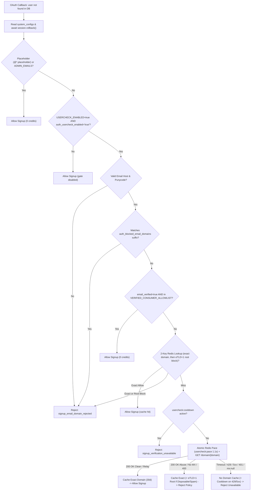

# UserCheck Email Domain Signup Gate

*   **Author:** Omarjan
*   **Status:** Approved for Implementation
*   **Date:** 2026-11-08

--------------------------------------------------------------------------------

## Overview

Kitabim authenticates readers exclusively through OAuth providers (Google and Facebook in production) and creates a new user record on first login. Attackers have begun registering OAuth accounts backed by disposable bulk-farm domains—such as `deodtbmtd38n6x@hhz.xintaitong.com`—to create fake accounts on production. This design introduces a pre-registration email domain gate (`services/backend/auth/email_domain_guard.py`) using the [UserCheck API](https://docs.usercheck.com) (`GET /domain/{domain}`) paired with offline `eTLD+1` extraction (`publicsuffix2`), Redis domain caching, fast-path allow/deny rules, a runtime Admin Panel kill-switch, and localized OAuth rejection messaging across desktop and mobile login flows.

## The Problem

When a user completes Google or Facebook login, [`oauth_callback`](../../../services/backend/api/endpoints/auth_router.py) checks only whether the OAuth provider marked the email address as verified. Because Google ("Use my current email address instead") and Facebook allow accounts to be created with any external mailbox that can receive a one-time code, bulk account sellers use wildcard disposable domains (such as `*.xintaitong.com`) to mint verified OAuth accounts in volume. Once inside Kitabim, fake accounts can consume paid Gemini RAG chat quotas and distort user metrics.

Calling UserCheck directly on every new login introduces three operational problems:

1.  **Free-tier quota exhaustion under randomized subdomains**: Kitabim uses UserCheck's free plan (1,000 requests/month and 1 request/second). Because farms rotate random subdomains (`a1.xintaitong.com`, `a2.xintaitong.com`, …), UserCheck's `GET /domain/{domain}` returns the queried hostname itself (`response["domain"] == "a1.xintaitong.com"`), and Kitabim fails closed when UserCheck returns `429` or `5xx`, caching only the queried subdomain lets a bot exhaust all 1,000 monthly credits in ~17 minutes and lock out new signups on uncached domains for the rest of the billing cycle.
2.  **No runtime operator recovery during upstream outages**: Relying only on static environment variables forces an administrator to SSH into the production VM and restart containers if UserCheck suffers an outage or exhausts monthly credits.
3.  **Silent login failures and wrong locale on desktop and mobile**: When [`_error_response`](../../../services/backend/api/endpoints/auth_router.py) rejects an OAuth callback today, the React frontend ([`useAuth.tsx`](../../../apps/frontend/src/hooks/useAuth.tsx)) never displays `state.error` to the user, Mobile Safari full-page redirects strand the user on a non-working `window.close()` button, and top-level browser redirects carry the OS `Accept-Language` header instead of the reader's selected Kitabim UI language (`ug` or `en`).

## Goals

*   **Block disposable, spam, and unroutable signup domains**: Reject new OAuth account creation when UserCheck flags a domain with `disposable: true`, `spam: true`, `blocklisted: true` (Pro-tier field; `false` on Free tier), `mx: false`, or `free_subdomain: true` (when `relay_domain` is `false`), or when the domain matches the `auth_blocked_email_domains` suffix denylist in `system_configs` (seeded with `"xintaitong.com"` and editable in the Admin Panel).
*   **Preserve privacy-relay and existing-user access**: Allow privacy-forwarding email relays (`relay_domain: true`, such as Apple Hide My Email or DuckDuckGo aliases) when no abuse flag is set, allow Facebook hidden-email logins (`@facebook.placeholder`), and skip domain checks for returning users.
*   **Protect the 1,000/month and 1 req/sec free-tier quota**: Keep verified mainstream consumer mailbox providers (`VERIFIED_CONSUMER_ALLOWLIST`) and `ADMIN_EMAILS` at zero UserCheck credit cost, extract registrable `eTLD+1` roots locally via bundled `publicsuffix2` so disposable/spam parent domains are cached in Redis for 30 days (capping randomized subdomain farms at 1 credit per root domain), and pace uncached lookups via an atomic Redis key so bursts do not trigger `429` rejections or Cloudflare IP bans.
*   **Fail closed with zero pooled DB hold time and a runtime Admin Panel override**: Release the SQLAlchemy transaction before external I/O so awaiting UserCheck holds zero pooled Cloud SQL connections, reject new signups (without caching domain verdicts) when UserCheck times out (`3.0s`), returns `5xx`/`4xx`, returns `mx: null`, or hits `429`, and allow admins to disable UserCheck checks at runtime via `auth_usercheck_enabled` in `system_configs` without restarting containers.
*   **Prevent silent production API-key misconfiguration**: Separate `USERCHECK_ENABLED` from `USERCHECK_API_KEY`, fail fast at startup if enabled in production with an empty/`"FILL_IN"` key, and verify the key against UserCheck's 0-credit `GET /status` endpoint (failing startup in production only on `401`/`403` invalid key, while logging a warning and continuing startup on upstream timeouts/`5xx`).
*   **Deliver localized UX and structured observability**: Display distinct English and Uyghur messages for domain-policy rejections versus temporary verification unavailability via a closed error-code allowlist across desktop popups and Mobile Safari redirects, and emit privacy-safe structured JSON audit logs.

## Non-Goals

*   **Retroactive database cleanup**: Auditing, disabling, or deleting existing accounts in the `users` table is out of scope; the gate runs strictly before `create_user` on new signups.
*   **Password or magic-link registration**: Kitabim supports OAuth login only; no email/password signup endpoints are added.
*   **Per-mailbox deliverability (`GET /email/{email}`)**: Sending full user email addresses to UserCheck is excluded for privacy and because OAuth providers already verify mailbox ownership when `email_verified` is `True`.
*   **Blocking hidden-email social accounts**: Blocking `@facebook.placeholder` logins when a Facebook user declines email sharing is out of scope.

## Open Questions

None.

## Critical User Journeys (CUJs)

1.  **CUJ 1 — Mainstream OAuth New Signup (`gmail.com`, `icloud.com`, `outlook.com`, `pm.me`)**:
    *   *Actor*: New reader signing up via Google or Facebook with a verified consumer mailbox in `VERIFIED_CONSUMER_ALLOWLIST`.
    *   *Journey*: `oauth_callback` sees no existing user, matches the verified domain against `VERIFIED_CONSUMER_ALLOWLIST`, skips UserCheck (0 credits, `< 1ms`), creates the user row, and signs the reader in.
2.  **CUJ 2 — Disposable Subdomain Farm Signup (`bot1@a1.tempfarm.example`, `bot2@b2.tempfarm.example`, or `hhz.xintaitong.com`)**:
    *   *Actor*: Automated/bulk account creator using a seeded blocked domain or a fresh wildcard disposable domain.
    *   *Journey*: Any `*.xintaitong.com` address matches `auth_blocked_email_domains` (`"xintaitong.com"`) and is rejected at 0 API credits. For a previously unseen farm `bot1@a1.tempfarm.example`, `email_domain_guard.py` extracts `root_domain = "tempfarm.example"` via `publicsuffix2`, misses Redis on both `a1.tempfarm.example` and `tempfarm.example`, queries `GET /domain/a1.tempfarm.example` (1 credit), receives `disposable: true` (`free_subdomain: false`), caches both `a1.tempfarm.example` and `tempfarm.example` as blocked for 30 days, and rejects signup with a visible localized toast. When `bot2@b2.tempfarm.example` attempts signup seconds later, the `tempfarm.example` root cache entry rejects it at 0 API credits.
3.  **CUJ 3 — Privacy Relay or Facebook No-Email Signup (`@privaterelay.appleid.com`, `@duck.com`, `@facebook.placeholder`)**:
    *   *Actor*: Privacy-conscious reader using an email forwarding alias or Facebook login without sharing an email address.
    *   *Journey*: `@facebook.placeholder` bypasses UserCheck (`reason="placeholder_email"`). `@privaterelay.appleid.com` returns `relay_domain: true, disposable: false, mx: true` from UserCheck, is cached as allowed for 30 days, and creates the reader's account.
4.  **CUJ 4 — UserCheck Outage / Quota Exhaustion & Runtime Admin Recovery**:
    *   *Actor*: Legitimate new reader on a custom corporate/university domain during a UserCheck `5xx` outage or `429` monthly credit exhaustion, followed by a Kitabim administrator.
    *   *Journey*: UserCheck times out (`3.0s`) or returns `429`; the gate does not cache a domain verdict, sets `usercheck:cooldown`, and displays the localized *"Sign-up verification is temporarily busy"* banner (returning users and `VERIFIED_CONSUMER_ALLOWLIST` signups continue unaffected). The administrator opens Admin Panel -> `System Configs` -> `Auth`, sets `auth_usercheck_enabled` to `"false"`, and new custom-domain signups resume without redeploying containers.

## Technical Plan (Architecture)

### 1. Component Boundaries

*   **`services/backend/auth/email_domain_guard.py` (New — Backend Auth Guard)**: Pure HTTP/Redis domain evaluation module (no SQLAlchemy `AsyncSession` dependency). Owns email domain normalization, offline `eTLD+1` extraction via `publicsuffix2`, `VERIFIED_CONSUMER_ALLOWLIST`, `auth_blocked_email_domains` suffix matching, two-key Redis verdict caching via [`cache_service`](../../../packages/backend-core/app/services/cache_service.py), atomic Redis 1 req/sec pacing (`usercheck:pace`) and cooldown (`usercheck:cooldown`), scoped `httpx.AsyncClient` calls to [UserCheck](https://docs.usercheck.com) (`GET /domain/{domain}` and startup `GET /status`), and structured JSON audit logging via [`log_json`](../../../packages/backend-core/app/utils/observability.py) and [`hash_ip_if_present`](../../../packages/backend-core/app/utils/security.py).
*   **[`services/backend/auth/oauth_providers.py`](../../../services/backend/auth/oauth_providers.py)**: Exports canonical `PLACEHOLDER_EMAIL_DOMAINS` and `is_placeholder_email(email, provider=None)` shared by `auth_router.py` and `email_domain_guard.py`.
*   **[`services/backend/api/endpoints/auth_router.py`](../../../services/backend/api/endpoints/auth_router.py)**: Inside `oauth_callback` (`if not user:`), reads `auth_usercheck_enabled` and `auth_blocked_email_domains` via [`SystemConfigsRepository`](../../../packages/backend-core/app/db/repositories/system_configs_repository.py), calls `await session.rollback()` so zero pooled DB connections remain checked out, invokes `evaluate_signup_email_domain(...)`, and returns localized `_error_response` payloads carrying a closed `AuthErrorCode` (`BroadcastChannel` + validated Mobile Safari `?auth_error=<error_code>` redirect). Public `GET /api/auth/health` remains unchanged.
*   **[`packages/backend-core/app/core/config.py`](../../../packages/backend-core/app/core/config.py), [`cache_config.py`](../../../packages/backend-core/app/core/cache_config.py), & [`seeds.py`](../../../packages/backend-core/app/db/seeds.py)**: Defines `usercheck_enabled: bool` (`False`) and `usercheck_api_key: str` (`""`) in `Settings`; defines `TTL_USERCHECK_DOMAIN = 2592000` (30 days), `TTL_USERCHECK_NEGATIVE_MX = 7200` (2 hours), `KEY_USERCHECK_DOMAIN`, `KEY_USERCHECK_COOLDOWN`, and `KEY_USERCHECK_PACE` in `cache_config.py` (excluded from [`cache_router.py`](../../../services/backend/api/endpoints/cache_router.py) admin flushes); seeds `auth_usercheck_enabled="true"` and `auth_blocked_email_domains="xintaitong.com"` in `seeds.py`.
*   **Frontend Auth Error Pipeline ([`authService.ts`](../../../apps/frontend/src/services/authService.ts), [`useAuth.tsx`](../../../apps/frontend/src/hooks/useAuth.tsx), [`App.tsx`](../../../apps/frontend/src/App.tsx), [`SystemConfigPanel.tsx`](../../../apps/frontend/src/components/admin/config/SystemConfigPanel.tsx), & [`apps/frontend/src/locales/`](../../../apps/frontend/src/locales/en.json))**: Relays validated `AuthErrorCode` values from `BroadcastChannel('kitabim_auth')`, `postMessage`, and Mobile Safari `?auth_error=` redirects, translates them into the reader's active Kitabim UI language (`ug` or `en`) via [`I18nContext.tsx`](../../../apps/frontend/src/i18n/I18nContext.tsx), and displays them via [`NotificationContext.tsx`](../../../apps/frontend/src/context/NotificationContext.tsx). Adds an `Auth` (`auth_`) category filter tab in `SystemConfigPanel.tsx`.

### 2. Evaluation Pipeline & Data Flow

### 3. Domain Policy, Allowlist, Truth Table, and Subdomain Caching

*   **Closed Verified Consumer Allowlist (`VERIFIED_CONSUMER_ALLOWLIST`)**: Requires `email_verified is True` and exact match against `gmail.com`, `googlemail.com`, `icloud.com`, `me.com`, `mac.com`, `outlook.com`, `hotmail.com`, `live.com`, `msn.com`, `yahoo.com`, `proton.me`, `protonmail.com`, `pm.me`, `yandex.com`, `yandex.ru`, `mail.ru`, `qq.com`, or `163.com`.
*   **Two-Key Asymmetric Redis Lookup (`publicsuffix2`)**: Compute `root_domain = publicsuffix2.get_sld(domain)` offline (zero network I/O). Check `usercheck:domain:{domain}` first (honoring both `"allow"` and `"reject_policy"`). On miss, if `root_domain` is non-empty and `root_domain != domain`, check `usercheck:domain:{root_domain}` and honor **only** `"reject_policy"` with `reason in {"disposable", "spam", "blocklisted"}` (never `"allow"`, so a cached clean root `university.edu` never auto-allows an unverified child `temp.university.edu`).
*   **UserCheck Response Truth Table & Cache TTLs**:

    | Upstream Outcome | Gate Decision | Domain Redis Cache Write | Cooldown Write |
    | :--- | :--- | :--- | :--- |
    | `200` with `disposable` or `spam` or `blocklisted` | `reject_policy` | `domain` (`30d`); also `root_domain` (`30d`) when `not free_subdomain` | None |
    | `200` with `free_subdomain: true` and `relay_domain: false` | `reject_policy` | `domain` (`30d`) only (never shared multi-tenant parent) | None |
    | `200` with `mx: false` | `reject_policy` | `domain` (`2h` — tolerates transient DNS propagation) | None |
    | `200` with `mx: null` (DNS lookup incomplete) | `reject_unavailable` | **None** | None |
    | `200` with `relay_domain: true` and `mx: true` (no abuse flags) | `allow` | `domain` (`30d`) | None |
    | `200` clean (`mx: true`, all abuse flags `false`) | `allow` | `domain` (`30d`) | None |
    | `400` (UserCheck syntactically invalid domain) | `reject_policy` | `domain` (`30d`) | None |
    | `429` (1 req/sec burst, monthly quota exhausted, or IP block) | `reject_unavailable` | **None** | `Retry-After` clamped `60..3600s` (default `300s` if header absent) |
    | `401` / `403` / `5xx` / timeout (`3.0s`) / JSON error | `reject_unavailable` | **None** | `15s` on `5xx` / timeout |

### 4. Concurrency Pacing, Connection Pool Safety, and Startup Validation

*   **Zero Pooled DB Connections During External Waits**: `oauth_callback` fetches `auth_usercheck_enabled` and `auth_blocked_email_domains` before calling `await session.rollback()`, guaranteeing that zero connections from the 10-connection Cloud SQL pool remain checked out while pacing or awaiting UserCheck.
*   **Atomic Redis Pacing (`<= 4.1s` Worst-Case Latency)**: Uncached lookups acquire `SET {prefix}usercheck:pace 1 NX PX 1100` in Redis. If already held, the coroutine sleeps `1.1s` **at most once**, re-checks the Redis domain cache and `usercheck:cooldown` (benefiting from singleflight hits if Request #1 cached the same domain or `eTLD+1` root), and attempts `SET NX PX 1100` once more—returning `reject_unavailable` (`reason="pacing_contended"`) immediately if still contended. Combined with `httpx.Timeout(3.0, connect=2.0)` and zero retries, worst-case callback latency is bounded to `<= 4.1s`.
*   **Startup Key Validation (`GET /status`)**: Because `GET /domain/{domain}` serves up to 5 unauthenticated requests/hour/IP with `200 OK` before returning `429`, `lifespan` in [`main.py`](../../../services/backend/main.py) runs synchronous `validate_usercheck_config()` (failing fast in `production` on empty/`"FILL_IN"` keys) followed by a `3.0s` startup probe against UserCheck's 0-credit `GET /status` endpoint when enabled: raising `RuntimeError` in `production` **only** on HTTP `401`/`403` (invalid/revoked key), logging `monthly_credits_remaining` (`usage.remaining`) on `200 OK`, and logging `WARNING` without aborting startup on network timeouts/`5xx`.

### 5. Closed-Enum Frontend Error UX and Structured Telemetry

*   **Closed `AuthErrorCode` Delivery**: `_error_response` emits `{ type: "OAUTH_ERROR", error: message, errorCode }` on `window.opener.postMessage` and `BroadcastChannel("kitabim_auth")`. On Mobile Safari full-page redirects (when `saved_state.redirect_uri` is non-null and validated via `_is_allowed_redirect_uri`), `_error_response` merges `?auth_error=<errorCode>` onto `redirect_uri` and navigates back; on desktop popups (`redirect_uri` is `None`), it never auto-redirects (avoiding duplicate SPA rendering inside COOP-severed popups). React validates `errorCode` against a closed 6-code allowlist (preventing reflected URL message spoofing) and translates it via `useI18n()` into the reader's active Kitabim UI language (`ug` or `en`).
*   **Audit Telemetry**: Every signup domain evaluation logs a structured JSON event on `app.auth.usercheck` via `log_json` containing `provider`, `domain`, `root_domain`, `decision`, `reason`, `cache_status`, `latency_ms`, `rate_limit_remaining` (`X-RateLimit-Remaining`), and `ip_hash` (`hash_ip_if_present(client_ip)`), omitting email local-parts, raw IPs, and API keys.

## Risks & Mitigations

*   **Redis Eviction (`allkeys-lru`) or Redis Outage**: Production Redis runs with `512mb` `allkeys-lru`, and `CacheService` returns `None`/`False` when its circuit breaker opens. At `< 120 bytes` per cached domain, 10,000 domains occupy `< 1.5 MB`. If Redis is unreachable (`get_redis()` raises on `usercheck:pace`), `email_domain_guard.py` catches the Redis error, logs `WARNING`, and still executes the single `3.0s` UserCheck check rather than silently allowing disposable domains; if UserCheck also hits `429`, fail-closed rejects until Redis or `auth_usercheck_enabled="false"` intervenes.
*   **Uncached Burst Contention (>2 Simultaneous Novel Domains/Second)**: Because the atomic Redis pace key allows at most one `1.1s` retry before failing closed (`pacing_contended`), a sudden burst of 3+ simultaneous signups on *distinct uncached non-allowlisted* domains within 1 second will reject the 3rd concurrent caller with the temporary *"Sign-up verification is temporarily busy"* toast. Mainstream consumer providers (`VERIFIED_CONSUMER_ALLOWLIST`) and returning users are unaffected, and retrying moments later succeeds (or hits the newly populated cache).
*   **Unlisted Regional/Institutional Domains During Monthly Credit Exhaustion**: If all 1,000 monthly credits are exhausted, fail-closed blocks new signups on uncached university or corporate domains while `VERIFIED_CONSUMER_ALLOWLIST` continues at 0 credits. Mitigation: `GET /status` logs remaining monthly credits at startup, `429` events emit `WARNING` structured logs, and operators can toggle `auth_usercheck_enabled="false"` in Admin Panel -> `System Configs` -> `Auth`.
*   **Facebook Hidden-Email (`@facebook.placeholder`) Abuse**: Allowing `@facebook.placeholder` preserves login for privacy-conscious Facebook users but could be abused if attackers switch to email-less Facebook accounts. Mitigation: `app.auth.usercheck` logs every `reason="placeholder_email"` signup with `ip_hash` so operators can detect volume spikes without breaking Facebook login preemptively.

## Alternatives Considered

### Alternative A: Maintaining Only a Manual Domain Blocklist in Code or Database

*   **Pros**: Zero external network dependency, zero latency, and no third-party API quota limits.
*   **Cons**: Disposable email providers register new domains continuously; manual blocklists always lag behind new bulk-signup campaigns.
*   **Reason for Rejection**: Reactive-only maintenance leaves production exposed to every newly registered disposable domain until an admin manually notices fake accounts.

### Alternative B: Failing Open When UserCheck Times Out or Exhausts Quota

*   **Pros**: Never delays or rejects a legitimate user on a custom domain during a UserCheck outage or monthly credit exhaustion.
*   **Cons**: Allows an attacker who triggers or waits for free-tier rate limits (`1 req/sec` or `1,000 req/month`) to bypass the signup gate completely.
*   **Reason for Rejection**: Rejected per security policy. Pairing fail-closed behavior with an expanded `VERIFIED_CONSUMER_ALLOWLIST` (estimated to cover the vast majority of legitimate signups at 0 credits), 30-day `eTLD+1` caching, and the runtime `auth_usercheck_enabled` Admin Panel kill-switch protects security without trapping operators.

### Alternative C: Calling UserCheck's Full Email Endpoint (`GET /email/{email}`)

*   **Pros**: Evaluates local-part syntax/aliasing in addition to domain flags in a single call.
*   **Cons**: Sends user PII (full email addresses) to a third-party vendor and prevents sharing a single Redis cache entry across multiple users on the same custom domain.
*   **Reason for Rejection**: Domain-level reputation flags (`GET /domain/{domain}`) satisfy the signup gate requirements with better privacy and higher Redis cache hit rates.

### Alternative D: Skipping the Local `system_configs` Blocklist (`auth_blocked_email_domains`)

*   **Pros**: Avoids maintaining a second domain list alongside UserCheck.
*   **Cons**: Leaves admins unable to block a newly observed abusive domain that UserCheck has not yet classified as disposable, and removes zero-credit local blocking when `auth_usercheck_enabled` is temporarily set to `"false"`.
*   **Reason for Rejection**: Keeping `auth_blocked_email_domains` in `system_configs` (seeded with `"xintaitong.com"`) complements live UserCheck domain lookups and gives admins immediate domain-level control.

### Alternative E: Relying on `response["domain"]` or `tldextract` Instead of `publicsuffix2`

*   **Pros**: Reading `response["domain"]` requires zero dependencies; `tldextract` is widely known.
*   **Cons**: UserCheck's `response["domain"]` echoes the normalized queried subdomain (`"a1.tempfarm.example"`), not the registrable `eTLD+1` root, leaving subdomain farms uncached; `tldextract` pulls in `requests`, `requests-file`, `filelock`, and live HTTP PSL fetch defaults unless explicitly disabled.
*   **Reason for Rejection**: `publicsuffix2` is a tiny pure-Python package with a bundled PSL list and zero network/filesystem side effects, enabling deterministic offline `eTLD+1` extraction in `services/backend/` only.

### Alternative F: Controlling the Gate Solely Through Static `.env` Variables

*   **Pros**: Slightly simpler runtime path (no `system_configs` read).
*   **Cons**: Recovering from a UserCheck outage or exhausted 1,000/month quota under fail-closed requires SSH access to the Compute Engine VM, editing `deploy/gcp/.env`, and restarting the `backend` container.
*   **Reason for Rejection**: Pairing startup `USERCHECK_ENABLED` validation with `auth_usercheck_enabled` in `system_configs` provides runtime Admin Panel recovery backed by the existing Redis-cached config read.

### Alternative G: Placing the Domain Guard in `packages/backend-core/app/services/`

*   **Pros**: Makes the domain guard directly importable from `scripts/` or other services that depend on `backend-core`.
*   **Cons**: Splits OAuth signup policy across `packages/backend-core` and `services/backend/auth/` (`is_admin_email`, OAuth providers) and ships auth-only code (and `publicsuffix2`) inside `services/worker/`, which never processes OAuth logins.
*   **Reason for Rejection**: Keeping `email_domain_guard.py` in `services/backend/auth/` colocates all OAuth signup rules in one service boundary with zero impact on `services/worker/`.

--------------------------------------------------------------------------------

## Non-Functional Requirements

*   **Security & Privacy**:
    *   UserCheck receives only the normalized domain portion of an email (`GET /domain/{domain}`), never the user's email local-part, name, or IP address.
    *   Structured logs record `hash_ip_if_present(client_ip)` and the domain name, never raw IP addresses, raw email addresses, or `USERCHECK_API_KEY`.
    *   Domain strings are Punycode-encoded, validated against a strict hostname regex, and URL-quoted (`quote(domain, safe="")`) before path interpolation with `Authorization: Bearer <USERCHECK_API_KEY>`.
    *   Frontend `?auth_error=` query parameters accept only a closed 6-code `AuthErrorCode` allowlist, eliminating reflected UI message spoofing.
*   **Performance, Latency, & Quota Budget**:
    *   `VERIFIED_CONSUMER_ALLOWLIST` domains and Redis cache hits complete in `< 5ms` with 0 external HTTP calls.
    *   Uncached UserCheck misses enforce `httpx.Timeout(3.0, connect=2.0)` plus at most one `1.1s` Redis pace wait, bounding worst-case callback overhead to `<= 4.1s` while holding zero pooled Cloud SQL connections.
    *   Cached Redis entries store compact JSON verdicts (`< 120 bytes` per domain; 10,000 domains `< 1.5 MB` inside the `512 MB` Redis budget).
*   **Rollout & Rollback**:
    *   Local development and automated test suites default to `USERCHECK_ENABLED=false`, requiring no external API key.
    *   Production rollout sets `ENVIRONMENT=production`, `USERCHECK_ENABLED=true`, `USERCHECK_API_KEY`, and `IP_SALT` in `deploy/gcp/.env` prior to running `./deploy/gcp/scripts/deploy.sh`.
    *   Runtime rollback without container restart is performed by setting `auth_usercheck_enabled` to `"false"` in the Admin Panel (`System Configs` -> `Auth` tab; takes effect immediately via `SystemConfigsRepository.set_value` cache invalidation).

--------------------------------------------------------------------------------

## Detailed Implementation Plan

### Execution Phases & Checkpoints

*   **Phase 1 — Dependencies, Config, Cache Keys, DB Seeds, & Env Templates** (Items 1–6): Verify with `PYTHONPATH=packages/backend-core:services/backend pytest packages/backend-core/tests`.
*   **Phase 2 — Placeholder Helper, Domain Guard, Startup Probe, & Guard Unit Tests** (Items 7–9, 17–18): Verify with `PYTHONPATH=packages/backend-core:services/backend pytest services/backend/tests/auth/oauth_providers_test.py services/backend/tests/auth/email_domain_guard_test.py`.
*   **Phase 3 — Backend Locales, OAuth Router Integration, & Router Unit Tests** (Items 10–12, 19): Verify with `PYTHONPATH=packages/backend-core:services/backend pytest services/backend/tests/api/endpoints/auth_router_test.py` and JSON locale parity check.
*   **Phase 4 — Frontend Error Code Localization, Toast Surfacing, Admin Tab, & Vitest/Build** (Items 13–16, 20): Verify with `cd apps/frontend && npx vitest run src/tests/services/authService.test.ts && npm run build`.
*   **Phase 5 — Module `README.md` Indexes & Docker Compose Integration** (Item 21 + Verification Plan): Rebuild `backend` and `frontend` via `./deploy/local/rebuild-and-restart.sh` and verify container startup logs and PostgreSQL `system_configs`.

### Target Files to Create/Modify

#### 1. `services/backend/requirements.txt` (Modify)

*   **Type / Scope**: Backend Python Dependencies
*   **Proposed Changes**: Append `publicsuffix2>=2.20191221`. Rationale: provides offline-bundled Public Suffix List `eTLD+1` extraction (`publicsuffix2.get_sld`) in the backend container without adding dependencies to `services/worker/`.

#### 2. `packages/backend-core/app/core/config.py` (Modify)

*   **Type / Scope**: Python Configuration (`Settings` frozen dataclass)
*   **Proposed Changes**: Add two fields to `Settings`: `usercheck_enabled: bool = field(default_factory=lambda: _env_bool("USERCHECK_ENABLED", False))` and `usercheck_api_key: str = field(default_factory=lambda: _env("USERCHECK_API_KEY", ""))`. Rationale: separates static feature activation from the API credential while keeping protocol constants out of `.env` sprawl.

#### 3. `packages/backend-core/app/core/cache_config.py` (Modify)

*   **Type / Scope**: Python Cache Constants
*   **Proposed Changes**: Add `TTL_USERCHECK_DOMAIN = 2592000` (30 days), `TTL_USERCHECK_NEGATIVE_MX = 7200` (2 hours), `KEY_USERCHECK_DOMAIN = "usercheck:domain:{domain}"`, `KEY_USERCHECK_COOLDOWN = "usercheck:cooldown"`, and `KEY_USERCHECK_PACE = "usercheck:pace"`. Keep these patterns out of `services/backend/api/endpoints/cache_router.py` so admin cache flushes never wipe cached domain verdicts. Rationale: centralizes Redis key namespaces and explicit TTLs alongside existing `KEY_*` constants.

#### 4. `packages/backend-core/app/db/seeds.py` (Modify)

*   **Type / Scope**: Database System Config Seeds
*   **Proposed Changes**: Append two entries to the `defaults` list in `seed_system_configs`:
    *   `{"key": "auth_usercheck_enabled", "value": "true", "description": "Enable pre-signup UserCheck email domain verification when USERCHECK_ENABLED=true (true/false)"}`
    *   `{"key": "auth_blocked_email_domains", "value": "xintaitong.com", "description": "Comma-separated root email domains blocked from new OAuth signups (matches exact domain and subdomains)"}`
    *   Rationale: provides runtime disable without container restart and seeds the observed bulk-farm domain in an admin-editable config row.

#### 5. `.env.template` (Modify)

*   **Type / Scope**: Local Environment Template
*   **Proposed Changes**: Add a `# --- UserCheck Email Domain Verification (Optional in Local Dev) ---` block defining `USERCHECK_ENABLED=false` and `USERCHECK_API_KEY=`. Rationale: lets local Docker Compose and test suites run without an API key.

#### 6. `deploy/gcp/.env.template` (Modify)

*   **Type / Scope**: Production Environment Template
*   **Proposed Changes**: Add `ENVIRONMENT=production`, `IP_SALT=FILL_IN`, Facebook OAuth placeholders (`FACEBOOK_CLIENT_ID=FILL_IN`, `FACEBOOK_CLIENT_SECRET=FILL_IN`, `FACEBOOK_REDIRECT_URI=https://kitabim.ai/api/auth/facebook/callback`), and a `# ─── UserCheck Email Domain Gate ───` section defining `USERCHECK_ENABLED=true` and `USERCHECK_API_KEY=FILL_IN`. Rationale: ensures production startup checks run under `ENVIRONMENT=production`, hashes client IPs with a non-empty salt, and documents all active OAuth/UserCheck secrets.

#### 7. `services/backend/auth/oauth_providers.py` (Modify)

*   **Type / Scope**: Python Auth Helper Module
*   **Proposed Changes**: Define `PLACEHOLDER_EMAIL_DOMAINS: frozenset[str] = frozenset({"facebook.placeholder", "twitter.placeholder", "instagram.placeholder"})` and `is_placeholder_email(email: str, provider: Optional[str] = None) -> bool`:
    *   Extract `local, sep, host = email.strip().lower().rpartition("@")`; return `False` if `not sep or not local or "@" in local`.
    *   When `provider is None`, return `host in PLACEHOLDER_EMAIL_DOMAINS`.
    *   When `provider` is passed, normalize `p = provider.strip().lower()` and return `p in {"facebook", "twitter", "instagram"} and host == f"{p}.placeholder"`.
    *   Rationale: replaces duplicated inline `.endswith(...)` tuples in `auth_router.py` while keeping cross-provider linking protection (`provider=None`) distinct from per-provider login checks (`provider=provider`).

#### 8. `services/backend/auth/email_domain_guard.py` (Create)

*   **Type / Scope**: Python Backend Auth Domain Validation Guard
*   **Proposed Changes**: Create the DB-free email-domain signup gate module exposing:
    *   Constants: `USERCHECK_BASE_URL = "https://api.usercheck.com"`, `USERCHECK_TIMEOUT_SECONDS = 3.0`, and `VERIFIED_CONSUMER_ALLOWLIST: frozenset[str]` (`gmail.com`, `googlemail.com`, `icloud.com`, `me.com`, `mac.com`, `outlook.com`, `hotmail.com`, `live.com`, `msn.com`, `yahoo.com`, `proton.me`, `protonmail.com`, `pm.me`, `yandex.com`, `yandex.ru`, `mail.ru`, `qq.com`, `163.com`).
    *   Types: `GateStatus = Literal["allow", "reject_policy", "reject_unavailable"]`, `CacheStatus = Literal["bypass", "hit_exact", "hit_parent", "miss"]`, and frozen dataclass `DomainGateDecision(status: GateStatus, reason: str, domain: str, root_domain: Optional[str] = None, cache_status: CacheStatus = "bypass")`.
    *   Canonical `reason` values: `"placeholder_email"`, `"admin_email"`, `"gate_disabled"`, `"invalid_domain"`, `"blocked_domain_config"`, `"trusted_provider"`, `"disposable"`, `"spam"`, `"blocklisted"`, `"free_subdomain"`, `"mx_false"`, `"upstream_bad_request"`, `"relay_domain"`, `"clean"`, `"cooldown_active"`, `"pacing_contended"`, `"mx_inconclusive"`, `"rate_limited"`, `"upstream_error"`, `"upstream_timeout"`.
    *   `validate_usercheck_config() -> None`: raises `ValueError` if `settings.usercheck_enabled` is `True` and `settings.usercheck_api_key.strip()` is empty or `"FILL_IN"`.
    *   `probe_usercheck_status() -> Optional[int]`: when `settings.usercheck_enabled` is `True`, performs a single `httpx.AsyncClient(base_url=USERCHECK_BASE_URL, timeout=httpx.Timeout(3.0, connect=2.0))` call to `GET /status` with `Authorization: Bearer {settings.usercheck_api_key.strip()}` and `Accept: application/json`. Raises `PermissionError` on HTTP `401`/`403`, returns `data.get("usage", {}).get("remaining")` on `200 OK`, and logs `WARNING` returning `None` on timeouts/`5xx`.
    *   `evaluate_signup_email_domain(*, email: str, provider: str, email_verified: bool, auth_usercheck_enabled_raw: Optional[str] = "true", blocked_domains_raw: Optional[str] = "", client_ip: Optional[str] = None) -> DomainGateDecision`:
        1.  Bypass (`"allow"`) for `is_placeholder_email(email, provider=provider)` (`reason="placeholder_email"`) and `is_admin_email(email)` (`reason="admin_email"`).
        2.  Normalize `local, sep, raw_host = email.strip().lower().rpartition("@")`; reject (`"reject_policy"`, `reason="invalid_domain"`) if `not sep or not local or "@" in local`, if `raw_host.rstrip(".").encode("idna").decode("ascii")` raises `UnicodeError`, or if the Punycode domain fails `^(?=.{1,253}$)[a-z0-9](?:[a-z0-9-]{0,61}[a-z0-9])?(?:\.[a-z0-9](?:[a-z0-9-]{0,61}[a-z0-9])?)+$`.
        3.  Parse `blocked_domains_raw` (splitting on `,` and whitespace, stripping `@`, leading `*.`, trailing `.`, and Punycode-encoding valid entries); if `domain == entry or domain.endswith(f".{entry}")`, return `"reject_policy"` (`reason="blocked_domain_config"`).
        4.  Check activation: if `not settings.usercheck_enabled` or `(auth_usercheck_enabled_raw or "true").strip().lower() not in {"true", "1", "yes"}`, return `"allow"` (`reason="gate_disabled"`).
        5.  If `email_verified is True` and `domain in VERIFIED_CONSUMER_ALLOWLIST`, return `"allow"` (`reason="trusted_provider"`).
        6.  Compute `root_domain = publicsuffix2.get_sld(domain) or domain`. Query `cache_service.get(KEY_USERCHECK_DOMAIN.format(domain=domain))` (`{"status": "allow" | "reject_policy", "reason": str, "root_domain": str | None}`); on miss and `root_domain != domain`, query `cache_service.get(KEY_USERCHECK_DOMAIN.format(domain=root_domain))` honoring only `status == "reject_policy"` with `reason in {"disposable", "spam", "blocklisted"}` (`cache_status="hit_parent"`).
        7.  Check `cache_service.get(KEY_USERCHECK_COOLDOWN)` (`reason="cooldown_active"` -> `"reject_unavailable"`). Acquire atomic pace lock via `get_redis().set(f"{settings.redis_cache_key_prefix}{KEY_USERCHECK_PACE}", "1", nx=True, px=1100)` (catching Redis errors gracefully with a `WARNING` log); if contended, `await asyncio.sleep(1.1)` once, re-check the 2-key domain cache and `KEY_USERCHECK_COOLDOWN`, and attempt `set(..., nx=True, px=1100)` once more—returning `"reject_unavailable"` (`reason="pacing_contended"`) if still contended.
        8.  Call `GET /domain/{quote(domain, safe="")}` via scoped `async with httpx.AsyncClient(base_url=USERCHECK_BASE_URL, timeout=httpx.Timeout(USERCHECK_TIMEOUT_SECONDS, connect=2.0)) as client:` with `Authorization: Bearer {settings.usercheck_api_key.strip()}` and `Accept: application/json`, evaluate the Section 3 truth table (`disposable` > `spam` > `blocklisted` precedence; catching `httpx.TimeoutException`, `httpx.HTTPError`, and `ValueError`/`JSONDecodeError`), write Redis domain verdicts (`TTL_USERCHECK_DOMAIN` or `TTL_USERCHECK_NEGATIVE_MX`) or `KEY_USERCHECK_COOLDOWN` (`Retry-After` integer clamped `60..3600s` or `300s` default on `429`; `15s` on `5xx`/timeout), and emit `log_json` on logger `app.auth.usercheck`.
    *   Rationale: isolates UserCheck wire rules, offline `eTLD+1` caching, and Redis pacing behind a typed, DB-free module interface.

#### 9. `services/backend/main.py` (Modify)

*   **Type / Scope**: FastAPI Application Lifespan
*   **Proposed Changes**: In `lifespan(app)`, call `validate_usercheck_config()`: on `ValueError`, raise `RuntimeError` when `settings.environment == "production"` or log an `ERROR` via `log_json` in non-production (mirroring `validate_jwt_secret()`). When `settings.usercheck_enabled` is `True` and config validation succeeds, `await probe_usercheck_status()`: on `PermissionError`, raise `RuntimeError` in `production` or log `ERROR` in non-production. Emit an `INFO` `log_json` event on `app.startup` recording `usercheck_enabled` and `monthly_credits_remaining`. Rationale: detects missing or invalid API keys at startup without crash-looping production if UserCheck has a transient `5xx` outage.

#### 10. `services/backend/api/endpoints/auth_router.py` (Modify)

*   **Type / Scope**: FastAPI OAuth Callback Endpoint
*   **Proposed Changes**:
    *   Normalize `normalized_email = user_info.email.strip().lower()` once after `oauth_provider.get_user_info(access_token)`. Use `is_placeholder_email(normalized_email, provider=provider)` at the unverified-email check, use `not is_placeholder_email(normalized_email)` (`provider=None`) at the cross-provider email-linking check, and pass `normalized_email` to `get_user_by_email`, `is_admin_email`, and `create_user`.
    *   Inside `if not user:` (before `create_user`), read `auth_enabled = await SystemConfigsRepository(session).get_value("auth_usercheck_enabled", "true")` and `blocked_raw = await SystemConfigsRepository(session).get_value("auth_blocked_email_domains", "")`, call `await session.rollback()`, and await `evaluate_signup_email_domain(email=normalized_email, provider=provider, email_verified=user_info.email_verified, auth_usercheck_enabled_raw=auth_enabled, blocked_domains_raw=blocked_raw, client_ip=client_ip)`.
    *   Map `decision.status == "reject_policy"` to `_error_response(t("errors.signup_email_domain_rejected"), error_code="signup_email_domain_rejected", redirect_uri=saved_state.redirect_uri)` and `"reject_unavailable"` to `_error_response(t("errors.signup_verification_unavailable"), error_code="signup_verification_unavailable", redirect_uri=saved_state.redirect_uri)`.
    *   Update all post-state `_error_response` call sites in `oauth_callback` (`no_access_token`, `email_not_verified`, `email_already_exists`, `account_disabled`, and `except Exception`, plus `if error:` when `state` decodes cleanly) to pass the matching `error_code` (`"oauth_login_failed"`, `"email_not_verified"`, `"email_already_exists"`, `"account_disabled"`) and `redirect_uri=saved_state.redirect_uri`.
    *   Update `_error_response(message: str, error_code: str = "oauth_login_failed", redirect_uri: Optional[str] = None) -> HTMLResponse`: emit `{ type: "OAUTH_ERROR", error: message, errorCode: error_code }` on both `window.opener.postMessage` and `BroadcastChannel("kitabim_auth")`. When `redirect_uri` is non-null and passes `_is_allowed_redirect_uri(redirect_uri)`, merge `auth_error=error_code` via `urlsplit`/`parse_qsl`/`urlencode`/`urlunsplit` and auto-redirect there after `1200ms` (with a visible link/button) when `!window.opener || window.opener.closed`. When `redirect_uri` is `None` (desktop popup), never auto-redirect; attempt `window.close()` after `BroadcastChannel` delivery and render a manual button (`window.close()` if opener exists, else `window.location.replace("/")`). Leave `GET /api/auth/health` unchanged.
    *   Rationale: enforces the signup gate with zero pooled DB hold time and fixes error transport across popups, COOP-severed popups, and Mobile Safari redirects.

#### 11. `services/backend/locales/en.json` (Modify)

*   **Type / Scope**: Backend English Localization Catalog
*   **Proposed Changes**: Under `"errors"`, add:
    *   `"oauth_login_failed": "Sign-in failed. Please try again."`
    *   `"signup_email_domain_rejected": "Temporary or unroutable email domains cannot be used to register. Please sign in with a standard email address."`
    *   `"signup_verification_unavailable": "Sign-up verification is temporarily busy. Please try again in a moment."`
    *   Rationale: provides fallback HTML copy for policy rejection, temporary unavailability, and generic OAuth callback failures.

#### 12. `services/backend/locales/ug.json` (Modify)

*   **Type / Scope**: Backend Uyghur Localization Catalog
*   **Proposed Changes**: Under `"errors"`, add exact matching Uyghur Arabic-script entries:
    *   `"oauth_login_failed": "كىرىش مەغلۇپ بولدى. قايتا سىناپ بېقىڭ."`
    *   `"signup_email_domain_rejected": "ۋاقىتلىق ياكى ئىناۋەتسىز ئېلخەت ئادرېسى بىلەن تىزىملاتقىلى بولمايدۇ. نورمال ئېلخەت ئادرېسىڭىز بىلەن كىرىڭ."`
    *   `"signup_verification_unavailable": "تىزىملىتىش دەلىللەش مۇلازىمىتى ۋاقتىنچە ئالدىراش. سەل تۇرۇپ قايتا سىناپ بېقىڭ."`
    *   Rationale: maintains 1:1 key parity with `en.json`.

#### 13. `apps/frontend/src/locales/en.json` & `apps/frontend/src/locales/ug.json` (Modify)

*   **Type / Scope**: Frontend English & Uyghur Localization Catalogs
*   **Proposed Changes**: Under `"auth"`, add an `"errors"` object with the 6 closed `AuthErrorCode` keys:
    *   `en.json`:
        *   `"signup_email_domain_rejected": "Temporary or unroutable email domains cannot be used to register. Please sign in with a standard email address."`
        *   `"signup_verification_unavailable": "Sign-up verification is temporarily busy. Please try again in a moment."`
        *   `"oauth_login_failed": "Sign-in failed. Please try again."`
        *   `"email_not_verified": "Your email address is not verified with the sign-in provider."`
        *   `"email_already_exists": "An account with this email already exists. Please sign in with your original provider."`
        *   `"account_disabled": "Your account has been disabled."`
    *   `ug.json`:
        *   `"signup_email_domain_rejected": "ۋاقىتلىق ياكى ئىناۋەتسىز ئېلخەت ئادرېسى بىلەن تىزىملاتقىلى بولمايدۇ. نورمال ئېلخەت ئادرېسىڭىز بىلەن كىرىڭ."`
        *   `"signup_verification_unavailable": "تىزىملىتىش دەلىللەش مۇلازىمىتى ۋاقتىنچە ئالدىراش. سەل تۇرۇپ قايتا سىناپ بېقىڭ."`
        *   `"oauth_login_failed": "كىرىش مەغلۇپ بولدى. قايتا سىناپ بېقىڭ."`
        *   `"email_not_verified": "ئېلخەت ئادرېسىڭىز كىرىش سۇپىسى تەرىپىدىن دەلىللەنمىگەن."`
        *   `"email_already_exists": "بۇ ئېلخەت ئادرېسى بىلەن ئاللىبۇرۇن ھېسابات بار. ئەسلىدىكى ئۇسۇل بىلەن كىرىڭ."`
        *   `"account_disabled": "ھېساباتىڭىز چەكلەنگەن."`
    *   Rationale: allows the React UI to display OAuth errors in the reader's selected `kitabim_language` (`ug` or `en`) regardless of browser/OS `Accept-Language`.

#### 14. `apps/frontend/src/services/authService.ts` (Modify)

*   **Type / Scope**: Frontend TypeScript Auth Service
*   **Proposed Changes**:
    *   Export `AuthErrorCode` union (`'signup_email_domain_rejected' | 'signup_verification_unavailable' | 'oauth_login_failed' | 'email_not_verified' | 'email_already_exists' | 'account_disabled'`), `isAuthErrorCode(value: unknown): value is AuthErrorCode`, and `OAuthCallbackError extends Error` (carrying `readonly errorCode: AuthErrorCode`).
    *   Export `consumeRedirectAuthError(): AuthErrorCode | null` and `clearConsumedRedirectAuthError(): void`: on first call per page load, reads `?auth_error=` from `window.location.search`, strips `auth_error` via `window.history.replaceState`, caches the validated `AuthErrorCode` in module state (returning `null` for any unknown value), and returns that cached code across React 19 `<StrictMode>` double-mounts until `clearConsumedRedirectAuthError()` is called.
    *   In `_loginWithProvider`, add a shared `failLogin(errorCode: AuthErrorCode, fallbackMessage?: string)` helper mirroring `finalizeLogin` (`if (messageReceived) return; messageReceived = true; clearInterval(checkInterval); authChannel?.close(); window.removeEventListener('message', handleMessage); popup.close(); reject(new OAuthCallbackError(errorCode, fallbackMessage))`), wire both `authChannel.onmessage` and `handleMessage` (`event.data?.type === 'OAUTH_ERROR'`) to `failLogin`, and resolve `null` (instead of rejecting) when the user closes the popup without an `OAUTH_ERROR`.
    *   Rationale: prevents leaked 500ms intervals, eliminates duplicate rejections, blocks URL error spoofing, survives `<StrictMode>` double-mounts, and treats voluntary popup closure as `null` cancellation.

#### 15. `apps/frontend/src/hooks/useAuth.tsx` (Modify)

*   **Type / Scope**: Frontend React Auth Context & Hook
*   **Proposed Changes**:
    *   Add `errorCode: AuthErrorCode | null` and `clearError: () => void` to `AuthState` / `AuthContextType`.
    *   Initialize `errorCode` from `consumeRedirectAuthError()` and preserve `prev.errorCode` across `initAuth()` completion (`!token` and `getCurrentUser()` branches) while keeping `error: null` on normal unauthenticated initial loads (instead of setting `'Session expired'` on mount).
    *   In `loginWithGoogle`, `loginWithFacebook`, and `loginWithTwitter` `catch` blocks, populate `errorCode: err instanceof OAuthCallbackError ? err.errorCode : 'oauth_login_failed'` (when `_loginWithProvider` resolves `null`, `if (user)` already skips state error updates). `clearError()` resets both `error` and `errorCode` to `null` and calls `clearConsumedRedirectAuthError()`.
    *   Rationale: forwards validated OAuth error codes to UI consumers without showing error toasts on normal guest loads or user-closed popups.

#### 16. `apps/frontend/src/App.tsx` & `apps/frontend/src/components/admin/config/SystemConfigPanel.tsx` (Modify)

*   **Type / Scope**: Frontend Root Content & Admin System Config Panel
*   **Proposed Changes**:
    *   In `AppContent` (`apps/frontend/src/App.tsx`), read `errorCode`, `error`, and `clearError` from `useAuth()`, `t` from `useI18n()`, and `addNotification` from `useNotification()`. In a `useEffect`, when `errorCode` is non-null, call `addNotification(t(\`auth.errors.${errorCode}\`), 'error')` and `clearError()`.
    *   In `apps/frontend/src/components/admin/config/SystemConfigPanel.tsx`, add `'auth'` to `FeatureGroup` and `{ id: 'auth', label: 'Auth', prefix: 'auth_', badgeBg: 'bg-cyan-50 dark:bg-cyan-950/40', badgeText: 'text-cyan-700 dark:text-cyan-400', badgeBorder: 'border-cyan-200 dark:border-cyan-900/40' }` to `FEATURE_GROUPS`.
    *   Rationale: displays localized OAuth error banners on desktop and mobile and surfaces `auth_usercheck_enabled` / `auth_blocked_email_domains` under a dedicated `Auth` filter tab in the Admin Panel.

#### 17. `services/backend/tests/auth/oauth_providers_test.py` (Modify)

*   **Type / Scope**: Backend Auth Helper Unit Tests (`pytest`)
*   **Proposed Changes**: Replace the placeholder `assert True` stub with unit tests for `is_placeholder_email` covering `provider=None` (cross-provider guard matching all `PLACEHOLDER_EMAIL_DOMAINS`), exact provider matching (`provider="facebook"` matching `@facebook.placeholder` and rejecting `@twitter.placeholder`), `provider="google"` always returning `False`, whitespace/case normalization, and malformed `@`-less strings. Rationale: verifies the shared predicate used by account-linking and UserCheck bypass checks.

#### 18. `services/backend/tests/auth/email_domain_guard_test.py` (Create)

*   **Type / Scope**: Backend Domain Guard Unit Tests (`pytest`)
*   **Proposed Changes**: Add async unit tests patching frozen `Settings` via `dataclasses.replace(settings, ...)` and mocking `httpx.AsyncClient`, `cache_service`, and `get_redis` to verify:
    *   Gate bypass when `USERCHECK_ENABLED=false` or `auth_usercheck_enabled="false"` (`"gate_disabled"`).
    *   Zero-credit fast-paths for `VERIFIED_CONSUMER_ALLOWLIST` (`email_verified=True` required; `email_verified=False` falls through to UserCheck), `ADMIN_EMAILS` (`"admin_email"`), and `@facebook.placeholder` (`"placeholder_email"`), plus `auth_blocked_email_domains` normalization (`*.xintaitong.com`, `@xintaitong.com`, `hhz.xintaitong.com`).
    *   Live UserCheck `200 OK` rejection on `bot1@a1.tempfarm.co.uk` (`disposable: true`, `free_subdomain: false`, `response["domain"] == "a1.tempfarm.co.uk"`), verifying `publicsuffix2` extracts `tempfarm.co.uk`, writes 30-day Redis entries for both `a1.tempfarm.co.uk` and `tempfarm.co.uk`, and blocks `bot2@b2.tempfarm.co.uk` via `cache_status="hit_parent"` with zero HTTP calls.
    *   Asymmetric parent-suffix rule: cached `"allow"` on `example.edu` does **not** skip UserCheck for `sub.example.edu`.
    *   `relay_domain: true` with `mx: true` (`privaterelay.appleid.com`) allowed; `free_subdomain: true` rejected when `relay_domain: false` (caching only subdomain, never root) and allowed when `relay_domain: true`.
    *   `mx: false` rejected with 2-hour TTL (`7200s`); `mx: null`, `429` (with and without `Retry-After`, verifying `300s` default cooldown), `503` (`15s` cooldown), `401`, and `httpx.ReadTimeout` rejected as `reject_unavailable` with **zero** domain cache writes.
    *   Atomic Redis pace contention (`usercheck:pace` single `1.1s` retry + `pacing_contended` on second miss).
    *   `@`-less input, `UnicodeError` Punycode labels (`a..b.com`), and path-injection hostnames (`evil.com/../status`) rejected as `invalid_domain`; `validate_usercheck_config()` and `probe_usercheck_status()` (`200`, `401`, timeout) behavior.

#### 19. `services/backend/tests/api/endpoints/auth_router_test.py` (Modify)

*   **Type / Scope**: Backend Endpoint Unit Tests (`pytest`)
*   **Proposed Changes**: Add tests verifying `oauth_callback` reads `system_configs` and calls `session.rollback()` before `evaluate_signup_email_domain`, blocks `create_user` and returns localized HTML with `errorCode` on `reject_policy` and `reject_unavailable`, skips `evaluate_signup_email_domain` for existing users, preserves cross-provider placeholder protection when `provider="google"`, and emits `BroadcastChannel` + validated `redirect_uri` `?auth_error=<error_code>` fallback in `_error_response` (without auto-redirecting when `redirect_uri` is `None`).

#### 20. `apps/frontend/src/tests/services/authService.test.ts` (Modify)

*   **Type / Scope**: Frontend Unit Tests (`vitest`)
*   **Proposed Changes**: Stub `BroadcastChannel` in the test suite and add tests covering `BroadcastChannel('kitabim_auth')` `OAUTH_ERROR` handling (`OAuthCallbackError` with `errorCode` and `clearInterval` cleanup), voluntary popup close resolving `null`, and `consumeRedirectAuthError()` allowlist validation, URL cleanup, and idempotency across double calls (`<StrictMode>`).

#### 21. Directory `README.md` Indexes (Modify)

*   **Type / Scope**: Directory `README.md` Indexes
*   **Proposed Changes**: Update module interface and side-effect entries in `packages/backend-core/app/core/README.md` (also updating stale `BaseSettings` text to `@dataclass(frozen=True) class Settings`), `packages/backend-core/app/db/README.md`, `services/backend/README.md`, `services/backend/auth/README.md`, `services/backend/api/endpoints/README.md`, `apps/frontend/src/services/README.md`, and `apps/frontend/src/hooks/README.md`. Rationale: keeps module `README.md` files aligned with the updated config fields, cache keys, seeds, lifespan startup probe, `email_domain_guard.py`, and frontend auth error hooks.

### Verification Plan

*   **Backend Auth & Guard Unit Tests**: `PYTHONPATH=packages/backend-core:services/backend pytest services/backend/tests/auth/oauth_providers_test.py services/backend/tests/auth/email_domain_guard_test.py services/backend/tests/api/endpoints/auth_router_test.py`
*   **Backend Core Regression Suite**: `PYTHONPATH=packages/backend-core pytest packages/backend-core/tests`
*   **Locale JSON & Key Parity Check**: `python3 -c 'import json; en=json.load(open("services/backend/locales/en.json")); ug=json.load(open("services/backend/locales/ug.json")); assert set(en["errors"]) == set(ug["errors"])'` (plus verifying `auth.errors` parity in `apps/frontend/src/locales/{en,ug}.json`).
*   **Frontend Unit Tests & TypeScript Build**: `cd apps/frontend && npx vitest run src/tests/services/authService.test.ts && npm run build`
*   **Docker Compose Integration Verification (per `AGENTS.md`)**: Rebuild and restart backend and frontend via `./deploy/local/rebuild-and-restart.sh backend` and `./deploy/local/rebuild-and-restart.sh frontend`, verify backend startup logs record the `app.startup` UserCheck gate status event, verify `GET http://localhost:30800/api/auth/health` returns an unchanged payload, and confirm `auth_usercheck_enabled` (`"true"`) and `auth_blocked_email_domains` (`"xintaitong.com"`) exist in PostgreSQL `system_configs`.

--------------------------------------------------------------------------------

<!-- Provenance: Indicates initial structural drafting via EGM. -->

*Drafted with EGM*
