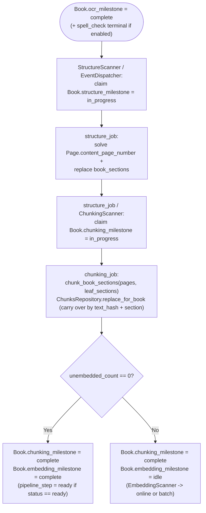

# Structure & Section-Stream Chunking — Design

See also: [WORKER_DESIGN.md](WORKER_DESIGN.md) for the full pipeline overview and [BOOK_PROCESSING_DIAGRAM.md](BOOK_PROCESSING_DIAGRAM.md) for the cross-stage diagram. Previous stage: [OCR_DESIGN.md](OCR_DESIGN.md). Next stage: [EMBEDDING_DESIGN.md](EMBEDDING_DESIGN.md).

## Overview

Once a book finishes OCR (`Book.ocr_milestone = 'complete'` and, when `spell_check_enabled == 'true'`, `Book.spell_check_milestone` is terminal), text segmentation runs as a **two-stage book-scoped pipeline**:

1. **Stage 1 — Deterministic Book Structure (`structure_scanner` → `structure_job` → `BookStructureService`):**
   - Solves `Page.content_page_number` across the book via piecewise-monotonic dynamic programming over detected header/footer page numbers (with ToC-heading anchor fallback when `< 15%` of body pages carry numbers, while preserving manual overrides `content_page_number_manual = true`).
   - Extracts a deterministic two-tier section tree (`book_sections`, `level IN (1, 2)`) reconciling Table-of-Contents entries (`toc_matched` / `toc_interpolated`) or in-page headings (`header_detected`) while filtering repeated running headers, repeated book-title headers, title-page metadata stacks, colon-ending labels, and recurring subsection rubrics (`تەرجىمىسى`, `تەپسىرى`, `مۇھىم نۇقتىلىرى`).
   - Nests `باب`/`پەسىل` chapters (`level = 2`) under `قىسىم`/`بۆلۈم` parts (`level = 1`) when both tiers exist, and labels unheaded leading front matter `"باش قىسىم"` (`section_type = 'front_matter'`).

2. **Stage 2 — Section-Stream Chunking (`chunking_scanner` → `chunking_job` → `ChunkingService.chunk_book_sections`):**
   - Packs each leaf `BookSection` (and any parent chapter/part preamble that contains substantive body blocks) independently so chunks **never cross section boundaries** and empty Part divider pages produce zero stub chunks.
   - Binds page-local footnotes (`①–⑳`, `¹–⁹`, `[1]:`) to the referencing paragraph on the same page before cross-page stitching.
   - Stitches cross-page `'prose'` continuations (trailing hyphen or missing terminal punctuation) while tracking **exact character-to-page intervals** (`PageCharSpan`), splitting internal single-`\n` paragraph/dialogue boundaries on the top block of a page only when cross-page stitching actually triggers, so every emitted `SectionChunk` receives the tight `(page_number, end_page_number)` of its own characters without shifting mid-page chunk boundaries.
   - Carries sentence-level overlap (`1–2` trailing sentences up to `CHUNK_OVERLAP = 200` chars when the trailing paragraph exceeds `200` chars), splits oversized blocks on Uyghur and ASCII sentence punctuation (`؟`, `!`, `۔`, `.`, `؛`, `;`), and folds undersized trailing chunks (`< CHUNK_MIN_SIZE = 350`) backward within the section.
   - Stores **unprefixed** `Chunk.text` + contextual v2 SHA-256 `Chunk.text_hash` (computed over `"emb:v2\0" + format_chunk_embedding_text(text, book_title=..., section_title=...)`), carrying over existing `vector(3072)` embeddings inside PostgreSQL (`ChunksRepository.replace_for_book`) only when `(text, book.title, parent › child section_title)` is unchanged, and resetting `Book.graph_milestone = 'idle'` whenever chunks are replaced. Contextual headers (`"{book.title} — {section_title}"`) are prepended only at embedding request time (`format_chunk_embedding_text`).

## Schema

### `books` table (structure & chunking columns)

| Column | Type | Description |
|---|---|---|
| `structure_milestone` | `varchar(20)`, default `'idle'` | `idle \| in_progress \| complete \| partial_failure \| failed`. |
| `structure_retry_count` / `structure_claimed_at` | `integer` / `timestamptz` | Book-level retry counter and active claim timestamp for `structure_job`. |
| `chunking_milestone` | `varchar(20)`, default `'idle'` | Book-scoped chunking state (`idle \| in_progress \| complete \| partial_failure \| failed`). |
| `chunking_retry_count` / `chunking_claimed_at` | `integer` / `timestamptz` | Book-level retry counter and active claim timestamp for `chunking_job`. |
| `content_page_offset` | `integer`, default `0` | Modal physical-to-printed page offset (`page_number - content_page_number`). |

### `book_sections` table

| Column | Type | Description |
|---|---|---|
| `id` | `bigserial`, PK | Section primary key. |
| `book_id` | `varchar(64)`, FK → `books.id` (`CASCADE`) | Owning book. |
| `parent_id` | `bigint`, nullable FK → `book_sections.id` (`CASCADE`) | Enclosing `level = 1` chapter/part section, if `level = 2`. |
| `section_index` | `integer`, not null | Reading-order index (`UNIQUE (book_id, section_index)`). |
| `level` | `smallint` (`1` or `2`) | `1` = top-level part/chapter/work; `2` = child chapter/work. |
| `section_type` | `varchar(32)` | `chapter \| work \| front_matter \| back_matter \| synthetic_body`. |
| `title` / `normalized_title` | `text`, not null | Display title and normalized lookup key (`toc_lookup`). |
| `start_page` / `start_block_index` | `integer`, not null | Inclusive physical start page and `PageBlock.block_index`. |
| `end_page` / `end_block_index` | `integer`, not null | Inclusive physical end page and `PageBlock.block_index`. |
| `source` / `confidence` | `varchar(32)` / `float8` | `toc_matched \| toc_interpolated \| header_detected \| synthetic_body`. |

### `chunks` table

| Column | Type | Description |
|---|---|---|
| `id` | `integer`, PK | Surrogate key. |
| `book_id` | `varchar(64)`, FK → `books.id` (`CASCADE`) | Owning book. |
| `page_number` | `integer`, not null | 1-based physical start page of the chunk's characters. |
| `end_page_number` | `integer`, nullable | 1-based physical end page of the chunk's characters (`>= page_number`). |
| `chunk_index` | `integer`, not null | 0-based ordinal among chunks starting on `page_number` (`UNIQUE (book_id, page_number, chunk_index)`). |
| `section_id` | `bigint`, nullable FK → `book_sections.id` (`SET NULL`) | Enclosing section row. |
| `text` | `text`, not null | Unprefixed chunk text. |
| `text_hash` | `varchar(64)`, nullable | SHA-256 of `"emb:v2\0"` + whitespace-normalized `format_chunk_embedding_text(text, book_title, section_title)` for embedding carry-over and batch deduplication. |
| `embedding` | `vector(3072)`, nullable | pgvector embedding computed from `format_chunk_embedding_text(text, book_title, section_title)`. |

## Data Flow

## Key Components

| File | Responsibility |
|---|---|
| `packages/backend-core/app/services/book_structure_service.py` | `parse_page_blocks` (canonical block parser with inline ToC & noise stripping), `solve_content_page_numbers`, `extract_book_sections`, `BookStructureService`, and atomic book claim helpers. |
| `packages/backend-core/app/services/chunking_service.py` | `ChunkingService.chunk_book_sections` (section-stream packer with `PageCharSpan` provenance and sentence-level overlap), `split_text` (single-page fallback built on `parse_page_blocks`), `format_chunk_embedding_text`, and `load_book_embedding_context`. |
| `packages/backend-core/app/db/repositories/chunks_repository.py` | `replace_for_book` (atomic book chunk swap + contextual v2 `text_hash` vector carry-over), cross-page `delete_by_page`, and section-hierarchy-aware `find_by_section_ids` / `similarity_search` / `keyword_search`. |
| `services/worker/scanners/structure_scanner.py` & `jobs/structure_job.py` | Book-level structure claim/execution and handoff to `chunking_job` (re-running up to 3x if dirtied mid-flight). |
| `services/worker/scanners/chunking_scanner.py` & `jobs/chunking_job.py` | Book-level chunking claim/execution, dirty-check loop, and fast-path completion when all vectors carry over. |
| `services/worker/scanners/stale_watchdog_scanner.py` | Resets stale `structure_claimed_at`, `chunking_claimed_at`, and `embedding_claimed_at` on both `'in_progress'` and orphaned `'idle'` books. |
| `services/backend/api/endpoints/books_router.py` | `update_page_text` (rebuilds full transitive cross-page chunk span synchronously, embeds with book/section context, and marks structure dirty for background reconciliation), `set_page_toc`, `reprocess_structure`, and `reprocess_chunking`. |

## Configuration Reference

| Key | Default | Used by |
|---|---|---|
| `CHUNK_SIZE` (env) | `1500` | Soft target chunk length in characters (`ChunkingService`). |
| `CHUNK_OVERLAP` (env) | `200` | Trailing block/sentence overlap carried across size-triggered chunk splits within a section. |
| `CHUNK_MIN_SIZE` (env) | `350` | Minimum chunk size before closing or backward-merging non-heading chunks. |
| `_EMBED_SAFE_CHARS` (const) | `4000` | Hard character ceiling per chunk for `gemini-embedding-2` token safety. |
| `spell_check_enabled` (`system_configs`) | `"true"` | Gates `structure_scanner` / `event_dispatcher` on terminal `Book.spell_check_milestone`. |
| `kg_chunk_batch_size` (`system_configs`) | `"4"` | Chunks combined per Knowledge Graph LLM call (paired with a `7,500`-char soft batch cap). |
