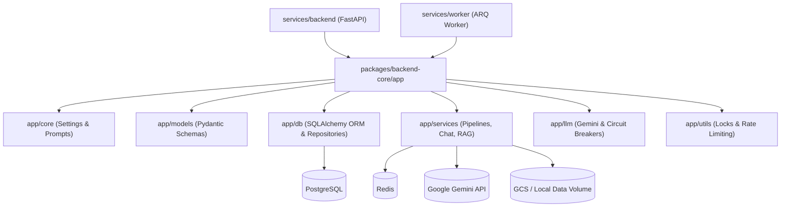

# Backend Core Blueprint

## System Overview
Shared backend Python library powering both the API service (`services/backend/`) and the background worker service (`services/worker/`). It is not run standalone — it has no `main.py` or `worker.py` of its own. Both services mount `packages/backend-core` on `PYTHONPATH` alongside their own service directories (configured via `Dockerfile.backend` and `Dockerfile.worker`) and import components via the `app` namespace (e.g. `app.core.config`, `app.db.models`, `app.services...`).

## Local Interface & Invariants
- `[agent.py:root_agent]` — Root agent entry point exposing `root_agent` for Google ADK web development discovery (`adk web packages/backend-core`).
- `[agent.py:_model]` — Reads `AGENT_MODEL` environment variable, defaulting to `"gemini-3.5-flash-lite"`.

## Subdirectories & System Boundaries
- **Migrations**: [./migrations/README.md](./migrations/README.md) — Raw sequential SQL migration scripts and rollbacks for PostgreSQL schema evolution.
- **Application Core**: [./app/README.md](./app/README.md) — Core Python application package containing configuration, database models, services, LLM integrations, and background worker queues.

## Global Invariants
- **Namespace Import Path**: Consumer services must include `packages/backend-core` in `PYTHONPATH` and import packages directly via the `app.*` hierarchy.
- **Prompt Language Policy**: All LLM system prompts in code must be written strictly in English with mandatory modern Uyghur Arabic script output directives.
- **Monorepo Database Boundary**: PostgreSQL is the single source of truth for structured application state; state changes across microservices must commit through backend-core repositories.

## Global Side Effects
- Mutates PostgreSQL database schema, tables, and rows via SQLAlchemy async connection pools.
- Modifies Redis cache entries, rate limit counters, distributed locks, and ARQ job queues.
- Dispatches multimodal inference calls to Google Gemini Generative AI endpoints.
- Reads and writes uploaded assets and rendered page images to Google Cloud Storage or `./data/`.

## System Verification
- Run: `pytest packages/backend-core/tests`

## Local Development
Local development runs everything via Docker Compose (`./deploy/local/rebuild-and-restart.sh all`). PostgreSQL runs as a standalone service on the host machine (`localhost:5432`), while containers connect via `host.docker.internal:5432`.
